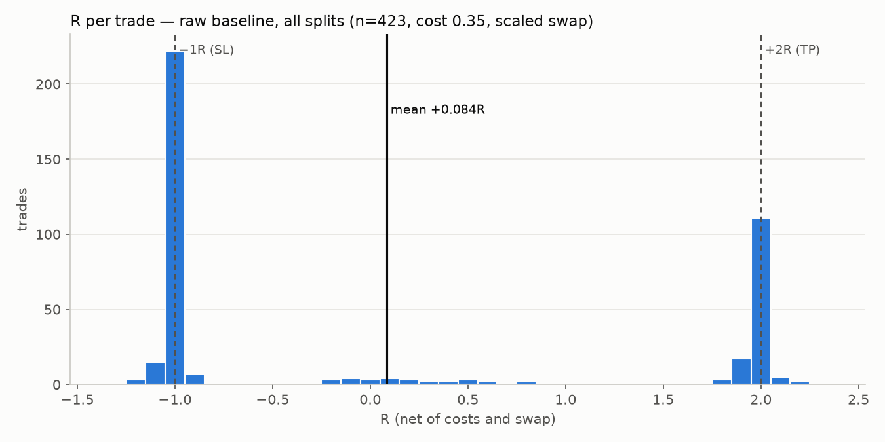

# 03 — Labels & raw baseline: XAUUSD.sc H1

Generated by `src/xauai/backtest.py` at 2026-10-24 02:49 (local). All numbers below come from that script.

**Base case:** entry at next bar open; cost = max(bar spread, 0.30) + 0.05 slippage (applied by shifting the entry against the trade); SL = 1.5×ATR, TP = 2.0×SL; SL+TP in one bar = loss; gap-through fills at the bar open; forced exit at Friday 22:00 open and at the close before any >24-bar gap; timeout 48 bars at close. Swap per server-midnight rollover, ×3 for the Wed→Thu rollover, scaled by price (swap_now × close_at_signal / last_close).

**Gate (≥ ~300 labeled signals): PASS** — 423 labeled trades from 426 signals.

## 1. Signal counts per split and direction

| split | buy | sell | total |
|---|---|---|---|
| train | 128 | 113 | 241 |
| val | 54 | 23 | 77 |
| test | 52 | 53 | 105 |
| all | 234 | 189 | 423 |

Signals not traded: 3 — entry_after_friday_close: 3
(The EA must apply the same entry rules: no entries from Friday 22:00 until the weekly open, and no stale signals across holiday gaps.)

## 2. Exit breakdown

| exit_reason | train | val | test | all | share | mean_R |
|---|---|---|---|---|---|---|
| tp | 74 | 24 | 38 | 136 | 32.2% | 1.988 |
| sl | 142 | 45 | 59 | 246 | 58.2% | -1.006 |
| sl_same_bar | 2 | 0 | 0 | 2 | 0.5% | -1.000 |
| gap_tp | 2 | 0 | 0 | 2 | 0.5% | 2.208 |
| friday | 20 | 8 | 8 | 36 | 8.5% | 0.290 |
| holiday | 1 | 0 | 0 | 1 | 0.2% | -0.172 |

- `sl_same_bar`: SL and TP both touched in one bar → counted as a loss.
- `gap_sl` / `gap_tp`: bar opened beyond the level → filled at that open.
- Trades losing more than 1R: 0 (worst -1.000R before swap).

## 3. Baseline metrics

Expectancy, drawdown and streaks are in R, net of costs and swap, in signal-time order (every signal counted, overlapping trades included).

### Per split

| group | n | win_rate | expectancy_R | profit_factor | max_dd_R | max_losing_streak | trades_per_month |
|---|---|---|---|---|---|---|---|
| train | 241 | 38.2% | 0.061 | 1.101 | 16.766 | 11 | 7.633 |
| val | 77 | 37.7% | 0.045 | 1.073 | 15.158 | 7 | 7.918 |
| test | 105 | 40.0% | 0.166 | 1.287 | 9.098 | 9 | 8.756 |
| all | 423 | 38.5% | 0.084 | 1.141 | 16.766 | 11 | 7.941 |

### Per year

| group | n | win_rate | expectancy_R | profit_factor | max_dd_R | max_losing_streak | trades_per_month |
|---|---|---|---|---|---|---|---|
| 2022 | 56 | 37.5% | 0.043 | 1.069 | 7.911 | 6 | 7.430 |
| 2023 | 99 | 41.4% | 0.154 | 1.268 | 12.558 | 11 | 8.256 |
| 2024 | 86 | 34.9% | -0.035 | 0.943 | 16.766 | 7 | 7.152 |
| 2025 | 96 | 35.4% | 0.002 | 1.003 | 15.334 | 9 | 8.005 |
| 2026 | 86 | 43.0% | 0.240 | 1.436 | 6.723 | 5 | 8.847 |

### Per direction (by split)

| group | n | win_rate | expectancy_R | profit_factor | max_dd_R | max_losing_streak | trades_per_month |
|---|---|---|---|---|---|---|---|
| train / buy | 128 | 39.1% | 0.105 | 1.171 | 9.489 | 9 | 4.054 |
| train / sell | 113 | 37.2% | 0.011 | 1.019 | 9.595 | 6 | 3.579 |
| val / buy | 54 | 40.7% | 0.106 | 1.174 | 12.931 | 5 | 5.553 |
| val / sell | 23 | 30.4% | -0.097 | 0.847 | 4.927 | 4 | 2.365 |
| test / buy | 52 | 34.6% | -0.062 | 0.903 | 9.850 | 8 | 4.336 |
| test / sell | 53 | 45.3% | 0.389 | 1.749 | 4.984 | 5 | 4.420 |
| all / buy | 234 | 38.5% | 0.068 | 1.110 | 12.931 | 9 | 4.393 |
| all / sell | 189 | 38.6% | 0.104 | 1.181 | 9.595 | 6 | 3.548 |

Breakeven win rate at 1:2 with exact −1R/+2R outcomes = 33.3%; costs and swap raise it.

## 4. Bootstrap 95% CI for expectancy (10,000 resamples, seed 7)

| group | n | expectancy_R | ci95_low | ci95_high |
|---|---|---|---|---|
| train | 241 | 0.061 | -0.113 | 0.232 |
| val | 77 | 0.045 | -0.258 | 0.359 |
| test | 105 | 0.166 | -0.108 | 0.446 |
| all | 423 | 0.084 | -0.046 | 0.217 |

## 5. Cost & swap sensitivity (expectancy, R)

Cost = total per trade (spread floor + 0.05 slippage). Floors 0.30 / 0.45 / 0.70 bind on every bar except where the bar spread exceeds the floor.

| cost | swap | train | val | test | all |
|---|---|---|---|---|---|
| 0.35 | scaled | 0.061 | 0.045 | 0.166 | 0.084 |
| 0.35 | flat | 0.059 | 0.040 | 0.166 | 0.082 |
| 0.50 | scaled | 0.046 | 0.044 | 0.165 | 0.075 |
| 0.50 | flat | 0.044 | 0.039 | 0.166 | 0.073 |
| 0.75 | scaled | 0.005 | 0.043 | 0.165 | 0.052 |
| 0.75 | flat | 0.002 | 0.037 | 0.166 | 0.049 |

## 6. Nights held and swap, per direction

| swap | side | trades | avg_nights | avg_charged_nights | share_held_overnight | avg_swap_R | total_swap_R |
|---|---|---|---|---|---|---|---|
| scaled | buy | 234 | 0.359 | 0.513 | 33.3% | -0.023 | -5.324 |
| scaled | sell | 189 | 0.386 | 0.587 | 37.6% | 0.011 | 2.099 |
| flat | buy | 234 | 0.359 | 0.513 | 33.3% | -0.034 | -7.996 |
| flat | sell | 189 | 0.386 | 0.587 | 37.6% | 0.021 | 3.887 |

Current swap (points/night/lot): long -77.54, short 32.15; charged-nights counts the Wed→Thu rollover as 3.

## 7. Bars with spread above the 0.30 floor

- Bars with bar_spread > 0.30: **3 of 26,294 = 0.0114%**
- Trades whose entry-bar spread exceeded the floor: 0 of 423

## 8. Distribution of R per trade

Quantiles: p5 -1.047, p25 -1.000, median -0.984, p75 1.982, p95 2.016.

## Notes for Phase 4

- **Overlap:** with one position max (EA rule), 392 of 423 trades would be taken; expectancy of that subset +0.086R. Labels keep every signal as a training sample.
- **Label spill-over (train):** 0 trade(s) exit after the split ends — purge/embargo at fold edges.
- **Label spill-over (val):** 0 trade(s) exit after the split ends — purge/embargo at fold edges.
- **Label spill-over (test):** 0 trade(s) exit after the split ends — purge/embargo at fold edges.

