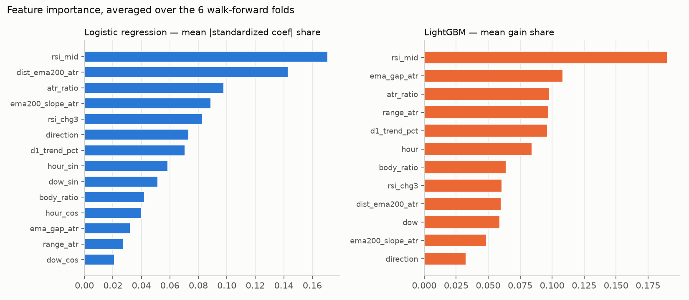
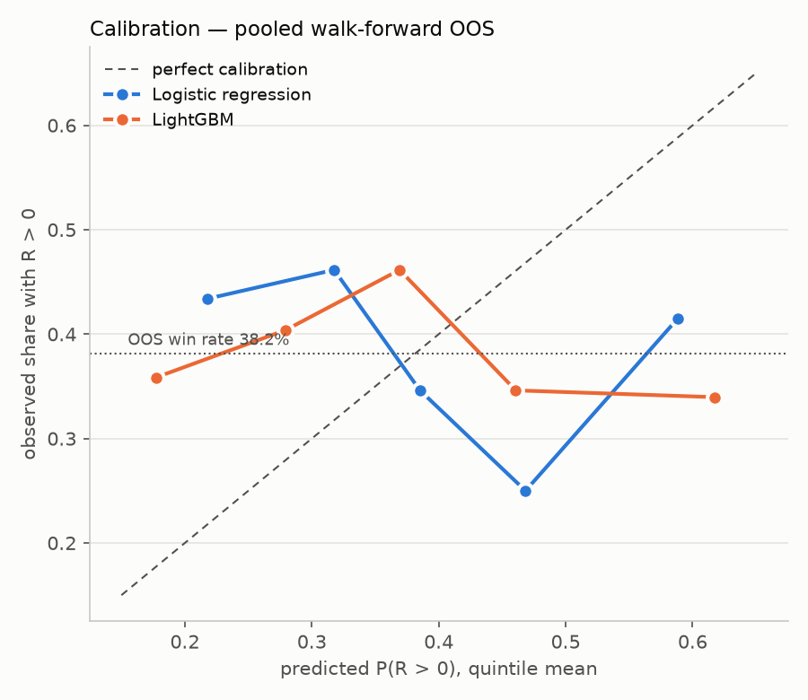
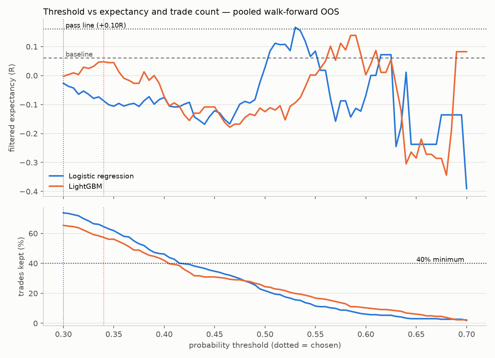

# 04 — Features & model filter: XAUUSD.sc H1

## Pre-registration (written and committed before any model was trained or evaluated)

### Data
- Samples: the Phase 3 base-case labels (`data/labels/trades_h1.parquet`: cost 0.35, price-scaled swap),
  one row per traded signal. Target `y = 1 if R > 0 else 0`. Evaluation is in R, not accuracy.
- Features (12, scale-free, computed from data available at the signal-bar close). Directional
  features are **oriented by trade direction** (multiplied by +1 buy / −1 sell) so "positive = with the trade":
  1. `dist_ema200_atr` = dir × (close − EMA200) / ATR
  2. `ema200_slope_atr` = dir × (EMA200[i] − EMA200[i−20]) / ATR
  3. `ema_gap_atr` = dir × (EMA9 − EMA21) / ATR
  4. `rsi_mid` = dir × (RSI − 50)
  5. `rsi_chg3` = dir × (RSI[i] − RSI[i−3])
  6. `atr_ratio` = ATR / SMA50(ATR)
  7. `range_atr` = (high − low) / ATR of the signal candle
  8. `body_ratio` = dir × (close − open) / (high − low)
  9. `d1_trend_pct` = dir × (close / EMA50(D1 close) − 1) × 100, using only **completed** broker D1 bars
     (a D1 bar is usable once its day has ended at or before the signal bar's close)
  10. `hour` (server, signal bar) 11. `dow` (signal bar) 12. `direction` (+1 / −1)

### Models (hyperparameters fixed in advance, no tuning)
1. Logistic regression: standardized features, hour/dow as sin/cos pairs, C = 1.0.
2. LightGBM: num_leaves 8, max_depth 3, min_data_in_leaf 20, learning_rate 0.05, 100 trees, seed 0.
3. Rule baseline: per fold, the single feature + threshold + side (≥ or ≤) with the best mean R on that
   fold's training set, among thresholds at the 10th..90th percentiles that keep ≥ 40% of training trades.

### Walk-forward
- Expanding window; folds start 2023-01-01, 2023-07-01, 2024-01-01, 2024-07-01, 2025-01-01, 2025-07-01;
  the last fold ends 2025-10-23 (inclusive). Each fold trains on all trades with signal time before the
  fold start, **purging** any whose trade exits at/after the fold start, and predicts the fold.
- Out-of-sample (OOS) predictions are pooled across folds.
- Probability threshold per model: grid 0.300..0.700 step 0.005, chosen on the **pooled OOS** only, as the
  threshold with the highest pooled filtered expectancy among those keeping ≥ 40% of OOS trades
  (ties → the lower threshold).
- Baseline = all OOS trades (no filter) over the same period.

### PASS criteria (a model passes only if it meets all five on the pooled OOS)
1. Filtered expectancy ≥ baseline expectancy + 0.10R.
2. Keeps ≥ 40% of OOS trades.
3. Filtered total R ≥ baseline total R.
4. Filtered expectancy ≥ baseline expectancy in at least 3 of the yearly buckets covered.
   The OOS covers only **3** calendar years (2023, 2024, 2025 to Oct 23), so this means **all 3**.
   A year in which the filter keeps no trades counts as worse.
5. Filtered expectancy > the rule baseline's pooled OOS expectancy.

The gate PASSES if at least one of the two models (LR, LightGBM) passes all five; if both pass, the one
with the higher filtered OOS expectancy is chosen. Note: the threshold and the model choice are both
selected on the same pooled OOS used to judge them, so the OOS numbers are optimistic; the test set is
the unbiased check.

### Test set
- Only if PASS: train the chosen model once on all trades before 2025-10-24 (purged), apply the chosen
  threshold to the untouched test set 2025-10-24..2026-10-23 **once**, and report filtered vs baseline
  with a bootstrap 95% CI (10,000 resamples).
- If FAIL: stop, report honestly, and do not touch the test set or tune and rerun.

<!-- RESULTS BELOW: generated by src/xauai/train.py; everything above is the pre-registration -->

## Results

Generated by `src/xauai/train.py` at 2026-10-24 03:00 (local).

Pooled OOS: 262 trades, 2023-01-06 .. 2025-10-20; baseline expectancy +0.060R, total +15.74R, win rate 38.2%.

**Gate: FAIL** — neither model meets all five pre-registered criteria. The test set was not touched.

### Pre-registered criteria (pooled OOS)

| criterion | Logistic regression | LightGBM |
|---|---|---|
| 1. expectancy ≥ baseline + 0.10R | -0.027 vs +0.160 ❌ | +0.047 vs +0.160 ❌ |
| 2. keeps ≥ 40% of trades | 73.7% ✅ | 57.3% ✅ |
| 3. total R ≥ baseline total R | -5.15 vs +15.74 ❌ | +7.11 vs +15.74 ❌ |
| 4. not worse in all 3 years | 1 of 3 ❌ | 2 of 3 ❌ |
| 5. beats rule baseline | -0.027 vs +0.072 ❌ | +0.047 vs +0.072 ❌ |
| **all five** | **FAIL** | **FAIL** |

### Pooled OOS summary

| filter | threshold | AUC | n | kept | win_rate | expectancy_R | ci95 | total_R | PF | max_dd_R |
|---|---|---|---|---|---|---|---|---|---|---|
| Baseline (all) | — | — | 262 | 100% | 38.2% | 0.060 | [-0.104, +0.231] | 15.744 | 1.100 | 16.766 |
| Rule baseline | — | — | 141 | 54% | 37.6% | 0.072 | [-0.156, +0.306] | 10.110 | 1.120 | 9.750 |
| Logistic regression | 0.300 | 0.448 | 193 | 74% | 35.8% | -0.027 | [-0.205, +0.163] | -5.149 | 0.957 | 17.216 |
| LightGBM | 0.340 | 0.488 | 150 | 57% | 39.3% | 0.047 | [-0.165, +0.265] | 7.112 | 1.081 | 11.234 |

The rule baseline is refit per fold; its rules were: fold 1: `rsi_mid <= 7.72`; fold 2: `rsi_chg3 <= 9.36`; fold 3: `rsi_mid <= 8.2`; fold 4: `rsi_mid <= 7.47`; fold 5: `atr_ratio >= 1.07`; fold 6: `atr_ratio >= 1.03`.

### Per fold

| fold | period | train_n | purged | oos_n | base_exp | lr_n | lr_exp | lgbm_n | lgbm_exp | rule_n | rule_exp |
|---|---|---|---|---|---|---|---|---|---|---|---|
| 1 | 2023-01-01 .. 2023-06-30 | 56 | 0 | 51 | -0.043 | 36 | -0.222 | 32 | -0.219 | 21 | 0.060 |
| 2 | 2023-07-01 .. 2023-12-31 | 107 | 0 | 48 | 0.364 | 33 | 0.197 | 30 | 0.223 | 30 | 0.215 |
| 3 | 2024-01-01 .. 2024-06-30 | 155 | 0 | 42 | -0.268 | 34 | -0.365 | 28 | -0.117 | 30 | -0.224 |
| 4 | 2024-07-01 .. 2024-12-31 | 197 | 0 | 44 | 0.188 | 32 | 0.166 | 23 | 0.206 | 28 | 0.220 |
| 5 | 2025-01-01 .. 2025-06-30 | 241 | 0 | 46 | 0.109 | 31 | 0.128 | 23 | 0.132 | 18 | 0.499 |
| 6 | 2025-07-01 .. 2025-10-23 | 287 | 0 | 31 | -0.050 | 27 | -0.020 | 14 | 0.211 | 14 | -0.429 |

### Per year: baseline vs filtered

| filter | year | base_n | base_exp | filt_n | filt_exp | base_total | filt_total |
|---|---|---|---|---|---|---|---|
| Rule baseline | 2023 | 99 | 0.154 | 51 | 0.151 | 15.284 | 7.692 |
| Rule baseline | 2024 | 86 | -0.035 | 58 | -0.010 | -3.012 | -0.566 |
| Rule baseline | 2025 | 77 | 0.045 | 32 | 0.093 | 3.473 | 2.983 |
| Logistic regression | 2023 | 99 | 0.154 | 69 | -0.022 | 15.284 | -1.495 |
| Logistic regression | 2024 | 86 | -0.035 | 66 | -0.107 | -3.012 | -7.094 |
| Logistic regression | 2025 | 77 | 0.045 | 58 | 0.059 | 3.473 | 3.439 |
| LightGBM | 2023 | 99 | 0.154 | 62 | -0.005 | 15.284 | -0.310 |
| LightGBM | 2024 | 86 | -0.035 | 51 | 0.028 | -3.012 | 1.448 |
| LightGBM | 2025 | 77 | 0.045 | 37 | 0.161 | 3.473 | 5.974 |

### Feature importance

### Calibration

### Threshold vs expectancy / trade count

| threshold | lr_kept | lr_exp | lgbm_kept | lgbm_exp |
|---|---|---|---|---|
| 0.35 | 162 (62%) | -0.106 | 147 (56%) | 0.045 |
| 0.40 | 121 (46%) | -0.076 | 110 (42%) | -0.073 |
| 0.45 | 91 (35%) | -0.121 | 81 (31%) | -0.108 |
| 0.50 | 57 (22%) | 0.028 | 64 (24%) | -0.125 |
| 0.55 | 30 (11%) | 0.084 | 44 (17%) | 0.001 |

## Test set

Not run (gate failed). Per the pre-registration: no tuning and no rerun against the test set.

