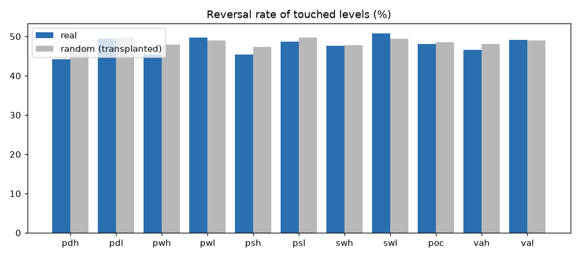

# 05 — Part A: do the levels and FVGs behave better than chance?

Generated by `src/xauai/levelstudy.py` at 2026-11-11 12:25 (local). All numbers below come from that script. Development period only: 2022-05-16 .. 2025-10-23. Random seed 7; 500 random placements per real level / per FVG.

## Definitions in plain words

- **Terms.** *M1* = one-minute candles (the finest data used to decide what was touched first). *ATR* = Average True Range, the typical candle size; here the average over the last 14 H1 (hourly) candles, used as a yardstick for 'distance'. *Volume profile* = how much trading volume happened at each price in the previous session. *Candle 1 / candle 3* of an FVG = the first and third of three consecutive H1 candles; the gap is the empty space between candle 1's extreme and candle 3's.
- **Level kinds.** pdh/pdl = previous day's high/low; pwh/pwl = previous week's high/low; psh/psl = high/low of the previous trading session; swh/swl = the last swing high/low of the previous session; poc = price with the most volume in the previous session's volume profile; vah/val = top/bottom of the zone holding 70% of that volume.
- **Which levels are studied.** Only the level set that becomes valid at the START of each session (Asia, London, NY), not the day-start refreshes. For each such session the **session-open price** is the open of the first M1 bar at/after the session start, and **ATR** is ATR14 on H1 as known at that moment (no lookahead). A level is *above* if it is higher than the session-open price, otherwise *below*.
- **The window.** From the session start to the end of the NEXT session (the session itself plus the one after it), measured on M1 bars.
- **Touched.** Price reaches the level (M1 high >= level for a level above, M1 low <= level for one below) inside the window.
- **Reversed / broke.** After the first touch we watch what happens first: price moving 1 ATR back away from the level (towards the session open) = *reversed* (price bounced back at least one ATR); price moving 1 ATR through it = *broke*. The touch bar's own low (for a level above) counts for the reversal check. If a single M1 bar contains both, it is counted as *broke* (we cannot know the order). If neither happens before the window ends it is *touched, no resolution*, reported separately. 'Reversal %' is the share of **touched** levels that reversed.
- **Random comparison.** Chance level: for each real level we take 500 OTHER sessions at random and put a level at the same signed distance from THAT session's open (distance measured in ATR units, scaled by that session's ATR), on the same side, then run the identical test in that session's window. 'Random' columns pool all those placements. A real level 'matters' only if it beats this.
- **FVG (fair value gap).** On H1: bullish if the high of candle 1 is below the low of candle 3 (bearish: mirror), and the middle candle's body is at least 1.5×ATR14(H1) (a 'big' gap). Known at the close of candle 3. Target = the gap's **midpoint**. 'Filled within N hours' = M1 price touches the midpoint within N hours of the gap being known (horizon 48 h). Random points = the same signed distance (in ATR units) from the close of the gap's third candle, transplanted onto 500 random other H1 closes in the development period (same side); same fill test.

## How to read this

If a level really attracts or repels price, its **touch %** should be higher than the random one (random levels at that distance are what plain volatility would give you) and its **reversal %** higher than random if it acts as support/resistance. A difference of a few percentage points is probably noise; look for gaps that are large and that repeat across related kinds. The FVG tables answer 'does price always fill FVGs?': compare real with random at each horizon. If both are close, FVGs are filled about as often as any nearby price would be touched.

Sessions in study: 2664; real levels evaluated: 29198; FVGs: 704. Dropped so that no data after 2025-10-23 23:59:59 is read: 2 sessions (window ends after it) and 1 FVGs (48 h horizon passes it); random pools use the same rule.

**Noise bands:** `touch +-` and `reversal +-` are approximate 95% binomial half-widths (1.96*sqrt(p(1-p)/n)) on the real rate, in percentage points; a `diff` smaller than about that is indistinguishable from noise. The random pool is NOT matched by session type (Asia/London/NY), only by distance and side, so small systematic differences can come from that.

## Level study per kind

| kind | n | touch% | touch +- | random touch% | touch diff (pp) | reversal% of touched | reversal +- | random reversal% | reversal diff (pp) | broke% of touched | no-resolution% of touched | random broke% |
|---|---|---|---|---|---|---|---|---|---|---|---|---|
| pdh | 2664 | 44.6 | 1.9 | 46.5 | -1.8 | 44.2 | 2.8 | 47.3 | -3.2 | 52.4 | 3.4 | 48.9 |
| pdl | 2664 | 38.1 | 1.8 | 38.3 | -0.2 | 49.5 | 3.1 | 49.8 | -0.3 | 47.9 | 2.7 | 46.9 |
| pwh | 2653 | 22.9 | 1.6 | 23.6 | -0.7 | 45.4 | 4.0 | 47.9 | -2.5 | 49.7 | 4.9 | 48.2 |
| pwl | 2653 | 16.8 | 1.4 | 16.9 | -0.1 | 49.7 | 4.6 | 49.1 | 0.6 | 45.6 | 4.7 | 47.2 |
| psh | 2652 | 59.4 | 1.9 | 60.9 | -1.5 | 45.4 | 2.5 | 47.4 | -2.0 | 52.2 | 2.4 | 49.6 |
| psl | 2652 | 53.8 | 1.9 | 53.8 | -0.0 | 48.7 | 2.6 | 49.7 | -1.1 | 49.4 | 2.0 | 47.4 |
| swh | 2652 | 70.7 | 1.7 | 71.1 | -0.4 | 47.6 | 2.3 | 47.9 | -0.3 | 50.8 | 1.7 | 49.9 |
| swl | 2652 | 67.8 | 1.8 | 67.4 | 0.4 | 50.8 | 2.3 | 49.4 | 1.4 | 47.5 | 1.7 | 48.5 |
| poc | 2652 | 74.2 | 1.7 | 73.6 | 0.5 | 48.0 | 2.2 | 48.5 | -0.4 | 49.7 | 2.3 | 49.6 |
| vah | 2652 | 73.2 | 1.7 | 73.6 | -0.4 | 46.5 | 2.2 | 48.1 | -1.6 | 51.1 | 2.4 | 49.9 |
| val | 2652 | 71.9 | 1.7 | 71.6 | 0.3 | 49.1 | 2.2 | 49.0 | 0.1 | 48.6 | 2.3 | 49.1 |

`diff (pp)` = real minus random, in percentage points.

## FVG fill study

Each cell is `real / random` (percent unless stated). 'never in 48h' = share whose midpoint was not reached within 48 h.

| group | n | within 1h | within 4h | within 12h | within 24h | within 48h | never in 48h | median h (filled only) |
|---|---|---|---|---|---|---|---|---|
| all | 704 | 19.5 / 16.3 | 38.6 / 35.8 | 53.8 / 55.4 | 64.2 / 65.9 | 69.7 / 72.5 | 30.3 / 27.5 | 3.00 / 4.10 |
| bullish | 366 | 17.8 / 15.0 | 35.2 / 33.4 | 50.5 / 51.9 | 59.3 / 62.3 | 64.8 / 68.7 | 35.2 / 31.3 | 3.45 / 4.23 |
| bearish | 338 | 21.3 / 17.6 | 42.3 / 38.4 | 57.4 / 59.0 | 69.5 / 69.9 | 75.1 / 76.5 | 24.9 / 23.5 | 2.91 / 4.00 |
| session: asia | 89 | 14.6 / 21.1 | 37.1 / 42.8 | 68.5 / 62.3 | 70.8 / 71.6 | 77.5 / 76.9 | 22.5 / 23.1 | 4.52 / 3.08 |
| session: london | 171 | 17.5 / 15.3 | 51.5 / 35.2 | 72.5 / 55.6 | 76.6 / 66.4 | 80.1 / 73.0 | 19.9 / 27.0 | 2.83 / 4.32 |
| session: ny | 444 | 21.2 / 15.7 | 34.0 / 34.6 | 43.7 / 53.9 | 58.1 / 64.6 | 64.2 / 71.4 | 35.8 / 28.6 | 2.60 / 4.27 |

