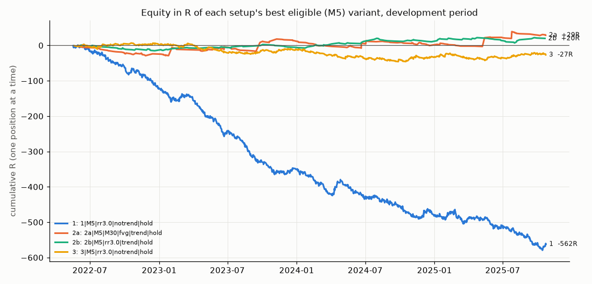
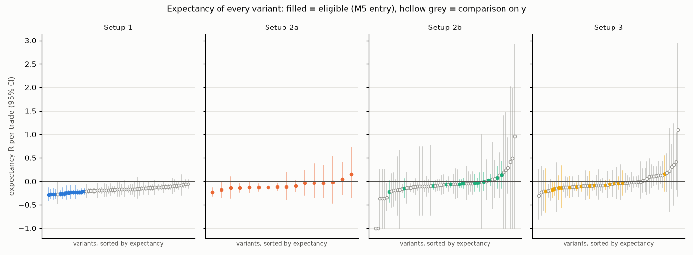

# 06 — Session & liquidity setups: XAUUSD.sc

## Pre-registration (written and committed before any Part B or Part C result exists)

### Why
Phase 4 failed: the EMA/RSI signal's raw edge was about +0.06R out-of-sample with a confidence interval
spanning zero, and neither model improved it (`reports/04_model.md`). This project instead tests the owner's
own discretionary setups (session levels, liquidity sweeps, volume profile, H1 order blocks) as exact rules,
with real costs, null baselines and an untouched test set. "These do not work" is a valid result.
Every definition below is written in plain words so the owner can check it against how they really trade.

### Time and sessions
- All bar times are broker server time (bar open time). Each session is defined in its own local time, so
  daylight saving is handled automatically:
  - **Asia:** 09:00-17:00 Tokyo (about 08:00-16:00 PH time, when the owner usually trades).
  - **London:** 08:00-17:00 London.
  - **New York:** 08:00-17:00 New York.
- "Previous session" at time t = the most recent session that has **fully ended** at or before t. A session in
  progress is never "previous". Signals may fire at any time the market is open, even outside all sessions.
- A bar's session (for reports and the session-close exit) = the session that started most recently among
  those active at its open; a bar outside all sessions belongs to the next session to start.
- "Previous day" = the previous broker server day (D1 bar). "Previous week" = the previous broker server week.

### Swings and trend
- Swing high = a bar whose **high** is strictly higher than the highs of the N bars on each side (N = 2 on every
  timeframe). Swing low mirrors on lows. The swing price is the wick tip. A swing is only known N bars after
  it forms, and is never used earlier.
- Trend on one timeframe: from the last two confirmed swing highs and lows, up = higher high and higher low,
  down = lower high and lower low, otherwise range. **Trend state = M30 and H1 agree**; disagreement or range
  = no trend. It is read at the signal bar's close. Requiring trend alignment is a variant (with / without).

### Levels
Marked at each session start and recomputed as sessions end:
1. Previous day high / low (PDH / PDL).
2. Previous week high / low (PWH / PWL).
3. Previous session high / low.
4. The previous session's last confirmed swing high and swing low on M30 (wick tips). If the session has no
   confirmed swing of one kind, that session's extreme is used.
5. Fixed-range volume profile anchored on the range between those two swings (from whichever came first to
   the other), built from M1 bars: each M1 bar's tick volume is spread evenly over the $0.50 price bins between
   its low and high. POC = the bin with most volume; the value area holds 70% of volume, grown outward from the
   POC one bin at a time, adding the side with more volume. Levels used: **POC, VAH, VAL**. (Tick volume only;
   real volume is zero on every bar.)

We say "level above" / "level below" instead of buy-side / sell-side liquidity, because the owner uses those
two terms the opposite way round to ICT/SMC convention.

Level handling:
- **Merging:** levels within 0.25 x ATR14(H1) of each other become one zone. Its outer edge is the level used
  for triggers and SL anchoring. One bar gives at most one signal per setup and direction.
- **Open rule:** a sweep or rejection of a level above needs the bar to open below it (mirror for levels
  below). A bar that opens beyond a level cannot sweep it.
- **Lifetime:** a sweep or rejection does **not** use a level up. It stays live and can trigger again until a
  bar **closes** beyond it by more than the tolerance (then it is broken), or until levels are recomputed at the
  next session start.
- **Near-miss tolerance:** a wick that comes within 0.10 x ATR14 (entry timeframe) of a level counts as
  reaching it. "Closes back below" is measured against the level itself.

### Order blocks (H1)
- Bullish OB = the last **bearish** H1 candle before an up-move whose close breaks above the most recent
  confirmed H1 swing high. Zone = that candle's high to low. Known only once the breaking bar has closed.
  Bearish OB mirrors.
- (Clarified during implementation) The breaking bar uses the latest swing high known at its open; each swing
  produces at most one OB (its first break); the OB candle is the last opposite candle strictly between the
  swing bar and the breaking bar (none = no OB).
- An OB is invalidated when an H1 bar closes beyond its far side (below the low for a bullish OB). An OB can
  produce at most one Setup 2b trade.

### Fair value gaps (H1)
- Bullish FVG = three consecutive H1 bars where bar 1's high < bar 3's low. Gap = bar 1 high to bar 3 low.
  Known once bar 3 has closed. Bearish mirrors. Only gaps with a **huge** middle candle count: bar 2's body
  >= 1.5 x ATR14(H1). Target price = the gap's **midpoint**. A gap stops being a valid target once price has
  traded to its midpoint after it formed.

### The four setups (described as sells; buys mirror them)
Fixed parameters used below: K = 12 bars of the entry timeframe; tolerance = 0.10 x ATR14 (entry timeframe);
SL buffer beyond a wick = 0 (costs already widen the effective stop).

**Setup 1 - sweep, reclaim, retest.** Entry timeframes M5, M15, M30, H1.
1. Sweep: a bar's high trades above a level above and the same bar closes back below it.
2. Retest: within K bars a later bar trades back up to the level (high >= level - tolerance) and closes below it.
3. Enter sell at the next bar's open. SL = just above the sweep wick tip.
- Invalidated if any bar closes above the sweep wick tip, or K bars pass before the retest.
- (Clarified during implementation) SL is the highest high from the sweep bar through the retest bar, so a
  higher retest wick counts as part of the sweep. A second sweep that closes back below is itself a retest.

**Setup 2a - rejection at a level, target the H1 OB or FVG.** Rejection read on M30 or H1 (both tested); entry
on M5 only.
1. Rejection: an M30/H1 bar opens below a level above, trades up to it (within tolerance of the trigger
   timeframe's ATR), closes back below it, and its upper wick is >= 50% of the bar's range.
2. Enter sell at the open of the first M5 bar after the rejection bar closes. SL = the rejection bar's high.
   No extra M5 confirmation pattern (the owner described none; adding one would invent a rule).
3. TP (two variants, both tested): **OB** = the near edge (top) of the nearest valid bullish H1 OB below the
   entry; **FVG** = the midpoint of the nearest valid bullish H1 FVG below the entry.
4. No such target below = no trade in that variant. Skip if the TP is less than 1R away.

**Setup 2b - pullback from the H1 OB.** Entry timeframes M5, M15, M30, H1.
1. Price trades into a valid bullish H1 OB zone. The OB must be approached from above (price above the zone
   when the OB is confirmed). "Entered the zone" = the first entry-timeframe bar after the OB is known whose
   low reaches the zone's top.
2. On the entry timeframe, a bar closes above the **last confirmed lower high** formed since price entered the
   zone (break of structure).
3. Retest: within K bars price trades back down to that broken level (low <= level + tolerance) and the bar
   closes above it. Enter buy at the next bar's open.
4. SL = below the lowest wick since price entered the zone.
- Invalidated if an H1 bar closes below the OB's low, or K bars pass after the break.
- If price closes back above the zone's top + 1.0 x ATR14(H1) without a trade, the episode ends; the next entry
  into the zone starts a fresh one (new lower-high search and SL window). Price need not stay inside the zone.
- (Clarified during implementation) A break with no retest inside K is cancelled and that swing high cannot be
  reused (a newer one is needed). One signal per OB.

**Setup 3 - lower high, break, continue to the PDL.** Entry timeframes M5, M15, M30, H1.
1. Price reaches a level above (within tolerance) without closing above it. The first touch is kept.
2. After the touch, a confirmed swing high forms on the entry timeframe that is **lower** than the touch high
   (the lower high).
3. Break: a bar closes below the last confirmed swing low (the "last higher low", the latest swing low known
   at that bar), taking the stops resting there.
4. Retest: within K bars price trades back up to that broken low (high >= level - tolerance) and the bar closes
   below it. Enter sell at the next bar's open.
5. SL = just above the lower high. Invalidated if a bar closes above the lower high, or K bars pass.
6. Owner target: the **PDL** (buys: PDH), unless an **unswept** entry-timeframe swing low lies above the PDL and
   below the signal close. Then the target is the unswept swing low nearest the PDL ("the last swing low just
   above it", the owner's confirmed words). Unswept = no bar after the swing traded below its price before the
   signal close. If price is already below the PDL there is no owner target, so no trade in that mode. Skip if
   the target is less than 1R away. (Clarified during implementation, with the owner, before any backtest
   result: the first wording, "nearest to the entry", gave targets around 0.02R.)

### Take-profit and exit variants
- Setups 1 and 2b: fixed **1:1.5, 1:2, 1:3**, or **next level** = the nearest level in the trade direction at
  least 1R away, taken from the raw (unmerged) level list valid at entry time; none = skip the trade.
- Setup 2a: OB edge or FVG midpoint (above). Setup 3: owner target (above) or fixed 1:1.5, 1:2, 1:3.
- Exit variants: **hold** = run until SL, TP or a forced exit; **session** = also close at the end of the
  session the trade was opened in.

### Trade simulation
- Signals are detected on the entry timeframe; **every trade is simulated on M1 bars** from the entry bar's
  open time. If SL and TP are both inside one M1 bar, it counts as a loss. If a bar opens beyond SL/TP, the
  fill is at that bar's open (a loss can exceed 1R).
- Cost per trade = max(M1 entry-bar spread x point, **0.30**) + **0.05** slippage, applied by shifting the entry
  against the trade. Sensitivity at total cost 0.50 and 0.75. Swap as in Phase 3: charged per server-midnight
  rollover held, x3 for the Wed to Thu rollover, historical swap scaled by price; the swap fields come from the
  research symbol snapshot `data/raw/research/symbol_info.json`.
- R = profit in units of the trade's own SL distance (entry fill to SL), net of cost and swap.
- **Forced exits:** at the open of the first bar at or after Friday 22:00 server time; and at the close of the
  last bar before a gap of more than 25 hours between two consecutive bars (i.e. more than 24 missing hourly bars, the same rule as Phase 3) (holidays). No bar-count timeout. No entry at or
  after Friday 22:00, and none after such a gap (stale signal).
- **One position at a time per variant:** a position blocks only its own variant; signals of that variant that
  arrive while it is open are dropped. Same-bar ties: the earlier-detected level wins, then the nearer SL. Both
  "every signal" and "one position" views are reported; **selection and the test use one position at a time**.
- No lookahead: a fact is used only if it was known by the entry bar's close. All data is cut at 2026-10-23.

### Fixed parameters (reported, never tuned)
| Parameter | Value |
|---|---|
| Swing N | 2 bars each side |
| Retest window K | 12 entry-timeframe bars |
| Tolerance | 0.10 x ATR14 (entry timeframe) |
| Level merge distance | 0.25 x ATR14(H1) |
| Volume profile bin / value area | $0.50 / 70% |
| Rejection wick (2a) | >= 50% of bar range |
| 2b episode reset | zone top + 1.0 x ATR14(H1) |
| FVG middle-candle body | >= 1.5 x ATR14(H1) |
| Minimum TP distance | 1R |
| Fixed reward:risk | 1.5 / 2.0 / 3.0 |
| SL buffer | 0 |
| Cost | max(spread, 0.30) + 0.05; sensitivity 0.50 / 0.75 |
| Null repeats | 200 |
| ATR | MT5 iATR (simple average of true range), period 14 |

### Variant grid (Part B)
Dimensions: setup x entry timeframe x TP mode x trend filter (with / without) x exit mode (hold / session).
Variant names look like `1|M5|rr2.0|trend|hold` and `2a|M5|H1|ob|notrend|session`.

| Setup | Entry timeframes | TP modes | Base combos |
|---|---|---|---|
| 1 | M5, M15, M30, H1 | rr1.5, rr2.0, rr3.0, next_level | 16 |
| 2b | M5, M15, M30, H1 | rr1.5, rr2.0, rr3.0, next_level | 16 |
| 3 | M5, M15, M30, H1 | rr1.5, rr2.0, rr3.0, owner | 16 |
| 2a | M5 (trigger M30 or H1) | ob, fvg | 4 |

52 base combinations x 2 (trend) x 2 (exit) = **208 variants tried in total**.
**64 are eligible** for selection and the test: every M5-entry variant (Setups 1, 2b, 3: 16 each; 2a: 16).
The other 144 (M15, M30, H1 entries) are **comparison only** ("would a slower entry do better?"): they are
labelled as such, never selected and never touch the test set. The report also shows cost as a share of the SL
distance per entry timeframe, since the fixed cost is a much bigger part of 1R on M5 than on H1.

### Metrics per variant (development period 2022-05-16 .. 2025-10-23)
Trades, win rate, expectancy in R with bootstrap 95% CI, total R, profit factor, max drawdown (R), longest
losing streak, trades per month, per year, per session, buy vs sell, and cost sensitivity at 0.50 / 0.75.

### Null baseline
Per variant: the same number of entries at random bars in the same sessions, with the same direction mix, SL
distances and TP rule, repeated 200 times. Reported as the share of random runs whose expectancy the variant
beats.

### Selection rule (development period only)
A variant is eligible for selection only if it is an M5-entry variant and all of these hold:
1. n >= 100 trades (one position at a time).
2. Expectancy > 0 in each of 2022 (partial), 2023, 2024 and 2025 (to Oct 23).
3. It beats >= 95% of its random runs.

Pick the eligible variant with the highest expectancy **per setup**: at most 4 (Setups 1, 2a, 2b, 3). A setup
with no eligible variant is reported FAIL and not tested. Because 64 variants are eligible, some may pass by
luck; the count is stated next to every result.

### Part C - test set (run once)
Run the selected variants (at most 4) on **2025-10-24 .. 2026-10-23, once**, with a bootstrap 95% CI.
**PASS** per variant: expectancy >= +0.10R, n >= 30, and lower CI bound > -0.10R. Whatever the result, no
re-tuning and no re-run; report it honestly, as Phase 4 did.

### Honesty notes
- (a) Part A (`reports/05_levels.md`, development period only) was completed before this pre-registration.
  None of its levels beat random, and no rule was changed because of it.
- (b) During engineering, one development-period smoke run was seen (variant `1|M5|rr2.0|notrend|hold`:
  n = 2754, expectancy -0.234R). No rule was changed because of it.
- (c) The Setup 3 owner-target rule was clarified with the owner's own words before any backtest result.
- (d) The test period 2025-10-24 .. 2026-10-23 has not been touched.

<!-- RESULTS BELOW: generated by src/xauai/research.py; everything above is the pre-registration -->

## Results — Part B (development period 2022-05-16 .. 2025-10-23)

Generated by `src/xauai/research.py` at 2026-11-11 15:34 (local), runtime 10.3 min. Every number below comes from that script. **The test set (2025-10-24 .. 2026-10-23) has NOT been touched**: no trade below has a signal time after 2025-10-23 23:59:59.

Variants tried: **208** (pre-registered: 208). Eligible for selection (M5 entries): **64** (pre-registered: 64). Because this many variants were tried, one or two can look good by pure luck.

### In plain words

- *R* is the size of the trade's own stop: -1R = a normal stop-out, +2R = won twice the risk. *Expectancy* is the average R per trade after spread, slippage and swap; above 0 means the rules made money in this period. The *95% CI* is the range the true average plausibly lies in; if it includes 0, the result could be luck.
- Of the 64 eligible M5 versions, 7 had a positive average; the median eligible version averaged -0.121R per trade.
- To be selected a version needed at least 100 trades, a positive average in every calendar year 2022-2025, and to beat at least 95% of 200 random-entry runs with the same sessions, directions and stops (the random runs show what plain luck and volatility give). 0 version(s) got far enough to be compared with random entries.
- **No version passed, so nothing goes to the test set.** As exact rules with real costs, these setups did not show an edge in 2022-2025. That is a valid, useful result.

### Selection outcome per setup

| setup | outcome | details |
|---|---|---|
| Setup 1 (sweep, reclaim, retest) | FAIL | 16 eligible -> 16 with n >= 100 -> 0 positive in every year -> 0 beat >= 95% of random runs. FAIL at 'expectancy > 0 in every year': closest is `1\|M5\|rr3.0\|notrend\|hold`, whose worst year 2023 was -0.291R (needs > 0); 0 of 4 years positive at best. |
| Setup 2a (rejection at a level, target H1 OB / FVG) | FAIL | 16 eligible -> 16 with n >= 100 -> 0 positive in every year -> 0 beat >= 95% of random runs. FAIL at 'expectancy > 0 in every year': closest is `2a\|M5\|H1\|fvg\|notrend\|session`, whose worst year 2022 was -0.241R (needs > 0); 3 of 4 years positive at best. |
| Setup 2b (pullback from the H1 OB) | FAIL | 16 eligible -> 16 with n >= 100 -> 0 positive in every year -> 0 beat >= 95% of random runs. FAIL at 'expectancy > 0 in every year': closest is `2b\|M5\|rr1.5\|notrend\|session`, whose worst year 2022 was -0.223R (needs > 0); 3 of 4 years positive at best. |
| Setup 3 (lower high, break, continue to PDL) | FAIL | 16 eligible -> 8 with n >= 100 -> 0 positive in every year -> 0 beat >= 95% of random runs. FAIL at 'expectancy > 0 in every year': closest is `3\|M5\|rr3.0\|notrend\|hold`, whose worst year 2024 was -0.112R (needs > 0); 2 of 4 years positive at best. |

### Charts

Equity chart: each setup's selected variant, or (if none was selected) its top eligible variant by expectancy among those with >= 100 trades — shown for comparison, not as a selection.

### Top 3 eligible variants per setup

Ranked by one-position expectancy among eligible variants with >= 100 trades (filled up with smaller ones only if fewer than 3 have that many). *One position* = a new signal is ignored while that variant's trade is open (used for selection and the test). *Every signal* = every signal is traded, overlapping allowed. PF = profit factor (gross won / gross lost). Max DD = largest peak-to-trough fall of the R equity curve. Cost sensitivity = the same variant re-run with total cost per trade 0.50 / 0.75 instead of >= 0.35.

#### Setup 1 (sweep, reclaim, retest)

#### `1|M5|rr3.0|notrend|hold`

| view | trades | win% | exp R | 95% CI | total R | PF | max DD R | longest losing streak | trades/month | exp R @ cost 0.50 | exp R @ cost 0.75 |
|---|---|---|---|---|---|---|---|---|---|---|---|
| one position (used for selection) | 2612 | 19.9% | -0.215 | [-0.274, -0.155] | -562.3 | 0.73 | 581.7 | 34 | 63.25 | -0.292 | -0.372 |
| every signal | 3491 | 19.1% | -0.247 | [-0.297, -0.195] | -860.7 | 0.70 | 879.7 | 42 | 84.53 | -0.311 | -0.393 |

Null baseline: not computed (it is only run for variants that pass n and every-year checks).

Breakdown, one position:

| group | n | win% | exp R | total R |
|---|---|---|---|---|
| year 2022 | 468 | 18.6% | -0.261 | -122.1 |
| year 2023 | 785 | 18.0% | -0.291 | -228.3 |
| year 2024 | 742 | 20.9% | -0.175 | -129.8 |
| year 2025 | 617 | 22.0% | -0.133 | -82.1 |
| session asia | 949 | 17.7% | -0.292 | -277.3 |
| session london | 608 | 19.1% | -0.237 | -144.1 |
| session ny | 1055 | 22.3% | -0.134 | -141.0 |
| buy | 1379 | 21.1% | -0.169 | -233.0 |
| sell | 1233 | 18.5% | -0.267 | -329.3 |

Breakdown, every signal:

| group | n | win% | exp R | total R |
|---|---|---|---|---|
| year 2022 | 651 | 19.2% | -0.236 | -153.9 |
| year 2023 | 1061 | 17.0% | -0.331 | -351.7 |
| year 2024 | 970 | 19.8% | -0.222 | -215.6 |
| year 2025 | 809 | 21.1% | -0.173 | -139.6 |
| session asia | 1273 | 16.5% | -0.340 | -433.3 |
| session london | 834 | 17.9% | -0.286 | -238.1 |
| session ny | 1384 | 22.3% | -0.137 | -189.3 |
| buy | 1837 | 20.0% | -0.214 | -393.9 |
| sell | 1654 | 18.2% | -0.282 | -466.8 |

#### `1|M5|rr3.0|notrend|session`

| view | trades | win% | exp R | 95% CI | total R | PF | max DD R | longest losing streak | trades/month | exp R @ cost 0.50 | exp R @ cost 0.75 |
|---|---|---|---|---|---|---|---|---|---|---|---|
| one position (used for selection) | 2727 | 21.1% | -0.222 | [-0.279, -0.165] | -605.4 | 0.72 | 621.9 | 28 | 66.03 | -0.299 | -0.376 |
| every signal | 3491 | 20.5% | -0.244 | [-0.293, -0.193] | -850.1 | 0.69 | 866.6 | 33 | 84.53 | -0.311 | -0.392 |

Null baseline: not computed (it is only run for variants that pass n and every-year checks).

Breakdown, one position:

| group | n | win% | exp R | total R |
|---|---|---|---|---|
| year 2022 | 492 | 19.3% | -0.282 | -138.9 |
| year 2023 | 828 | 19.1% | -0.296 | -245.3 |
| year 2024 | 768 | 22.8% | -0.170 | -130.4 |
| year 2025 | 639 | 23.0% | -0.142 | -90.9 |
| session asia | 1011 | 18.7% | -0.299 | -302.3 |
| session london | 645 | 18.9% | -0.242 | -156.4 |
| session ny | 1071 | 24.6% | -0.137 | -146.7 |
| buy | 1435 | 21.9% | -0.179 | -256.5 |
| sell | 1292 | 20.2% | -0.270 | -348.9 |

Breakdown, every signal:

| group | n | win% | exp R | total R |
|---|---|---|---|---|
| year 2022 | 651 | 20.1% | -0.240 | -155.9 |
| year 2023 | 1061 | 18.4% | -0.322 | -341.6 |
| year 2024 | 970 | 21.3% | -0.220 | -213.7 |
| year 2025 | 809 | 22.4% | -0.172 | -138.8 |
| session asia | 1273 | 17.7% | -0.334 | -425.5 |
| session london | 834 | 17.9% | -0.285 | -237.4 |
| session ny | 1384 | 24.6% | -0.135 | -187.2 |
| buy | 1837 | 20.9% | -0.218 | -400.2 |
| sell | 1654 | 20.0% | -0.272 | -449.9 |

#### `1|M5|rr1.5|notrend|hold`

| view | trades | win% | exp R | 95% CI | total R | PF | max DD R | longest losing streak | trades/month | exp R @ cost 0.50 | exp R @ cost 0.75 |
|---|---|---|---|---|---|---|---|---|---|---|---|
| one position (used for selection) | 2858 | 30.7% | -0.233 | [-0.276, -0.189] | -664.8 | 0.66 | 671.8 | 20 | 69.20 | -0.305 | -0.388 |
| every signal | 3491 | 29.8% | -0.255 | [-0.292, -0.217] | -890.5 | 0.64 | 899.5 | 22 | 84.53 | -0.328 | -0.412 |

Null baseline: not computed (it is only run for variants that pass n and every-year checks).

Breakdown, one position:

| group | n | win% | exp R | total R |
|---|---|---|---|---|
| year 2022 | 515 | 29.5% | -0.262 | -135.1 |
| year 2023 | 864 | 27.5% | -0.312 | -269.4 |
| year 2024 | 815 | 33.0% | -0.176 | -143.5 |
| year 2025 | 664 | 33.0% | -0.176 | -116.7 |
| session asia | 1041 | 27.9% | -0.304 | -316.0 |
| session london | 662 | 28.7% | -0.283 | -187.1 |
| session ny | 1155 | 34.5% | -0.140 | -161.6 |
| buy | 1507 | 31.3% | -0.217 | -327.8 |
| sell | 1351 | 30.1% | -0.249 | -337.0 |

Breakdown, every signal:

| group | n | win% | exp R | total R |
|---|---|---|---|---|
| year 2022 | 651 | 30.0% | -0.251 | -163.6 |
| year 2023 | 1061 | 25.9% | -0.352 | -373.9 |
| year 2024 | 970 | 31.8% | -0.209 | -203.1 |
| year 2025 | 809 | 32.6% | -0.185 | -149.9 |
| session asia | 1273 | 27.1% | -0.323 | -410.6 |
| session london | 834 | 27.5% | -0.314 | -261.6 |
| session ny | 1384 | 33.8% | -0.158 | -218.3 |
| buy | 1837 | 29.9% | -0.252 | -462.9 |
| sell | 1654 | 29.7% | -0.259 | -427.6 |

#### Setup 2a (rejection at a level, target H1 OB / FVG)

#### `2a|M5|M30|fvg|trend|hold`

| view | trades | win% | exp R | 95% CI | total R | PF | max DD R | longest losing streak | trades/month | exp R @ cost 0.50 | exp R @ cost 0.75 |
|---|---|---|---|---|---|---|---|---|---|---|---|
| one position (used for selection) | 196 | 16.8% | 0.147 | [-0.342, +0.727] | 28.8 | 1.18 | 29.0 | 24 | 4.75 | 0.089 | 0.007 |
| every signal | 214 | 15.9% | 0.062 | [-0.397, +0.597] | 13.3 | 1.07 | 30.9 | 25 | 5.18 | 0.009 | -0.066 |

Null baseline: not computed (it is only run for variants that pass n and every-year checks).

Breakdown, one position:

| group | n | win% | exp R | total R |
|---|---|---|---|---|
| year 2022 | 41 | 9.8% | -0.580 | -23.8 |
| year 2023 | 61 | 21.3% | 0.586 | 35.8 |
| year 2024 | 58 | 13.8% | -0.213 | -12.3 |
| year 2025 | 36 | 22.2% | 0.810 | 29.2 |
| session asia | 68 | 13.2% | -0.099 | -6.7 |
| session london | 43 | 18.6% | 0.517 | 22.2 |
| session ny | 85 | 18.8% | 0.156 | 13.3 |
| buy | 78 | 15.4% | -0.247 | -19.3 |
| sell | 118 | 17.8% | 0.407 | 48.1 |

Breakdown, every signal:

| group | n | win% | exp R | total R |
|---|---|---|---|---|
| year 2022 | 42 | 9.5% | -0.590 | -24.8 |
| year 2023 | 68 | 19.1% | 0.424 | 28.8 |
| year 2024 | 64 | 12.5% | -0.287 | -18.3 |
| year 2025 | 40 | 22.5% | 0.691 | 27.6 |
| session asia | 77 | 11.7% | -0.204 | -15.7 |
| session london | 48 | 16.7% | 0.360 | 17.3 |
| session ny | 89 | 19.1% | 0.132 | 11.8 |
| buy | 82 | 15.9% | -0.254 | -20.8 |
| sell | 132 | 15.9% | 0.258 | 34.1 |

#### `2a|M5|M30|ob|trend|hold`

| view | trades | win% | exp R | 95% CI | total R | PF | max DD R | longest losing streak | trades/month | exp R @ cost 0.50 | exp R @ cost 0.75 |
|---|---|---|---|---|---|---|---|---|---|---|---|
| one position (used for selection) | 201 | 19.9% | 0.045 | [-0.281, +0.401] | 9.1 | 1.06 | 21.9 | 16 | 4.87 | 0.007 | -0.062 |
| every signal | 223 | 20.6% | 0.061 | [-0.242, +0.395] | 13.6 | 1.08 | 25.7 | 17 | 5.40 | 0.031 | -0.039 |

Null baseline: not computed (it is only run for variants that pass n and every-year checks).

Breakdown, one position:

| group | n | win% | exp R | total R |
|---|---|---|---|---|
| year 2022 | 48 | 10.4% | -0.456 | -21.9 |
| year 2023 | 54 | 24.1% | 0.136 | 7.4 |
| year 2024 | 59 | 25.4% | 0.372 | 22.0 |
| year 2025 | 40 | 17.5% | 0.042 | 1.7 |
| session asia | 67 | 14.9% | 0.066 | 4.4 |
| session london | 52 | 21.2% | 0.044 | 2.3 |
| session ny | 82 | 23.2% | 0.030 | 2.5 |
| buy | 101 | 20.8% | 0.199 | 20.1 |
| sell | 100 | 19.0% | -0.109 | -10.9 |

Breakdown, every signal:

| group | n | win% | exp R | total R |
|---|---|---|---|---|
| year 2022 | 53 | 9.4% | -0.485 | -25.7 |
| year 2023 | 61 | 26.2% | 0.202 | 12.3 |
| year 2024 | 65 | 26.2% | 0.413 | 26.9 |
| year 2025 | 44 | 18.2% | 0.003 | 0.1 |
| session asia | 74 | 13.5% | -0.035 | -2.6 |
| session london | 58 | 22.4% | 0.069 | 4.0 |
| session ny | 91 | 25.3% | 0.134 | 12.2 |
| buy | 112 | 23.2% | 0.283 | 31.6 |
| sell | 111 | 18.0% | -0.162 | -18.0 |

#### `2a|M5|H1|fvg|trend|hold`

| view | trades | win% | exp R | 95% CI | total R | PF | max DD R | longest losing streak | trades/month | exp R @ cost 0.50 | exp R @ cost 0.75 |
|---|---|---|---|---|---|---|---|---|---|---|---|
| one position (used for selection) | 155 | 16.8% | -0.018 | [-0.468, +0.533] | -2.8 | 0.98 | 25.3 | 18 | 3.75 | -0.055 | -0.112 |
| every signal | 167 | 17.4% | 0.192 | [-0.339, +0.862] | 32.1 | 1.23 | 23.7 | 18 | 4.04 | 0.143 | 0.067 |

Null baseline: not computed (it is only run for variants that pass n and every-year checks).

Breakdown, one position:

| group | n | win% | exp R | total R |
|---|---|---|---|---|
| year 2022 | 39 | 10.3% | -0.378 | -14.8 |
| year 2023 | 53 | 13.2% | 0.363 | 19.2 |
| year 2024 | 35 | 22.9% | -0.033 | -1.1 |
| year 2025 | 28 | 25.0% | -0.219 | -6.1 |
| session asia | 47 | 12.8% | -0.171 | -8.1 |
| session london | 45 | 17.8% | 0.110 | 5.0 |
| session ny | 63 | 19.0% | 0.005 | 0.3 |
| buy | 68 | 16.2% | -0.388 | -26.4 |
| sell | 87 | 17.2% | 0.271 | 23.6 |

Breakdown, every signal:

| group | n | win% | exp R | total R |
|---|---|---|---|---|
| year 2022 | 43 | 11.6% | -0.077 | -3.3 |
| year 2023 | 57 | 15.8% | 0.820 | 46.7 |
| year 2024 | 38 | 21.1% | -0.109 | -4.1 |
| year 2025 | 29 | 24.1% | -0.246 | -7.1 |
| session asia | 50 | 14.0% | 0.088 | 4.4 |
| session london | 51 | 17.6% | 0.547 | 27.9 |
| session ny | 66 | 19.7% | -0.002 | -0.1 |
| buy | 71 | 16.9% | -0.378 | -26.8 |
| sell | 96 | 17.7% | 0.614 | 58.9 |

#### Setup 2b (pullback from the H1 OB)

#### `2b|M5|rr3.0|trend|hold`

| view | trades | win% | exp R | 95% CI | total R | PF | max DD R | longest losing streak | trades/month | exp R @ cost 0.50 | exp R @ cost 0.75 |
|---|---|---|---|---|---|---|---|---|---|---|---|
| one position (used for selection) | 147 | 29.3% | 0.135 | [-0.146, +0.426] | 19.9 | 1.19 | 16.0 | 15 | 3.56 | 0.088 | 0.033 |
| every signal | 150 | 30.0% | 0.166 | [-0.121, +0.452] | 24.9 | 1.24 | 15.0 | 15 | 3.63 | 0.113 | 0.059 |

Null baseline: not computed (it is only run for variants that pass n and every-year checks).

Breakdown, one position:

| group | n | win% | exp R | total R |
|---|---|---|---|---|
| year 2022 | 35 | 14.3% | -0.431 | -15.1 |
| year 2023 | 31 | 32.3% | 0.314 | 9.7 |
| year 2024 | 43 | 37.2% | 0.364 | 15.6 |
| year 2025 | 38 | 31.6% | 0.252 | 9.6 |
| session asia | 52 | 25.0% | -0.001 | -0.1 |
| session london | 51 | 35.3% | 0.410 | 20.9 |
| session ny | 44 | 27.3% | -0.022 | -1.0 |
| buy | 77 | 28.6% | 0.071 | 5.4 |
| sell | 70 | 30.0% | 0.206 | 14.4 |

Breakdown, every signal:

| group | n | win% | exp R | total R |
|---|---|---|---|---|
| year 2022 | 36 | 16.7% | -0.336 | -12.1 |
| year 2023 | 31 | 32.3% | 0.314 | 9.7 |
| year 2024 | 44 | 36.4% | 0.333 | 14.6 |
| year 2025 | 39 | 33.3% | 0.323 | 12.6 |
| session asia | 53 | 26.4% | 0.055 | 2.9 |
| session london | 51 | 35.3% | 0.410 | 20.9 |
| session ny | 46 | 28.3% | 0.023 | 1.0 |
| buy | 79 | 29.1% | 0.094 | 7.4 |
| sell | 71 | 31.0% | 0.246 | 17.4 |

#### `2b|M5|rr3.0|trend|session`

| view | trades | win% | exp R | 95% CI | total R | PF | max DD R | longest losing streak | trades/month | exp R @ cost 0.50 | exp R @ cost 0.75 |
|---|---|---|---|---|---|---|---|---|---|---|---|
| one position (used for selection) | 149 | 38.3% | 0.081 | [-0.152, +0.325] | 12.0 | 1.14 | 13.1 | 8 | 3.61 | 0.046 | -0.020 |
| every signal | 150 | 38.7% | 0.100 | [-0.134, +0.335] | 15.0 | 1.18 | 13.1 | 8 | 3.63 | 0.066 | 0.001 |

Null baseline: not computed (it is only run for variants that pass n and every-year checks).

Breakdown, one position:

| group | n | win% | exp R | total R |
|---|---|---|---|---|
| year 2022 | 35 | 25.7% | -0.329 | -11.5 |
| year 2023 | 31 | 29.0% | 0.060 | 1.9 |
| year 2024 | 44 | 50.0% | 0.276 | 12.1 |
| year 2025 | 39 | 43.6% | 0.244 | 9.5 |
| session asia | 53 | 43.4% | -0.012 | -0.6 |
| session london | 51 | 37.3% | 0.349 | 17.8 |
| session ny | 45 | 33.3% | -0.115 | -5.2 |
| buy | 79 | 39.2% | 0.030 | 2.4 |
| sell | 70 | 37.1% | 0.138 | 9.6 |

Breakdown, every signal:

| group | n | win% | exp R | total R |
|---|---|---|---|---|
| year 2022 | 36 | 27.8% | -0.236 | -8.5 |
| year 2023 | 31 | 29.0% | 0.060 | 1.9 |
| year 2024 | 44 | 50.0% | 0.276 | 12.1 |
| year 2025 | 39 | 43.6% | 0.244 | 9.5 |
| session asia | 53 | 43.4% | -0.012 | -0.6 |
| session london | 51 | 37.3% | 0.349 | 17.8 |
| session ny | 46 | 34.8% | -0.047 | -2.2 |
| buy | 79 | 39.2% | 0.030 | 2.4 |
| sell | 71 | 38.0% | 0.178 | 12.6 |

#### `2b|M5|rr3.0|notrend|hold`

| view | trades | win% | exp R | 95% CI | total R | PF | max DD R | longest losing streak | trades/month | exp R @ cost 0.50 | exp R @ cost 0.75 |
|---|---|---|---|---|---|---|---|---|---|---|---|
| one position (used for selection) | 753 | 27.8% | 0.022 | [-0.098, +0.146] | 16.6 | 1.03 | 55.4 | 13 | 18.23 | -0.022 | -0.035 |
| every signal | 910 | 26.8% | -0.013 | [-0.122, +0.096] | -12.0 | 0.98 | 77.0 | 16 | 22.04 | -0.053 | -0.079 |

Null baseline: not computed (it is only run for variants that pass n and every-year checks).

Breakdown, one position:

| group | n | win% | exp R | total R |
|---|---|---|---|---|
| year 2022 | 152 | 20.4% | -0.268 | -40.7 |
| year 2023 | 197 | 29.9% | 0.132 | 26.0 |
| year 2024 | 220 | 30.0% | 0.104 | 22.9 |
| year 2025 | 184 | 28.8% | 0.045 | 8.3 |
| session asia | 260 | 29.6% | 0.159 | 41.3 |
| session london | 184 | 23.9% | -0.074 | -13.7 |
| session ny | 309 | 28.5% | -0.036 | -11.1 |
| buy | 398 | 30.2% | 0.081 | 32.2 |
| sell | 355 | 25.1% | -0.044 | -15.7 |

Breakdown, every signal:

| group | n | win% | exp R | total R |
|---|---|---|---|---|
| year 2022 | 183 | 18.6% | -0.327 | -59.9 |
| year 2023 | 244 | 27.9% | 0.057 | 14.0 |
| year 2024 | 259 | 30.1% | 0.091 | 23.7 |
| year 2025 | 224 | 28.6% | 0.046 | 10.2 |
| session asia | 310 | 28.7% | 0.127 | 39.3 |
| session london | 226 | 23.5% | -0.087 | -19.6 |
| session ny | 374 | 27.3% | -0.085 | -31.7 |
| buy | 479 | 29.0% | 0.036 | 17.3 |
| sell | 431 | 24.4% | -0.068 | -29.3 |

#### Setup 3 (lower high, break, continue to PDL)

#### `3|M5|rr3.0|notrend|hold`

| view | trades | win% | exp R | 95% CI | total R | PF | max DD R | longest losing streak | trades/month | exp R @ cost 0.50 | exp R @ cost 0.75 |
|---|---|---|---|---|---|---|---|---|---|---|---|
| one position (used for selection) | 621 | 25.4% | -0.043 | [-0.172, +0.092] | -26.8 | 0.94 | 52.5 | 20 | 15.04 | -0.066 | -0.094 |
| every signal | 732 | 25.1% | -0.055 | [-0.173, +0.064] | -40.4 | 0.92 | 63.0 | 12 | 17.72 | -0.085 | -0.127 |

Null baseline: not computed (it is only run for variants that pass n and every-year checks).

Breakdown, one position:

| group | n | win% | exp R | total R |
|---|---|---|---|---|
| year 2022 | 110 | 28.2% | 0.022 | 2.4 |
| year 2023 | 180 | 23.9% | -0.077 | -13.9 |
| year 2024 | 185 | 24.9% | -0.112 | -20.7 |
| year 2025 | 146 | 26.0% | 0.038 | 5.5 |
| session asia | 199 | 23.1% | -0.076 | -15.1 |
| session london | 144 | 26.4% | 0.042 | 6.1 |
| session ny | 278 | 26.6% | -0.064 | -17.8 |
| buy | 354 | 25.4% | -0.057 | -20.0 |
| sell | 267 | 25.5% | -0.025 | -6.7 |

Breakdown, every signal:

| group | n | win% | exp R | total R |
|---|---|---|---|---|
| year 2022 | 139 | 25.9% | -0.040 | -5.6 |
| year 2023 | 223 | 24.7% | -0.057 | -12.7 |
| year 2024 | 208 | 24.5% | -0.132 | -27.5 |
| year 2025 | 162 | 25.9% | 0.033 | 5.4 |
| session asia | 242 | 24.4% | -0.025 | -6.1 |
| session london | 177 | 24.9% | -0.017 | -3.0 |
| session ny | 313 | 25.9% | -0.100 | -31.3 |
| buy | 412 | 25.0% | -0.085 | -34.9 |
| sell | 320 | 25.3% | -0.017 | -5.4 |

#### `3|M5|rr1.5|notrend|hold`

| view | trades | win% | exp R | 95% CI | total R | PF | max DD R | longest losing streak | trades/month | exp R @ cost 0.50 | exp R @ cost 0.75 |
|---|---|---|---|---|---|---|---|---|---|---|---|
| one position (used for selection) | 660 | 37.7% | -0.061 | [-0.150, +0.031] | -40.4 | 0.90 | 51.8 | 10 | 15.98 | -0.108 | -0.175 |
| every signal | 732 | 36.5% | -0.092 | [-0.176, -0.007] | -67.1 | 0.85 | 72.9 | 11 | 17.72 | -0.141 | -0.202 |

Null baseline: not computed (it is only run for variants that pass n and every-year checks).

Breakdown, one position:

| group | n | win% | exp R | total R |
|---|---|---|---|---|
| year 2022 | 120 | 41.7% | 0.033 | 3.9 |
| year 2023 | 190 | 34.7% | -0.135 | -25.6 |
| year 2024 | 197 | 40.1% | -0.010 | -2.0 |
| year 2025 | 153 | 35.3% | -0.109 | -16.7 |
| session asia | 211 | 38.9% | -0.028 | -6.0 |
| session london | 155 | 39.4% | -0.016 | -2.5 |
| session ny | 294 | 36.1% | -0.108 | -31.9 |
| buy | 376 | 39.1% | -0.028 | -10.7 |
| sell | 284 | 35.9% | -0.105 | -29.7 |

Breakdown, every signal:

| group | n | win% | exp R | total R |
|---|---|---|---|---|
| year 2022 | 139 | 38.1% | -0.048 | -6.7 |
| year 2023 | 223 | 34.1% | -0.154 | -34.3 |
| year 2024 | 208 | 38.9% | -0.038 | -7.9 |
| year 2025 | 162 | 35.2% | -0.112 | -18.2 |
| session asia | 242 | 38.4% | -0.039 | -9.5 |
| session london | 177 | 36.7% | -0.082 | -14.5 |
| session ny | 313 | 34.8% | -0.138 | -43.1 |
| buy | 412 | 38.1% | -0.055 | -22.6 |
| sell | 320 | 34.4% | -0.139 | -44.5 |

#### `3|M5|rr2.0|notrend|hold`

| view | trades | win% | exp R | 95% CI | total R | PF | max DD R | longest losing streak | trades/month | exp R @ cost 0.50 | exp R @ cost 0.75 |
|---|---|---|---|---|---|---|---|---|---|---|---|
| one position (used for selection) | 651 | 31.3% | -0.081 | [-0.184, +0.025] | -52.8 | 0.88 | 57.0 | 20 | 15.76 | -0.120 | -0.171 |
| every signal | 732 | 30.7% | -0.100 | [-0.194, -0.003] | -72.9 | 0.85 | 78.5 | 12 | 17.72 | -0.138 | -0.182 |

Null baseline: not computed (it is only run for variants that pass n and every-year checks).

Breakdown, one position:

| group | n | win% | exp R | total R |
|---|---|---|---|---|
| year 2022 | 120 | 31.7% | -0.077 | -9.3 |
| year 2023 | 190 | 28.9% | -0.145 | -27.5 |
| year 2024 | 192 | 34.9% | 0.002 | 0.4 |
| year 2025 | 149 | 29.5% | -0.110 | -16.4 |
| session asia | 209 | 32.5% | -0.024 | -5.0 |
| session london | 151 | 29.1% | -0.127 | -19.2 |
| session ny | 291 | 31.6% | -0.098 | -28.6 |
| buy | 371 | 32.3% | -0.058 | -21.5 |
| sell | 280 | 30.0% | -0.112 | -31.4 |

Breakdown, every signal:

| group | n | win% | exp R | total R |
|---|---|---|---|---|
| year 2022 | 139 | 30.2% | -0.110 | -15.2 |
| year 2023 | 223 | 29.1% | -0.143 | -31.9 |
| year 2024 | 208 | 33.7% | -0.040 | -8.3 |
| year 2025 | 162 | 29.6% | -0.108 | -17.4 |
| session asia | 242 | 32.6% | -0.021 | -5.0 |
| session london | 177 | 27.1% | -0.188 | -33.2 |
| session ny | 313 | 31.3% | -0.111 | -34.7 |
| buy | 412 | 31.8% | -0.079 | -32.7 |
| sell | 320 | 29.4% | -0.125 | -40.2 |

### Null baseline (random entries)

Computed only for eligible variants that already pass n >= 100 and every-year > 0. Each random run takes the same number of entries at random M5 bars in the same sessions with the same directions; each gets a (stop distance, target distance in R) pair drawn from the variant's own trades; same exit mode, same simulator, one position at a time. *Beats* = share of random runs whose expectancy is not above the variant's.

_none_

### Cost sensitivity (eligible variants with >= 100 trades)

| variant | n | exp R base | exp R @ 0.50 | exp R @ 0.75 | every signal base | every signal @ 0.50 | every signal @ 0.75 |
|---|---|---|---|---|---|---|---|
| 1\|M5\|rr3.0\|notrend\|hold | 2612 | -0.215 | -0.292 | -0.372 | -0.247 | -0.311 | -0.393 |
| 1\|M5\|rr3.0\|notrend\|session | 2727 | -0.222 | -0.299 | -0.376 | -0.244 | -0.311 | -0.392 |
| 1\|M5\|rr1.5\|notrend\|hold | 2858 | -0.233 | -0.305 | -0.388 | -0.255 | -0.328 | -0.412 |
| 1\|M5\|rr2.0\|notrend\|hold | 2754 | -0.234 | -0.313 | -0.382 | -0.259 | -0.333 | -0.406 |
| 1\|M5\|next_level\|trend\|hold | 419 | -0.234 | -0.309 | -0.402 | -0.285 | -0.356 | -0.442 |
| 1\|M5\|rr1.5\|notrend\|session | 2893 | -0.236 | -0.307 | -0.390 | -0.256 | -0.326 | -0.410 |
| 1\|M5\|next_level\|trend\|session | 420 | -0.237 | -0.304 | -0.398 | -0.284 | -0.348 | -0.437 |
| 1\|M5\|rr2.0\|notrend\|session | 2814 | -0.238 | -0.318 | -0.382 | -0.256 | -0.331 | -0.403 |
| 1\|M5\|rr3.0\|trend\|hold | 439 | -0.245 | -0.283 | -0.371 | -0.284 | -0.319 | -0.394 |
| 1\|M5\|next_level\|notrend\|session | 2778 | -0.261 | -0.327 | -0.404 | -0.270 | -0.339 | -0.419 |
| 1\|M5\|rr2.0\|trend\|hold | 441 | -0.262 | -0.317 | -0.405 | -0.291 | -0.346 | -0.427 |
| 1\|M5\|next_level\|notrend\|hold | 2667 | -0.263 | -0.331 | -0.405 | -0.276 | -0.346 | -0.421 |
| 1\|M5\|rr1.5\|trend\|hold | 448 | -0.275 | -0.337 | -0.399 | -0.293 | -0.360 | -0.430 |
| 1\|M5\|rr2.0\|trend\|session | 441 | -0.275 | -0.336 | -0.424 | -0.303 | -0.362 | -0.444 |
| 1\|M5\|rr1.5\|trend\|session | 448 | -0.277 | -0.341 | -0.409 | -0.295 | -0.363 | -0.438 |
| 1\|M5\|rr3.0\|trend\|session | 439 | -0.285 | -0.327 | -0.402 | -0.319 | -0.359 | -0.423 |
| 2a\|M5\|M30\|fvg\|trend\|hold | 196 | 0.147 | 0.089 | 0.007 | 0.062 | 0.009 | -0.066 |
| 2a\|M5\|M30\|ob\|trend\|hold | 201 | 0.045 | 0.007 | -0.062 | 0.061 | 0.031 | -0.039 |
| 2a\|M5\|H1\|fvg\|trend\|hold | 155 | -0.018 | -0.055 | -0.112 | 0.192 | 0.143 | 0.067 |
| 2a\|M5\|M30\|fvg\|trend\|session | 200 | -0.034 | -0.083 | -0.153 | -0.043 | -0.092 | -0.161 |
| 2a\|M5\|H1\|fvg\|trend\|session | 165 | -0.038 | -0.076 | -0.133 | -0.050 | -0.087 | -0.144 |
| 2a\|M5\|M30\|ob\|trend\|session | 204 | -0.040 | -0.076 | -0.143 | -0.055 | -0.083 | -0.150 |
| 2a\|M5\|H1\|ob\|notrend\|hold | 1035 | -0.100 | -0.141 | -0.195 | -0.139 | -0.181 | -0.231 |
| 2a\|M5\|H1\|ob\|trend\|hold | 148 | -0.115 | -0.152 | -0.202 | -0.109 | -0.145 | -0.195 |
| 2a\|M5\|M30\|ob\|notrend\|session | 1523 | -0.123 | -0.168 | -0.240 | -0.118 | -0.165 | -0.236 |
| 2a\|M5\|H1\|fvg\|notrend\|hold | 859 | -0.127 | -0.161 | -0.212 | -0.103 | -0.143 | -0.199 |
| 2a\|M5\|H1\|ob\|notrend\|session | 1228 | -0.134 | -0.173 | -0.224 | -0.140 | -0.180 | -0.227 |
| 2a\|M5\|M30\|ob\|notrend\|hold | 1301 | -0.135 | -0.181 | -0.251 | -0.127 | -0.174 | -0.244 |
| 2a\|M5\|H1\|fvg\|notrend\|session | 1255 | -0.139 | -0.175 | -0.226 | -0.134 | -0.171 | -0.224 |
| 2a\|M5\|H1\|ob\|trend\|session | 149 | -0.141 | -0.176 | -0.231 | -0.147 | -0.181 | -0.236 |
| 2a\|M5\|M30\|fvg\|notrend\|hold | 1087 | -0.184 | -0.222 | -0.277 | -0.194 | -0.236 | -0.294 |
| 2a\|M5\|M30\|fvg\|notrend\|session | 1493 | -0.230 | -0.271 | -0.326 | -0.187 | -0.232 | -0.292 |
| 2b\|M5\|rr3.0\|trend\|hold | 147 | 0.135 | 0.088 | 0.033 | 0.166 | 0.113 | 0.059 |
| 2b\|M5\|rr3.0\|trend\|session | 149 | 0.081 | 0.046 | -0.020 | 0.100 | 0.066 | 0.001 |
| 2b\|M5\|rr3.0\|notrend\|hold | 753 | 0.022 | -0.022 | -0.035 | -0.013 | -0.053 | -0.079 |
| 2b\|M5\|rr2.0\|trend\|hold | 147 | 0.021 | -0.000 | -0.042 | 0.040 | 0.020 | -0.021 |
| 2b\|M5\|rr2.0\|trend\|session | 149 | -0.008 | -0.018 | -0.058 | 0.005 | -0.005 | -0.044 |
| 2b\|M5\|rr1.5\|trend\|hold | 148 | -0.023 | -0.041 | -0.103 | -0.003 | -0.020 | -0.088 |
| 2b\|M5\|rr2.0\|notrend\|hold | 795 | -0.033 | -0.082 | -0.122 | -0.052 | -0.096 | -0.136 |
| 2b\|M5\|rr1.5\|trend\|session | 149 | -0.036 | -0.068 | -0.123 | -0.025 | -0.058 | -0.112 |
| 2b\|M5\|next_level\|notrend\|hold | 729 | -0.047 | -0.085 | -0.138 | -0.070 | -0.109 | -0.161 |
| 2b\|M5\|rr1.5\|notrend\|hold | 825 | -0.050 | -0.077 | -0.120 | -0.062 | -0.085 | -0.131 |
| 2b\|M5\|rr3.0\|notrend\|session | 854 | -0.053 | -0.093 | -0.133 | -0.056 | -0.094 | -0.134 |
| 2b\|M5\|rr1.5\|notrend\|session | 870 | -0.062 | -0.095 | -0.141 | -0.070 | -0.099 | -0.145 |
| 2b\|M5\|rr2.0\|notrend\|session | 860 | -0.064 | -0.100 | -0.144 | -0.065 | -0.100 | -0.143 |
| 2b\|M5\|next_level\|notrend\|session | 786 | -0.099 | -0.139 | -0.185 | -0.111 | -0.150 | -0.196 |
| 2b\|M5\|next_level\|trend\|session | 119 | -0.154 | -0.176 | -0.277 | -0.154 | -0.176 | -0.277 |
| 2b\|M5\|next_level\|trend\|hold | 119 | -0.226 | -0.254 | -0.356 | -0.226 | -0.260 | -0.361 |
| 3\|M5\|rr3.0\|notrend\|hold | 621 | -0.043 | -0.066 | -0.094 | -0.055 | -0.085 | -0.127 |
| 3\|M5\|rr1.5\|notrend\|hold | 660 | -0.061 | -0.108 | -0.175 | -0.092 | -0.141 | -0.202 |
| 3\|M5\|rr2.0\|notrend\|hold | 651 | -0.081 | -0.120 | -0.171 | -0.100 | -0.138 | -0.182 |
| 3\|M5\|rr1.5\|notrend\|session | 708 | -0.092 | -0.146 | -0.206 | -0.101 | -0.157 | -0.218 |
| 3\|M5\|rr3.0\|notrend\|session | 698 | -0.108 | -0.149 | -0.197 | -0.118 | -0.159 | -0.211 |
| 3\|M5\|rr2.0\|notrend\|session | 701 | -0.118 | -0.153 | -0.211 | -0.127 | -0.161 | -0.218 |
| 3\|M5\|owner\|notrend\|session | 415 | -0.163 | -0.198 | -0.247 | -0.172 | -0.209 | -0.255 |
| 3\|M5\|owner\|notrend\|hold | 394 | -0.183 | -0.220 | -0.266 | -0.167 | -0.205 | -0.251 |

### Cost as a share of the stop, per entry timeframe

cost = spread (min $0.30) + $0.05 slippage, in price; SL distance = entry fill to stop. Over unique simulated trades (the same trade shared by several variants counts once). A 0.35 cost on a 1.00 stop means every trade starts 0.35R behind.

| entry TF | unique trades | mean cost / SL | median cost / SL | median SL distance ($) | median cost ($) |
|---|---|---|---|---|---|
| M5 | 8916 | 18.4% | 14.0% | 2.50 | 0.35 |
| M15 | 4209 | 16.7% | 12.8% | 2.73 | 0.35 |
| M30 | 3432 | 13.8% | 10.3% | 3.39 | 0.35 |
| H1 | 2486 | 11.3% | 8.7% | 4.03 | 0.35 |

### Entry-timeframe comparison (M15 / M30 / H1 rows: comparison only — never selected or tested)

One row per setup and entry timeframe, over its 16 variants (TP mode x trend x exit).

| setup | entry TF | status | variants | variants exp > 0 | median exp R | best variant | best n | best exp R | best 95% CI |
|---|---|---|---|---|---|---|---|---|---|
| 1 | H1 | comparison only | 16 | 0 | -0.128 | 1\|H1\|rr3.0\|notrend\|hold | 1229 | -0.058 | [-0.150, +0.034] |
| 1 | M15 | comparison only | 16 | 0 | -0.181 | 1\|M15\|rr2.0\|trend\|hold | 427 | -0.097 | [-0.226, +0.034] |
| 1 | M30 | comparison only | 16 | 0 | -0.149 | 1\|M30\|next_level\|trend\|hold | 303 | -0.088 | [-0.291, +0.138] |
| 1 | M5 | eligible (M5) | 16 | 0 | -0.241 | 1\|M5\|rr3.0\|notrend\|hold | 2612 | -0.215 | [-0.274, -0.155] |
| 2a | M5 | eligible (M5) | 16 | 2 | -0.119 | 2a\|M5\|M30\|fvg\|trend\|hold | 196 | 0.147 | [-0.342, +0.727] |
| 2b | H1 | comparison only | 16 | 2 | -0.111 | 2b\|H1\|rr3.0\|trend\|hold | 5 | 0.419 | [-1.009, +2.007] |
| 2b | M15 | comparison only | 16 | 5 | -0.075 | 2b\|M15\|rr3.0\|trend\|hold | 37 | 0.294 | [-0.252, +0.931] |
| 2b | M30 | comparison only | 16 | 3 | -0.091 | 2b\|M30\|rr3.0\|trend\|hold | 4 | 0.960 | [-1.000, +2.919] |
| 2b | M5 | eligible (M5) | 16 | 4 | -0.042 | 2b\|M5\|rr3.0\|trend\|hold | 147 | 0.135 | [-0.146, +0.426] |
| 3 | H1 | comparison only | 16 | 8 | 0.013 | 3\|H1\|rr3.0\|trend\|hold | 34 | 0.411 | [-0.181, +1.029] |
| 3 | M15 | comparison only | 16 | 5 | -0.066 | 3\|M15\|owner\|trend\|hold | 15 | 1.099 | [-0.319, +2.935] |
| 3 | M30 | comparison only | 16 | 3 | -0.035 | 3\|M30\|rr3.0\|notrend\|hold | 306 | 0.114 | [-0.071, +0.308] |
| 3 | M5 | eligible (M5) | 16 | 1 | -0.102 | 3\|M5\|rr3.0\|trend\|hold | 81 | 0.161 | [-0.214, +0.547] |

### Skipped signals by reason

Per base combination (no trend filter, hold; the exit mode does not change skipping). no_entry_bar = no M1 bar at the entry time; stale_after_gap = entry right after a > 25 h gap; entry_after_friday_close = entry at/after Friday 22:00; sl_behind_fill = the stop is on the wrong side of the fill after costs; no_target = no OB / FVG / owner / next level target; target_too_close_or_passed = target < 1R from the fill.

| setup | entry TF | trigger TF | TP mode | simulated | no_entry_bar | stale_after_gap | entry_after_friday_close | sl_behind_fill | no_target | target_too_close_or_passed | other |
|---|---|---|---|---|---|---|---|---|---|---|---|
| 1 | M5 |  | rr1.5 | 3491 | 0 | 0 | 5 | 2 | 0 | 0 | 0 |
| 1 | M5 |  | rr2.0 | 3491 | 0 | 0 | 5 | 2 | 0 | 0 | 0 |
| 1 | M5 |  | rr3.0 | 3491 | 0 | 0 | 5 | 2 | 0 | 0 | 0 |
| 1 | M5 |  | next_level | 3388 | 0 | 0 | 5 | 2 | 103 | 0 | 0 |
| 1 | M15 |  | rr1.5 | 3207 | 0 | 0 | 5 | 2 | 0 | 0 | 0 |
| 1 | M15 |  | rr2.0 | 3207 | 0 | 0 | 5 | 2 | 0 | 0 | 0 |
| 1 | M15 |  | rr3.0 | 3207 | 0 | 0 | 5 | 2 | 0 | 0 | 0 |
| 1 | M15 |  | next_level | 3053 | 0 | 0 | 5 | 2 | 154 | 0 | 0 |
| 1 | M30 |  | rr1.5 | 2879 | 0 | 2 | 14 | 3 | 0 | 0 | 0 |
| 1 | M30 |  | rr2.0 | 2879 | 0 | 2 | 14 | 3 | 0 | 0 | 0 |
| 1 | M30 |  | rr3.0 | 2879 | 0 | 2 | 14 | 3 | 0 | 0 | 0 |
| 1 | M30 |  | next_level | 2656 | 0 | 2 | 14 | 3 | 223 | 0 | 0 |
| 1 | H1 |  | rr1.5 | 2341 | 0 | 6 | 17 | 1 | 0 | 0 | 0 |
| 1 | H1 |  | rr2.0 | 2341 | 0 | 6 | 17 | 1 | 0 | 0 | 0 |
| 1 | H1 |  | rr3.0 | 2341 | 0 | 6 | 17 | 1 | 0 | 0 | 0 |
| 1 | H1 |  | next_level | 2074 | 0 | 6 | 17 | 1 | 267 | 0 | 0 |
| 2b | M5 |  | rr1.5 | 910 | 0 | 1 | 12 | 0 | 0 | 0 | 0 |
| 2b | M5 |  | rr2.0 | 910 | 0 | 1 | 12 | 0 | 0 | 0 | 0 |
| 2b | M5 |  | rr3.0 | 910 | 0 | 1 | 12 | 0 | 0 | 0 | 0 |
| 2b | M5 |  | next_level | 824 | 0 | 1 | 12 | 0 | 86 | 0 | 0 |
| 2b | M15 |  | rr1.5 | 444 | 0 | 0 | 9 | 0 | 0 | 0 | 0 |
| 2b | M15 |  | rr2.0 | 444 | 0 | 0 | 9 | 0 | 0 | 0 | 0 |
| 2b | M15 |  | rr3.0 | 444 | 0 | 0 | 9 | 0 | 0 | 0 | 0 |
| 2b | M15 |  | next_level | 378 | 0 | 0 | 9 | 0 | 66 | 0 | 0 |
| 2b | M30 |  | rr1.5 | 188 | 0 | 3 | 3 | 0 | 0 | 0 | 0 |
| 2b | M30 |  | rr2.0 | 188 | 0 | 3 | 3 | 0 | 0 | 0 | 0 |
| 2b | M30 |  | rr3.0 | 188 | 0 | 3 | 3 | 0 | 0 | 0 | 0 |
| 2b | M30 |  | next_level | 161 | 0 | 3 | 3 | 0 | 27 | 0 | 0 |
| 2b | H1 |  | rr1.5 | 60 | 0 | 1 | 0 | 0 | 0 | 0 | 0 |
| 2b | H1 |  | rr2.0 | 60 | 0 | 1 | 0 | 0 | 0 | 0 | 0 |
| 2b | H1 |  | rr3.0 | 60 | 0 | 1 | 0 | 0 | 0 | 0 | 0 |
| 2b | H1 |  | next_level | 46 | 0 | 1 | 0 | 0 | 14 | 0 | 0 |
| 3 | M5 |  | rr1.5 | 732 | 0 | 1 | 2 | 0 | 0 | 0 | 0 |
| 3 | M5 |  | rr2.0 | 732 | 0 | 1 | 2 | 0 | 0 | 0 | 0 |
| 3 | M5 |  | rr3.0 | 732 | 0 | 1 | 2 | 0 | 0 | 0 | 0 |
| 3 | M5 |  | owner | 430 | 0 | 1 | 2 | 0 | 158 | 144 | 0 |
| 3 | M15 |  | rr1.5 | 558 | 0 | 0 | 13 | 0 | 0 | 0 | 0 |
| 3 | M15 |  | rr2.0 | 558 | 0 | 0 | 13 | 0 | 0 | 0 | 0 |
| 3 | M15 |  | rr3.0 | 558 | 0 | 0 | 13 | 0 | 0 | 0 | 0 |
| 3 | M15 |  | owner | 223 | 0 | 0 | 13 | 0 | 158 | 177 | 0 |
| 3 | M30 |  | rr1.5 | 365 | 0 | 2 | 10 | 0 | 0 | 0 | 0 |
| 3 | M30 |  | rr2.0 | 365 | 0 | 2 | 10 | 0 | 0 | 0 | 0 |
| 3 | M30 |  | rr3.0 | 365 | 0 | 2 | 10 | 0 | 0 | 0 | 0 |
| 3 | M30 |  | owner | 105 | 0 | 2 | 10 | 0 | 110 | 150 | 0 |
| 3 | H1 |  | rr1.5 | 85 | 0 | 0 | 0 | 0 | 0 | 0 | 0 |
| 3 | H1 |  | rr2.0 | 85 | 0 | 0 | 0 | 0 | 0 | 0 | 0 |
| 3 | H1 |  | rr3.0 | 85 | 0 | 0 | 0 | 0 | 0 | 0 | 0 |
| 3 | H1 |  | owner | 15 | 0 | 0 | 0 | 0 | 27 | 43 | 0 |
| 2a | M5 | M30 | ob | 1927 | 0 | 1 | 7 | 2 | 219 | 471 | 0 |
| 2a | M5 | M30 | fvg | 1945 | 0 | 1 | 7 | 2 | 635 | 37 | 0 |
| 2a | M5 | H1 | ob | 1459 | 1 | 3 | 8 | 1 | 159 | 492 | 0 |
| 2a | M5 | H1 | fvg | 1558 | 1 | 3 | 8 | 1 | 473 | 79 | 0 |

### All variants

Sorted by setup, then one-position expectancy. n taken = one position at a time; n signals = every simulated signal.

| variant | eligible | n taken | n signals | win% | exp R | 95% CI | total R | PF |
|---|---|---|---|---|---|---|---|---|
| 1\|H1\|rr3.0\|notrend\|hold | comparison only | 1229 | 2341 | 25.3% | -0.058 | [-0.150, +0.034] | -71.6 | 0.92 |
| 1\|H1\|next_level\|notrend\|hold | comparison only | 1344 | 2074 | 33.0% | -0.060 | [-0.144, +0.029] | -81.0 | 0.91 |
| 1\|H1\|rr2.0\|notrend\|hold | comparison only | 1382 | 2341 | 31.9% | -0.069 | [-0.140, +0.004] | -94.9 | 0.90 |
| 1\|M30\|next_level\|trend\|hold | comparison only | 303 | 320 | 29.4% | -0.088 | [-0.291, +0.138] | -26.7 | 0.87 |
| 1\|M30\|rr3.0\|notrend\|hold | comparison only | 1654 | 2879 | 24.3% | -0.092 | [-0.169, -0.011] | -151.8 | 0.88 |
| 1\|H1\|next_level\|notrend\|session | comparison only | 1640 | 2074 | 36.1% | -0.094 | [-0.156, -0.031] | -154.3 | 0.84 |
| 1\|M15\|rr2.0\|trend\|hold | comparison only | 427 | 462 | 30.4% | -0.097 | [-0.226, +0.034] | -41.3 | 0.86 |
| 1\|M30\|rr3.0\|trend\|hold | comparison only | 361 | 387 | 23.8% | -0.105 | [-0.268, +0.061] | -38.0 | 0.86 |
| 1\|H1\|rr2.0\|notrend\|session | comparison only | 1760 | 2341 | 34.7% | -0.114 | [-0.169, -0.059] | -200.4 | 0.80 |
| 1\|H1\|rr1.5\|notrend\|hold | comparison only | 1477 | 2341 | 35.7% | -0.118 | [-0.177, -0.057] | -174.2 | 0.81 |
| 1\|H1\|rr3.0\|notrend\|session | comparison only | 1716 | 2341 | 31.8% | -0.121 | [-0.182, -0.058] | -208.0 | 0.80 |
| 1\|M15\|rr2.0\|trend\|session | comparison only | 427 | 462 | 32.1% | -0.124 | [-0.247, +0.001] | -53.1 | 0.81 |
| 1\|H1\|rr1.5\|notrend\|session | comparison only | 1796 | 2341 | 37.2% | -0.126 | [-0.175, -0.077] | -226.3 | 0.77 |
| 1\|M30\|rr2.0\|notrend\|hold | comparison only | 1840 | 2879 | 29.9% | -0.130 | [-0.191, -0.069] | -239.7 | 0.81 |
| 1\|H1\|rr3.0\|trend\|hold | comparison only | 246 | 264 | 23.2% | -0.130 | [-0.325, +0.069] | -32.1 | 0.82 |
| 1\|M15\|rr3.0\|trend\|hold | comparison only | 420 | 462 | 22.1% | -0.134 | [-0.285, +0.027] | -56.1 | 0.83 |
| 1\|M30\|rr3.0\|notrend\|session | comparison only | 2108 | 2879 | 28.5% | -0.143 | [-0.204, -0.082] | -301.3 | 0.79 |
| 1\|M30\|rr1.5\|notrend\|hold | comparison only | 1967 | 2879 | 34.6% | -0.145 | [-0.198, -0.094] | -285.5 | 0.78 |
| 1\|M30\|rr2.0\|trend\|hold | comparison only | 366 | 387 | 29.2% | -0.145 | [-0.283, -0.006] | -53.2 | 0.79 |
| 1\|M30\|rr2.0\|notrend\|session | comparison only | 2171 | 2879 | 32.2% | -0.148 | [-0.200, -0.097] | -321.7 | 0.77 |
| 1\|M30\|rr1.5\|trend\|hold | comparison only | 366 | 387 | 34.2% | -0.151 | [-0.271, -0.028] | -55.2 | 0.77 |
| 1\|M30\|rr1.5\|notrend\|session | comparison only | 2222 | 2879 | 35.6% | -0.155 | [-0.200, -0.110] | -345.2 | 0.74 |
| 1\|H1\|rr1.5\|trend\|hold | comparison only | 250 | 264 | 33.6% | -0.158 | [-0.297, -0.013] | -39.5 | 0.75 |
| 1\|H1\|next_level\|trend\|session | comparison only | 203 | 209 | 30.0% | -0.161 | [-0.363, +0.090] | -32.7 | 0.75 |
| 1\|M15\|next_level\|trend\|hold | comparison only | 383 | 413 | 27.7% | -0.167 | [-0.322, +0.002] | -64.1 | 0.77 |
| 1\|M15\|rr1.5\|trend\|session | comparison only | 431 | 462 | 34.6% | -0.169 | [-0.278, -0.059] | -72.9 | 0.74 |
| 1\|M30\|rr1.5\|trend\|session | comparison only | 372 | 387 | 34.9% | -0.169 | [-0.281, -0.056] | -62.9 | 0.73 |
| 1\|M15\|rr3.0\|notrend\|hold | comparison only | 2123 | 3207 | 21.5% | -0.170 | [-0.236, -0.101] | -360.2 | 0.78 |
| 1\|H1\|rr2.0\|trend\|hold | comparison only | 250 | 264 | 28.4% | -0.170 | [-0.325, -0.008] | -42.5 | 0.75 |
| 1\|M30\|next_level\|trend\|session | comparison only | 310 | 320 | 31.9% | -0.171 | [-0.326, +0.015] | -52.9 | 0.74 |
| 1\|M15\|rr1.5\|trend\|hold | comparison only | 431 | 462 | 33.2% | -0.173 | [-0.283, -0.059] | -74.6 | 0.74 |
| 1\|M15\|rr3.0\|trend\|session | comparison only | 424 | 462 | 25.2% | -0.175 | [-0.314, -0.029] | -74.0 | 0.76 |
| 1\|M30\|rr3.0\|trend\|session | comparison only | 371 | 387 | 28.6% | -0.176 | [-0.316, -0.030] | -65.2 | 0.74 |
| 1\|M30\|next_level\|notrend\|hold | comparison only | 1781 | 2656 | 28.4% | -0.179 | [-0.249, -0.107] | -318.3 | 0.75 |
| 1\|M30\|next_level\|notrend\|session | comparison only | 2070 | 2656 | 31.9% | -0.180 | [-0.236, -0.122] | -372.1 | 0.72 |
| 1\|H1\|rr1.5\|trend\|session | comparison only | 256 | 264 | 34.0% | -0.180 | [-0.308, -0.050] | -46.1 | 0.69 |
| 1\|M15\|next_level\|notrend\|hold | comparison only | 2224 | 3053 | 27.0% | -0.187 | [-0.254, -0.120] | -416.6 | 0.74 |
| 1\|M30\|rr2.0\|trend\|session | comparison only | 372 | 387 | 31.5% | -0.188 | [-0.311, -0.062] | -69.8 | 0.71 |
| 1\|M15\|next_level\|trend\|session | comparison only | 384 | 413 | 29.7% | -0.188 | [-0.321, -0.048] | -72.4 | 0.73 |
| 1\|M15\|rr3.0\|notrend\|session | comparison only | 2401 | 3207 | 24.2% | -0.192 | [-0.250, -0.130] | -460.1 | 0.74 |
| 1\|M15\|rr2.0\|notrend\|session | comparison only | 2501 | 3207 | 28.8% | -0.196 | [-0.246, -0.146] | -490.3 | 0.72 |
| 1\|H1\|rr3.0\|trend\|session | comparison only | 256 | 264 | 28.5% | -0.197 | [-0.350, -0.037] | -50.4 | 0.69 |
| 1\|M15\|next_level\|notrend\|session | comparison only | 2441 | 3053 | 28.9% | -0.201 | [-0.256, -0.146] | -491.7 | 0.71 |
| 1\|M15\|rr2.0\|notrend\|hold | comparison only | 2291 | 3207 | 26.9% | -0.202 | [-0.256, -0.147] | -462.0 | 0.72 |
| 1\|M15\|rr1.5\|notrend\|session | comparison only | 2569 | 3207 | 32.7% | -0.202 | [-0.246, -0.159] | -520.2 | 0.69 |
| 1\|M15\|rr1.5\|notrend\|hold | comparison only | 2429 | 3207 | 31.9% | -0.204 | [-0.250, -0.157] | -495.1 | 0.70 |
| 1\|H1\|rr2.0\|trend\|session | comparison only | 256 | 264 | 31.2% | -0.211 | [-0.344, -0.071] | -53.9 | 0.66 |
| 1\|M5\|rr3.0\|notrend\|hold | yes | 2612 | 3491 | 19.9% | -0.215 | [-0.274, -0.155] | -562.3 | 0.73 |
| 1\|M5\|rr3.0\|notrend\|session | yes | 2727 | 3491 | 21.1% | -0.222 | [-0.279, -0.165] | -605.4 | 0.72 |
| 1\|M5\|rr1.5\|notrend\|hold | yes | 2858 | 3491 | 30.7% | -0.233 | [-0.276, -0.189] | -664.8 | 0.66 |
| 1\|M5\|rr2.0\|notrend\|hold | yes | 2754 | 3491 | 25.7% | -0.234 | [-0.281, -0.184] | -643.2 | 0.69 |
| 1\|M5\|next_level\|trend\|hold | yes | 419 | 492 | 23.4% | -0.234 | [-0.378, -0.087] | -97.9 | 0.70 |
| 1\|M5\|rr1.5\|notrend\|session | yes | 2893 | 3491 | 30.8% | -0.236 | [-0.278, -0.195] | -683.0 | 0.66 |
| 1\|M5\|next_level\|trend\|session | yes | 420 | 492 | 24.8% | -0.237 | [-0.376, -0.092] | -99.4 | 0.68 |
| 1\|M5\|rr2.0\|notrend\|session | yes | 2814 | 3491 | 26.2% | -0.238 | [-0.286, -0.191] | -670.4 | 0.68 |
| 1\|M5\|rr3.0\|trend\|hold | yes | 439 | 519 | 19.1% | -0.245 | [-0.387, -0.097] | -107.3 | 0.70 |
| 1\|M5\|next_level\|notrend\|session | yes | 2778 | 3388 | 24.8% | -0.261 | [-0.313, -0.209] | -725.8 | 0.65 |
| 1\|M5\|rr2.0\|trend\|hold | yes | 441 | 519 | 24.7% | -0.262 | [-0.379, -0.139] | -115.4 | 0.65 |
| 1\|M5\|next_level\|notrend\|hold | yes | 2667 | 3388 | 23.7% | -0.263 | [-0.320, -0.206] | -702.4 | 0.65 |
| 1\|H1\|next_level\|trend\|hold | comparison only | 195 | 209 | 24.6% | -0.273 | [-0.480, -0.009] | -53.2 | 0.63 |
| 1\|M5\|rr1.5\|trend\|hold | yes | 448 | 519 | 29.0% | -0.275 | [-0.380, -0.168] | -123.3 | 0.61 |
| 1\|M5\|rr2.0\|trend\|session | yes | 441 | 519 | 25.2% | -0.275 | [-0.391, -0.155] | -121.5 | 0.63 |
| 1\|M5\|rr1.5\|trend\|session | yes | 448 | 519 | 29.5% | -0.277 | [-0.380, -0.170] | -124.0 | 0.61 |
| 1\|M5\|rr3.0\|trend\|session | yes | 439 | 519 | 19.8% | -0.285 | [-0.421, -0.142] | -124.9 | 0.64 |
| 2a\|M5\|M30\|fvg\|trend\|hold | yes | 196 | 214 | 16.8% | 0.147 | [-0.342, +0.727] | 28.8 | 1.18 |
| 2a\|M5\|M30\|ob\|trend\|hold | yes | 201 | 223 | 19.9% | 0.045 | [-0.281, +0.401] | 9.1 | 1.06 |
| 2a\|M5\|H1\|fvg\|trend\|hold | yes | 155 | 167 | 16.8% | -0.018 | [-0.468, +0.533] | -2.8 | 0.98 |
| 2a\|M5\|M30\|fvg\|trend\|session | yes | 200 | 214 | 25.0% | -0.034 | [-0.354, +0.346] | -6.8 | 0.95 |
| 2a\|M5\|H1\|fvg\|trend\|session | yes | 165 | 167 | 26.7% | -0.038 | [-0.359, +0.377] | -6.3 | 0.94 |
| 2a\|M5\|M30\|ob\|trend\|session | yes | 204 | 223 | 25.5% | -0.040 | [-0.294, +0.238] | -8.2 | 0.94 |
| 2a\|M5\|H1\|ob\|notrend\|hold | yes | 1035 | 1459 | 23.2% | -0.100 | [-0.222, +0.024] | -103.3 | 0.87 |
| 2a\|M5\|H1\|ob\|trend\|hold | yes | 148 | 150 | 23.6% | -0.115 | [-0.393, +0.191] | -17.0 | 0.85 |
| 2a\|M5\|M30\|ob\|notrend\|session | yes | 1523 | 1927 | 26.5% | -0.123 | [-0.207, -0.033] | -187.6 | 0.83 |
| 2a\|M5\|H1\|fvg\|notrend\|hold | yes | 859 | 1558 | 16.3% | -0.127 | [-0.307, +0.065] | -109.5 | 0.85 |
| 2a\|M5\|H1\|ob\|notrend\|session | yes | 1228 | 1459 | 30.7% | -0.134 | [-0.214, -0.052] | -164.2 | 0.80 |
| 2a\|M5\|M30\|ob\|notrend\|hold | yes | 1301 | 1927 | 20.3% | -0.135 | [-0.245, -0.022] | -175.6 | 0.83 |
| 2a\|M5\|H1\|fvg\|notrend\|session | yes | 1255 | 1558 | 27.9% | -0.139 | [-0.233, -0.041] | -174.5 | 0.79 |
| 2a\|M5\|H1\|ob\|trend\|session | yes | 149 | 150 | 28.2% | -0.141 | [-0.365, +0.097] | -21.1 | 0.79 |
| 2a\|M5\|M30\|fvg\|notrend\|hold | yes | 1087 | 1945 | 13.2% | -0.184 | [-0.346, -0.005] | -199.7 | 0.79 |
| 2a\|M5\|M30\|fvg\|notrend\|session | yes | 1493 | 1945 | 23.4% | -0.230 | [-0.315, -0.144] | -344.1 | 0.69 |
| 2b\|M30\|rr3.0\|trend\|hold | comparison only | 4 | 4 | 50.0% | 0.960 | [-1.000, +2.919] | 3.8 | 2.92 |
| 2b\|M30\|rr2.0\|trend\|hold | comparison only | 4 | 4 | 50.0% | 0.488 | [-1.000, +1.976] | 2.0 | 1.98 |
| 2b\|H1\|rr3.0\|trend\|hold | comparison only | 5 | 5 | 40.0% | 0.419 | [-1.009, +2.007] | 2.1 | 1.69 |
| 2b\|M15\|rr3.0\|trend\|hold | comparison only | 37 | 38 | 32.4% | 0.294 | [-0.252, +0.931] | 10.9 | 1.43 |
| 2b\|M30\|rr1.5\|trend\|hold | comparison only | 4 | 4 | 50.0% | 0.238 | [-1.000, +1.476] | 1.0 | 1.48 |
| 2b\|H1\|rr2.0\|trend\|hold | comparison only | 5 | 5 | 40.0% | 0.187 | [-1.009, +1.392] | 0.9 | 1.31 |
| 2b\|M5\|rr3.0\|trend\|hold | yes | 147 | 150 | 29.3% | 0.135 | [-0.146, +0.426] | 19.9 | 1.19 |
| 2b\|M15\|rr2.0\|trend\|hold | comparison only | 37 | 38 | 37.8% | 0.130 | [-0.351, +0.612] | 4.8 | 1.21 |
| 2b\|M5\|rr3.0\|trend\|session | yes | 149 | 150 | 38.3% | 0.081 | [-0.152, +0.325] | 12.0 | 1.14 |
| 2b\|M15\|rr1.5\|trend\|hold | comparison only | 38 | 38 | 42.1% | 0.050 | [-0.343, +0.446] | 1.9 | 1.09 |
| 2b\|M15\|next_level\|trend\|hold | comparison only | 26 | 26 | 30.8% | 0.049 | [-0.586, +0.841] | 1.3 | 1.07 |
| 2b\|M5\|rr3.0\|notrend\|hold | yes | 753 | 910 | 27.8% | 0.022 | [-0.098, +0.146] | 16.6 | 1.03 |
| 2b\|M5\|rr2.0\|trend\|hold | yes | 147 | 150 | 34.7% | 0.021 | [-0.202, +0.249] | 3.0 | 1.03 |
| 2b\|M15\|rr3.0\|trend\|session | comparison only | 37 | 38 | 37.8% | 0.003 | [-0.399, +0.457] | 0.1 | 1.01 |
| 2b\|M5\|rr2.0\|trend\|session | yes | 149 | 150 | 39.6% | -0.008 | [-0.202, +0.194] | -1.2 | 0.99 |
| 2b\|H1\|rr1.5\|trend\|hold | comparison only | 5 | 5 | 40.0% | -0.013 | [-1.009, +0.992] | -0.1 | 0.98 |
| 2b\|M5\|rr1.5\|trend\|hold | yes | 148 | 150 | 39.2% | -0.023 | [-0.215, +0.175] | -3.4 | 0.96 |
| 2b\|M5\|rr2.0\|notrend\|hold | yes | 795 | 910 | 33.5% | -0.033 | [-0.127, +0.064] | -26.5 | 0.95 |
| 2b\|M5\|rr1.5\|trend\|session | yes | 149 | 150 | 41.6% | -0.036 | [-0.209, +0.145] | -5.3 | 0.93 |
| 2b\|M30\|rr3.0\|notrend\|hold | comparison only | 166 | 188 | 28.3% | -0.043 | [-0.277, +0.199] | -7.2 | 0.94 |
| 2b\|M30\|rr1.5\|notrend\|hold | comparison only | 173 | 188 | 39.9% | -0.044 | [-0.217, +0.138] | -7.6 | 0.93 |
| 2b\|M30\|next_level\|notrend\|hold | comparison only | 144 | 161 | 33.3% | -0.045 | [-0.278, +0.198] | -6.5 | 0.93 |
| 2b\|M15\|rr2.0\|trend\|session | comparison only | 37 | 38 | 40.5% | -0.047 | [-0.395, +0.326] | -1.7 | 0.90 |
| 2b\|M5\|next_level\|notrend\|hold | yes | 729 | 824 | 34.8% | -0.047 | [-0.153, +0.065] | -34.6 | 0.93 |
| 2b\|M5\|rr1.5\|notrend\|hold | yes | 825 | 910 | 38.8% | -0.050 | [-0.131, +0.032] | -41.5 | 0.92 |
| 2b\|M5\|rr3.0\|notrend\|session | yes | 854 | 910 | 35.8% | -0.053 | [-0.138, +0.034] | -45.6 | 0.90 |
| 2b\|H1\|rr1.5\|notrend\|hold | comparison only | 58 | 60 | 39.7% | -0.056 | [-0.353, +0.251] | -3.3 | 0.90 |
| 2b\|M15\|rr1.5\|trend\|session | comparison only | 38 | 38 | 42.1% | -0.059 | [-0.374, +0.272] | -2.3 | 0.87 |
| 2b\|M30\|rr2.0\|notrend\|hold | comparison only | 169 | 188 | 33.7% | -0.062 | [-0.258, +0.145] | -10.5 | 0.90 |
| 2b\|M5\|rr1.5\|notrend\|session | yes | 870 | 910 | 40.7% | -0.062 | [-0.130, +0.006] | -54.2 | 0.88 |
| 2b\|M15\|next_level\|notrend\|hold | comparison only | 317 | 378 | 34.4% | -0.064 | [-0.217, +0.094] | -20.2 | 0.90 |
| 2b\|M5\|rr2.0\|notrend\|session | yes | 860 | 910 | 37.9% | -0.064 | [-0.138, +0.013] | -55.0 | 0.88 |
| 2b\|H1\|rr1.5\|notrend\|session | comparison only | 60 | 60 | 41.7% | -0.068 | [-0.265, +0.140] | -4.1 | 0.82 |
| 2b\|H1\|rr2.0\|notrend\|session | comparison only | 60 | 60 | 41.7% | -0.076 | [-0.277, +0.132] | -4.6 | 0.80 |
| 2b\|M30\|rr1.5\|notrend\|session | comparison only | 185 | 188 | 42.2% | -0.083 | [-0.197, +0.036] | -15.3 | 0.78 |
| 2b\|M15\|rr1.5\|notrend\|hold | comparison only | 388 | 444 | 37.6% | -0.087 | [-0.203, +0.032] | -33.8 | 0.86 |
| 2b\|M30\|rr2.0\|notrend\|session | comparison only | 185 | 188 | 41.6% | -0.099 | [-0.215, +0.024] | -18.3 | 0.74 |
| 2b\|M5\|next_level\|notrend\|session | yes | 786 | 824 | 38.3% | -0.099 | [-0.175, -0.020] | -78.1 | 0.81 |
| 2b\|H1\|rr1.5\|trend\|session | comparison only | 5 | 5 | 20.0% | -0.100 | [-0.730, +0.765] | -0.5 | 0.75 |
| 2b\|M15\|rr2.0\|notrend\|hold | comparison only | 370 | 444 | 31.6% | -0.105 | [-0.237, +0.033] | -38.8 | 0.84 |
| 2b\|H1\|rr3.0\|notrend\|session | comparison only | 60 | 60 | 40.0% | -0.109 | [-0.312, +0.105] | -6.6 | 0.72 |
| 2b\|M30\|rr3.0\|notrend\|session | comparison only | 185 | 188 | 41.1% | -0.110 | [-0.226, +0.014] | -20.3 | 0.71 |
| 2b\|H1\|rr2.0\|trend\|session | comparison only | 5 | 5 | 20.0% | -0.112 | [-0.730, +0.729] | -0.6 | 0.72 |
| 2b\|H1\|rr3.0\|trend\|session | comparison only | 5 | 5 | 20.0% | -0.112 | [-0.730, +0.729] | -0.6 | 0.72 |
| 2b\|M15\|rr1.5\|notrend\|session | comparison only | 426 | 444 | 41.3% | -0.112 | [-0.196, -0.029] | -47.9 | 0.74 |
| 2b\|M15\|rr3.0\|notrend\|hold | comparison only | 350 | 444 | 25.4% | -0.115 | [-0.280, +0.050] | -40.3 | 0.84 |
| 2b\|M30\|next_level\|notrend\|session | comparison only | 158 | 161 | 40.5% | -0.116 | [-0.232, +0.006] | -18.3 | 0.70 |
| 2b\|M15\|rr2.0\|notrend\|session | comparison only | 423 | 444 | 40.2% | -0.138 | [-0.222, -0.052] | -58.2 | 0.69 |
| 2b\|M15\|rr3.0\|notrend\|session | comparison only | 423 | 444 | 39.2% | -0.142 | [-0.231, -0.049] | -60.0 | 0.69 |
| 2b\|H1\|rr2.0\|notrend\|hold | comparison only | 58 | 60 | 31.0% | -0.144 | [-0.465, +0.188] | -8.4 | 0.78 |
| 2b\|M5\|next_level\|trend\|session | yes | 119 | 119 | 34.5% | -0.154 | [-0.354, +0.058] | -18.3 | 0.74 |
| 2b\|M15\|next_level\|notrend\|session | comparison only | 367 | 378 | 40.9% | -0.159 | [-0.245, -0.069] | -58.3 | 0.64 |
| 2b\|H1\|next_level\|trend\|hold | comparison only | 5 | 5 | 40.0% | -0.179 | [-1.009, +0.659] | -0.9 | 0.70 |
| 2b\|H1\|next_level\|trend\|session | comparison only | 5 | 5 | 20.0% | -0.183 | [-0.730, +0.515] | -0.9 | 0.54 |
| 2b\|H1\|next_level\|notrend\|session | comparison only | 46 | 46 | 32.6% | -0.193 | [-0.413, +0.036] | -8.9 | 0.56 |
| 2b\|H1\|rr3.0\|notrend\|hold | comparison only | 58 | 60 | 25.9% | -0.195 | [-0.533, +0.176] | -11.3 | 0.72 |
| 2b\|H1\|next_level\|notrend\|hold | comparison only | 45 | 46 | 31.1% | -0.207 | [-0.554, +0.159] | -9.3 | 0.70 |
| 2b\|M5\|next_level\|trend\|hold | yes | 119 | 119 | 28.6% | -0.226 | [-0.448, +0.010] | -26.9 | 0.68 |
| 2b\|M15\|next_level\|trend\|session | comparison only | 26 | 26 | 34.6% | -0.351 | [-0.625, -0.048] | -9.1 | 0.33 |
| 2b\|M30\|rr1.5\|trend\|session | comparison only | 4 | 4 | 50.0% | -0.371 | [-1.000, +0.258] | -1.5 | 0.26 |
| 2b\|M30\|rr2.0\|trend\|session | comparison only | 4 | 4 | 50.0% | -0.371 | [-1.000, +0.258] | -1.5 | 0.26 |
| 2b\|M30\|rr3.0\|trend\|session | comparison only | 4 | 4 | 50.0% | -0.371 | [-1.000, +0.258] | -1.5 | 0.26 |
| 2b\|M30\|next_level\|trend\|hold | comparison only | 1 | 1 | 0.0% | -1.000 | [-1.000, -1.000] | -1.0 | 0.00 |
| 2b\|M30\|next_level\|trend\|session | comparison only | 1 | 1 | 0.0% | -1.000 | [-1.000, -1.000] | -1.0 | 0.00 |
| 3\|M15\|owner\|trend\|hold | comparison only | 15 | 15 | 40.0% | 1.099 | [-0.319, +2.935] | 16.5 | 2.92 |
| 3\|H1\|rr3.0\|trend\|hold | comparison only | 34 | 35 | 41.2% | 0.411 | [-0.181, +1.029] | 14.0 | 1.69 |
| 3\|H1\|owner\|trend\|session | comparison only | 6 | 6 | 50.0% | 0.353 | [-0.510, +1.225] | 2.1 | 1.93 |
| 3\|H1\|rr2.0\|trend\|hold | comparison only | 35 | 35 | 45.7% | 0.309 | [-0.157, +0.784] | 10.8 | 1.57 |
| 3\|H1\|owner\|trend\|hold | comparison only | 6 | 6 | 50.0% | 0.224 | [-0.644, +1.141] | 1.3 | 1.44 |
| 3\|H1\|rr1.5\|trend\|hold | comparison only | 35 | 35 | 48.6% | 0.177 | [-0.220, +0.589] | 6.2 | 1.34 |
| 3\|M5\|rr3.0\|trend\|hold | yes | 81 | 84 | 29.6% | 0.161 | [-0.214, +0.547] | 13.1 | 1.24 |
| 3\|M15\|rr2.0\|trend\|hold | comparison only | 91 | 96 | 39.6% | 0.131 | [-0.145, +0.427] | 12.0 | 1.23 |
| 3\|M15\|rr1.5\|trend\|session | comparison only | 94 | 96 | 44.7% | 0.125 | [-0.063, +0.317] | 11.8 | 1.38 |
| 3\|H1\|rr2.0\|notrend\|hold | comparison only | 81 | 85 | 39.5% | 0.123 | [-0.168, +0.422] | 10.0 | 1.22 |
| 3\|M30\|rr3.0\|notrend\|hold | comparison only | 306 | 365 | 30.1% | 0.114 | [-0.071, +0.308] | 34.9 | 1.17 |
| 3\|M15\|rr2.0\|trend\|session | comparison only | 94 | 96 | 41.5% | 0.108 | [-0.098, +0.321] | 10.2 | 1.31 |
| 3\|M15\|rr1.5\|trend\|hold | comparison only | 92 | 96 | 45.7% | 0.106 | [-0.139, +0.350] | 9.7 | 1.20 |
| 3\|M30\|rr3.0\|trend\|hold | comparison only | 82 | 85 | 31.7% | 0.100 | [-0.248, +0.475] | 8.2 | 1.15 |
| 3\|H1\|rr3.0\|notrend\|hold | comparison only | 77 | 85 | 32.5% | 0.055 | [-0.285, +0.416] | 4.3 | 1.09 |
| 3\|H1\|rr1.5\|notrend\|hold | comparison only | 83 | 85 | 42.2% | 0.029 | [-0.219, +0.286] | 2.4 | 1.05 |
| 3\|M30\|rr1.5\|trend\|hold | comparison only | 83 | 85 | 42.2% | 0.018 | [-0.234, +0.271] | 1.5 | 1.03 |
| 3\|H1\|rr3.0\|trend\|session | comparison only | 35 | 35 | 40.0% | -0.003 | [-0.367, +0.413] | -0.1 | 0.99 |
| 3\|M30\|rr1.5\|notrend\|hold | comparison only | 332 | 365 | 39.8% | -0.009 | [-0.133, +0.121] | -3.1 | 0.98 |
| 3\|M30\|rr2.0\|notrend\|session | comparison only | 356 | 365 | 39.3% | -0.013 | [-0.117, +0.096] | -4.5 | 0.97 |
| 3\|M30\|rr3.0\|notrend\|session | comparison only | 356 | 365 | 37.9% | -0.018 | [-0.129, +0.101] | -6.6 | 0.96 |
| 3\|M15\|rr3.0\|trend\|session | comparison only | 93 | 96 | 37.6% | -0.021 | [-0.218, +0.190] | -2.0 | 0.95 |
| 3\|M30\|rr1.5\|notrend\|session | comparison only | 356 | 365 | 40.7% | -0.022 | [-0.118, +0.077] | -8.0 | 0.94 |
| 3\|M30\|rr2.0\|notrend\|hold | comparison only | 325 | 365 | 32.9% | -0.033 | [-0.178, +0.115] | -10.7 | 0.95 |
| 3\|M30\|rr1.5\|trend\|session | comparison only | 85 | 85 | 41.2% | -0.038 | [-0.237, +0.166] | -3.2 | 0.91 |
| 3\|M5\|rr1.5\|trend\|hold | yes | 82 | 84 | 37.8% | -0.039 | [-0.295, +0.221] | -3.2 | 0.93 |
| 3\|M15\|owner\|trend\|session | comparison only | 15 | 15 | 33.3% | -0.041 | [-0.393, +0.350] | -0.6 | 0.86 |
| 3\|M5\|rr3.0\|notrend\|hold | yes | 621 | 732 | 25.4% | -0.043 | [-0.172, +0.092] | -26.8 | 0.94 |
| 3\|M15\|rr3.0\|trend\|hold | comparison only | 88 | 96 | 27.3% | -0.047 | [-0.380, +0.297] | -4.2 | 0.93 |
| 3\|M5\|rr2.0\|trend\|hold | yes | 81 | 84 | 32.1% | -0.048 | [-0.340, +0.256] | -3.9 | 0.93 |
| 3\|M30\|owner\|notrend\|hold | comparison only | 102 | 105 | 33.3% | -0.055 | [-0.327, +0.227] | -5.6 | 0.92 |
| 3\|M5\|rr1.5\|notrend\|hold | yes | 660 | 732 | 37.7% | -0.061 | [-0.150, +0.031] | -40.4 | 0.90 |
| 3\|M30\|rr2.0\|trend\|hold | comparison only | 83 | 85 | 32.5% | -0.080 | [-0.357, +0.208] | -6.7 | 0.88 |
| 3\|M5\|rr2.0\|notrend\|hold | yes | 651 | 732 | 31.3% | -0.081 | [-0.184, +0.025] | -52.8 | 0.88 |
| 3\|M15\|rr3.0\|notrend\|hold | comparison only | 465 | 558 | 25.6% | -0.084 | [-0.229, +0.063] | -39.0 | 0.88 |
| 3\|M15\|rr2.0\|notrend\|hold | comparison only | 487 | 558 | 32.2% | -0.086 | [-0.205, +0.035] | -42.0 | 0.87 |
| 3\|H1\|rr2.0\|trend\|session | comparison only | 35 | 35 | 40.0% | -0.089 | [-0.393, +0.251] | -3.1 | 0.80 |
| 3\|H1\|rr2.0\|notrend\|session | comparison only | 85 | 85 | 41.2% | -0.092 | [-0.290, +0.124] | -7.8 | 0.79 |
| 3\|M5\|rr1.5\|notrend\|session | yes | 708 | 732 | 39.0% | -0.092 | [-0.170, -0.009] | -65.3 | 0.83 |
| 3\|M15\|rr1.5\|notrend\|hold | comparison only | 502 | 558 | 37.5% | -0.094 | [-0.195, +0.009] | -47.3 | 0.85 |
| 3\|M5\|rr3.0\|trend\|session | yes | 84 | 84 | 34.5% | -0.095 | [-0.381, +0.209] | -8.0 | 0.84 |
| 3\|M30\|owner\|notrend\|session | comparison only | 103 | 105 | 35.9% | -0.096 | [-0.296, +0.108] | -9.9 | 0.81 |
| 3\|H1\|rr1.5\|trend\|session | comparison only | 35 | 35 | 40.0% | -0.101 | [-0.396, +0.221] | -3.5 | 0.78 |
| 3\|M15\|rr2.0\|notrend\|session | comparison only | 542 | 558 | 35.6% | -0.101 | [-0.186, -0.017] | -54.9 | 0.78 |
| 3\|M5\|rr3.0\|notrend\|session | yes | 698 | 732 | 32.2% | -0.108 | [-0.209, -0.005] | -75.5 | 0.83 |
| 3\|H1\|rr3.0\|notrend\|session | comparison only | 85 | 85 | 38.8% | -0.111 | [-0.327, +0.126] | -9.5 | 0.76 |
| 3\|M5\|rr2.0\|notrend\|session | yes | 701 | 732 | 34.7% | -0.118 | [-0.206, -0.028] | -82.9 | 0.80 |
| 3\|M15\|rr1.5\|notrend\|session | comparison only | 544 | 558 | 37.1% | -0.120 | [-0.195, -0.044] | -65.0 | 0.73 |
| 3\|M30\|rr2.0\|trend\|session | comparison only | 85 | 85 | 37.6% | -0.122 | [-0.321, +0.099] | -10.4 | 0.73 |
| 3\|M5\|rr1.5\|trend\|session | yes | 84 | 84 | 38.1% | -0.125 | [-0.353, +0.111] | -10.5 | 0.78 |
| 3\|H1\|rr1.5\|notrend\|session | comparison only | 85 | 85 | 41.2% | -0.127 | [-0.309, +0.071] | -10.8 | 0.72 |
| 3\|M30\|rr3.0\|trend\|session | comparison only | 85 | 85 | 36.5% | -0.134 | [-0.339, +0.097] | -11.4 | 0.72 |
| 3\|M15\|rr3.0\|notrend\|session | comparison only | 541 | 558 | 34.4% | -0.134 | [-0.219, -0.048] | -72.2 | 0.71 |
| 3\|M5\|owner\|trend\|session | yes | 30 | 30 | 33.3% | -0.136 | [-0.565, +0.334] | -4.1 | 0.78 |
| 3\|M5\|rr2.0\|trend\|session | yes | 84 | 84 | 35.7% | -0.145 | [-0.393, +0.118] | -12.2 | 0.76 |
| 3\|H1\|owner\|notrend\|session | comparison only | 15 | 15 | 33.3% | -0.153 | [-0.649, +0.390] | -2.3 | 0.73 |
| 3\|M5\|owner\|notrend\|session | yes | 415 | 430 | 30.4% | -0.163 | [-0.294, -0.020] | -67.5 | 0.75 |
| 3\|M5\|owner\|notrend\|hold | yes | 394 | 430 | 20.8% | -0.183 | [-0.353, +0.001] | -72.0 | 0.77 |
| 3\|M15\|owner\|notrend\|hold | comparison only | 210 | 223 | 23.3% | -0.195 | [-0.412, +0.045] | -41.0 | 0.73 |
| 3\|M15\|owner\|notrend\|session | comparison only | 220 | 223 | 31.8% | -0.202 | [-0.336, -0.053] | -44.4 | 0.61 |
| 3\|M5\|owner\|trend\|hold | yes | 30 | 30 | 26.7% | -0.209 | [-0.656, +0.268] | -6.3 | 0.71 |
| 3\|M30\|owner\|trend\|session | comparison only | 20 | 20 | 25.0% | -0.215 | [-0.622, +0.240] | -4.3 | 0.61 |
| 3\|M30\|owner\|trend\|hold | comparison only | 20 | 20 | 30.0% | -0.232 | [-0.723, +0.318] | -4.6 | 0.66 |
| 3\|H1\|owner\|notrend\|hold | comparison only | 15 | 15 | 26.7% | -0.304 | [-0.807, +0.262] | -4.6 | 0.55 |

### Caveats

- Trades opened near 2025-10-23 may exit after it (7 taken trades across all variants exit after 2025-10-23 23:59:59); they are kept, with their full outcome, because their signal is in the development period.
- Historical swap is scaled by price with the 2026-10-23 close as the reference (the current swap snapshot is from then), as in Phase 3. This uses one price from after the development period, only to scale swap.
- Setup 3's 'lower high -> break' stage has no time limit once the lower high is known; only the retest after the break has the K = 12 bar window.
- 208 variants were tried; with 64 eligible, a few can pass the development checks by luck. The test set is the only honest check.
- **The test set has NOT been touched.** It is run once, in Part C, only for selected variants.

## Test set (Part C)

Not run: no setup was selected in Part B. Per the pre-registration, the test period 2025-10-24 .. 2026-10-23 stays untouched.
