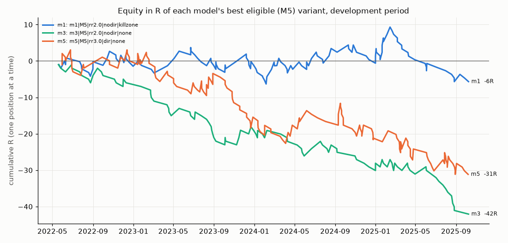
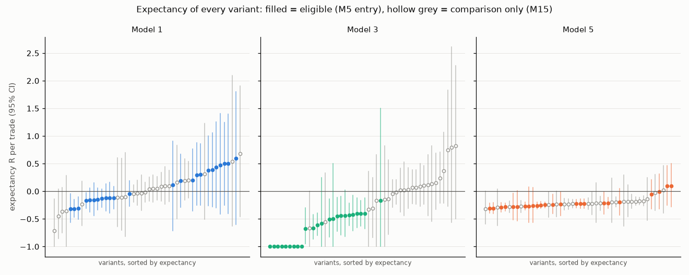

# 07 — ICT entry models: XAUUSD.sc

## Pre-registration (written and committed before any batch 2 result exists)

### Why
Batch 1 (`reports/05_levels.md`, `reports/06_setups.md`) tested the owner's four setups as exact rules.
208 variants were tried and none was positive in every year. On M5, spread and slippage cost about 14% of
every stop, which is a big hurdle. The owner also uses ICT entry models. Batch 2 tests three of them
(Model 1, Model 3, Model 5), plus a kill-zone filter, under the same honest process: exact rules written first,
real costs, random baselines, and a test period touched once. "These do not work either" is a valid result.
Every rule below is in plain words so the owner can check it against how they really trade.

### Time and sessions
- All bar times are broker server time (bar open time). Sessions are defined in their own local time, so
  daylight saving is handled automatically. PH time is Asia/Manila (no daylight saving).
- **Asian range (for Model 5):** 20:00-24:00 New York. In US winter time that is 09:00-13:00 PH time; during
  US daylight saving it is 08:00-12:00 PH time. The box is ready by early afternoon PH time (owner's choice).
- **Kill zones (ICT):** London 02:00-05:00 New York, and New York 07:00-10:00 New York. In US winter time that
  is 15:00-18:00 and 20:00-23:00 PH time; one hour earlier during US daylight saving.
- **Owner's hours:** 08:00-18:00 PH time (Asia/Manila). No evening trades.
- Batch 1's sessions (Asia 09:00-17:00 Tokyo, London 08:00-17:00 London, New York 08:00-17:00 New York) are
  reused for the per-session labels in the report.

### Time filter (three settings, all models)
1. **none.**
2. **kill zones.**
3. **owner's hours.**

How the filter is applied depends on the entry type:
- **Models 1 and 3 (limit orders):** the order can only fill inside the active window. If price touches the
  limit outside the window, the order does not fill (it stays live until its 12 bars run out or it is cancelled).
- **Model 5 (market entry):** the entry time must be inside the window.

The report also shows results per session and per PH-time band. The owner trades 08:00-18:00 PH time and
loses most in the New York evening. The per-session and per-band tables show whether those evening losses come
from the market or from the trader.

### Direction (H4 and H1)
- Swings exactly as batch 1: a swing high is a bar whose high is strictly above the highs of the 2 bars on each
  side (N = 2); lows mirror. The swing price is the wick tip. A swing is only known 2 bars after it forms.
- On one timeframe, up = the last two known swing highs and lows make a higher high and a higher low; down =
  lower high and lower low; otherwise range.
- **Direction = H4 and H1 agree**, read at the signal bar's close. Disagreement or range = no direction.
- The direction filter is a variant (on / off). "On" means a sell needs "down" and a buy needs "up".

### Levels (as batch 1)
PDH/PDL, PWH/PWL, previous session high/low, the previous session's last M30 swing high/low, and POC/VAH/VAL.
Merging (0.25 x ATR14(H1)), lifetime (a level stays live until a bar closes beyond it by more than the
tolerance, or until levels are recomputed at the next session start) and the near-miss tolerance
(0.10 x ATR14 of the entry timeframe) are exactly as in `reports/06_setups.md`.

### Displacement
A displacement candle is an entry-timeframe candle whose range (high minus low) is at least **2 x the mean range
of the previous 20 candles** (not counting the candle itself), **and** which closes in the trade direction
(a sell needs a bearish close). This is a designer's call, taken from the article's own scorecard.

### Model 1 - FVG entry after a market-structure shift (described as a sell; buys mirror)
1. **Failed break:** an entry-timeframe bar opens below a live level above, trades up to it (within tolerance)
   and closes back below it. The failed break's high is the wick tip. Only the failed break itself has to fall
   within the level's live span. While one failed break is waiting for its MSS, later failed breaks are
   ignored. Scanning resumes after the MSS, a cancel or an expiry.
2. **Market-structure shift (MSS):** within 12 bars after the failed break, a bar closes below the latest M5
   swing low on the trade side that was already known at the failed break's close (the low of the leg that ran
   up into the sweep; a swing that forms later is not needed). At least one bar from the failed break to the
   MSS bar (inclusive) must be a bearish displacement candle. While waiting, a close above the failed-break
   bar's high cancels the setup.
3. **FVG:** the latest bearish fair value gap (bar 1 low above bar 3 high, any size) whose bar 3 lies between
   the failed-break bar and the MSS bar (inclusive). None = no setup. No setup either if the MSS bar's close
   is already at or beyond the limit price, or if the stop would equal the limit.
4. **Entry (limit order):** a sell limit at the gap's near edge (its bottom = bar 3's high).
5. **Stop loss:** the highest high from the failed break to the MSS bar. This is the same as "to the fill",
   because price must pass the limit before it can reach the stop. A stop touch inside the fill minute counts
   as a loss (conservative).

### Model 3 - OTE
Model 1, plus a filter. The impulse leg runs from the failed break's wick tip down to the lowest low from the
failed break to the MSS bar. The OTE zone (sell) = leg low + 0.62 to 0.79 x leg height. The Model 1 gap must
**overlap** the OTE zone, otherwise there is no setup. Entry, stop and cancel rules are identical to Model 1,
so the only difference between Models 1 and 3 is "does the OTE filter help".

### Model 5 - Asian-range box (described as a sell; buys mirror at the box low)
1. **Box:** the M1 high and low of 20:00-24:00 New York, known at 00:00 New York and used until the next
   20:00 New York. No minimum or maximum box size (the report shows the box-height distribution).
2. **Breakout start:** a bar trades above the box high and its previous close was at or below the box high.
   Within 12 bars a close below the box low cancels. Otherwise a close below the box high is the failure.
3. **Retest:** within the next 12 bars, a bar whose high comes within tolerance of the box high and which
   closes below it. A close above the box high, or below the box low, before that cancels.
4. **Entry** at the next bar's open (market entry). **Stop loss** = the highest high from the breakout start to
   the retest bar.
5. After a signal, a cancel or an expiry, scanning resumes at the next bar.
6. The stop size is uncapped (as in batch 1, pre-registered, not tuned). The report shows the stop-size
   distribution and cost as a percentage of the stop.

### Limit-order rules (Models 1 and 3)
- **Live window:** a limit order is live from the MSS bar's close for 12 entry-timeframe bars.
- **Cancelled earlier** by an entry-timeframe close beyond the stop, at Friday 22:00 server time, or before a
  gap of more than 25 hours.
- **Fill:** on M1 bars, the first M1 bar (inside the live window and the time filter) whose high reaches the
  limit (for a buy: whose low reaches it). If that bar opens beyond the limit, the fill is at its open
  (gap-open fill).
- A fill bar that opens at or beyond the stop = no trade (skip reason `gap_through_sl`). The order still
  blocked the variant.
- A stop touch inside the fill minute = a loss. A target touched inside the fill minute does not count.
- **Cost** is the batch 1 cost, taken from the fill minute's spread (see below). A limit order still pays the
  spread, so this is conservative.
- **One position or pending order at a time** per variant. New signals of that variant while an order is
  pending or a trade is open are dropped.

### Take profit and exits
- Fixed **1:1.5, 1:2, 1:3** measured from the fill, or **next level** = the nearest level in the trade direction
  at least 1R away (none = skip), as in batch 1.
- Exit: hold until stop, target or a forced exit. No session-close variant in batch 2 (it keeps the variant
  count down, and batch 1's session-exit variants did not change any outcome).

### Trade simulation and costs (as batch 1)
- Signals are detected on the entry timeframe; every trade is simulated on M1 bars. If stop and target are both
  inside one M1 bar, it is a loss. If a bar opens beyond the stop or target, the fill is at that bar's open (a
  loss can exceed 1R).
- Cost per trade = max(M1 spread x point, **0.30**) + **0.05** slippage, shifted against the trade. Sensitivity
  at total cost 0.50 and 0.75. Swap per server-midnight rollover held, x3 for Wed to Thu, historical swap scaled
  by price, from `data/raw/research/symbol_info.json`.
- R = profit in units of the trade's own stop distance, net of cost and swap.
- Forced exits: at the open of the first bar at or after Friday 22:00 server time; and at the close of the last
  bar before a gap of more than 25 hours. No bar-count timeout. No entry at or after Friday 22:00, none after
  such a gap.
- No lookahead: a fact is used only if it was known by the signal bar's close. All data is cut at 2026-10-23.

### Fixed parameters (reported, never tuned)
| Parameter | Value |
|---|---|
| Swing N | 2 bars each side |
| Window K (MSS, breakout failure, retest, limit order) | 12 entry-timeframe bars |
| Tolerance | 0.10 x ATR14 (entry timeframe) |
| Level merge distance | 0.25 x ATR14(H1) |
| Displacement | range >= 2 x mean range of previous 20 bars, closes in trade direction |
| OTE zone | 0.62 to 0.79 of the impulse leg |
| Fixed reward:risk | 1.5 / 2.0 / 3.0 |
| Minimum TP distance (next level) | 1R |
| SL buffer | 0 |
| Cost | max(spread, 0.30) + 0.05; sensitivity 0.50 / 0.75 |
| Null repeats | 200 |
| ATR | MT5 iATR (simple average of true range), period 14 |

### Variant grid
Model {1, 3, 5} x entry timeframe {M5, M15} x TP {rr1.5, rr2.0, rr3.0, next_level} x direction filter
{dir, nodir} x time filter {none, killzone, owner} = **144 variants**. Names look like `m1|M5|rr2.0|dir|killzone`.
**72 are eligible** for selection and the test (M5 only). The 72 M15 variants are **comparison only**, because
of batch 1's cost finding (cost is a much bigger share of a small M5 stop): never selected, never on the test set.

**Cumulative count with batch 1: 208 + 144 = 352 variants tried, 64 + 72 = 136 eligible.** Some will pass by
luck; the count is stated next to every result.

### Metrics per variant (development period 2022-05-16 .. 2025-10-23)
Trades, win rate, expectancy in R with bootstrap 95% CI, total R, profit factor, max drawdown (R), longest
losing streak, trades per month, per year, per session, per PH-time band, buy vs sell, skipped-signal counts,
cost as a share of the stop, and cost sensitivity at 0.50 / 0.75.

### Null baseline (200 random runs per variant)
- **Models 1 and 3 (limit entries):**
  - Random placement bars are drawn only inside the variant's active window, and match each taken trade's
    session label (real trades are labelled by their fill session) and direction.
  - The limit distance is a taken trade's (limit minus signal close) in ATR14 units of the entry timeframe,
    applied to the close and ATR of the bar before the random placement.
  - The stop distance and target R are drawn jointly from the variant's taken trades.
  - Same 12-bar fill window and the same simulator. An unfilled random order is no trade.
  - Seeds differ from batch 1.
- **Model 5 (market entries):** as batch 1, with placements drawn only inside the active window.
- Reported as the share of random runs whose expectancy the variant beats.

### Selection rule (development period only)
Per model, at most 3 selected. A variant must pass all of these, in order:
1. M5 entry (eligible).
2. n >= 100 trades (one position at a time).
3. Expectancy > 0 in each of 2022 (partial), 2023, 2024 and 2025 (to Oct 23).
4. Beats >= 95% of its 200 random runs.
5. Then the best expectancy per model.

A model with nothing selected is reported FAIL and not tested.

### Part C - test set (run once)
Run only the selected variants on **2025-10-24 .. 2026-10-23, once**, with a bootstrap 95% CI. **PASS** =
expectancy >= +0.10R, n >= 30, and lower CI bound > -0.10R. Nothing selected = the test is not run. Whatever
the result, no re-tuning and no re-run.

### Honesty notes
- (a) Batch 1's results were known when batch 2 was designed. Batch 2's rules are not independent of that.
- (b) The M15 comparison exists because of batch 1's cost finding; it is never selected.
- (c) Several rules are designer's calls, marked in the text above (displacement, stop inside the fill minute,
  full cost on limit fills, uncapped Model 5 stops). They were fixed before any result and are not tuned.
- (d) Where the implementation refines the design spec (the failed-break span, the swing known at the failed
  break, the SL definition, the cancel and skip rules), this document states the implemented rule.
- (e) The owner's evening losses are examined per session and per PH-time band, to separate market from trader.
- (f) The test period 2025-10-24 .. 2026-10-23 has not been touched. No batch 2 result exists at the time of
  writing.

<!-- RESULTS BELOW: generated by src/xauai/research_ict.py; everything above is the pre-registration -->

## Results — development period 2022-05-16 .. 2025-10-23

Generated by `src/xauai/research_ict.py` at 2026-11-11 20:56 (local), runtime 4.5 min. Every number below comes from that script. **The test set (2025-10-24 .. 2026-10-23) has NOT been touched**: no trade below has a signal time after 2025-10-23 23:59:59.

Variants tried: **144** (pre-registered: 144). Eligible for selection (M5 entries): **72** (pre-registered: 72). Together with batch 1 (208 variants, 64 eligible) that is **352** variants (**136** eligible) tried on the same development data.

### In plain words

- *R* is the size of the trade's own stop: -1R = a normal stop-out, +2R = won twice the risk. *Expectancy* is the average R per trade after spread, slippage and swap; above 0 means the rules made money in this period. The *95% CI* is the range the true average plausibly lies in; if it includes 0, the result could be luck.
- Of the 72 eligible M5 versions, 14 had a positive average; the median eligible version averaged -0.255R per trade.
- To be selected a version needed at least 100 trades, a positive average in every calendar year 2022-2025, and to beat at least 95% of 200 random-entry runs with the same sessions, directions and stops (Models 1 and 3: random limit orders at the same kind of distance from price). 0 version(s) got far enough to be compared with random entries.
- 352 versions have now been tried across both batches (136 of them eligible). With this many tries, luck is likely: a few versions will look good by chance alone. That is why the random-entry check and the untouched test year exist.
- The evening question (losses in Philippine evening hours: market or trader?) is answered per model in "Results by session and by Philippine time" below.
- **No version passed, so nothing goes to the test set.** As exact rules with real costs, these ICT entry models did not show an edge in 2022-2025. That is a valid, useful result.

### Selection outcome per model

| model | outcome | details |
|---|---|---|
| Model 1 (failed break, MSS, FVG limit entry) | FAIL | 24 eligible -> 12 with n >= 100 -> 0 positive in every year -> 0 beat >= 95% of random runs. FAIL at 'expectancy > 0 in every year': closest is `m1\|M5\|rr2.0\|nodir\|owner`, whose worst year 2022 was -0.217R (needs > 0); 2 of 4 years positive at best. |
| Model 3 (Model 1 with the FVG inside the OTE band) | FAIL | 24 eligible -> 3 with n >= 100 -> 0 positive in every year -> 0 beat >= 95% of random runs. FAIL at 'expectancy > 0 in every year': closest is `m3\|M5\|rr2.0\|nodir\|none`, whose worst year 2025 was -0.482R (needs > 0); 0 of 4 years positive at best. |
| Model 5 (failed breakout of the Asian range, retest, market entry) | FAIL | 24 eligible -> 16 with n >= 100 -> 0 positive in every year -> 0 beat >= 95% of random runs. FAIL at 'expectancy > 0 in every year': closest is `m5\|M5\|rr1.5\|dir\|none`, whose worst year 2022 was -0.271R (needs > 0); 1 of 4 years positive at best. |

### Charts

Equity chart: each model's selected variant, or (if none was selected) its top eligible variant by expectancy among those with >= 100 trades — shown for comparison, not as a selection.

### Top 3 eligible variants per model

Ranked by one-position expectancy among eligible variants with >= 100 trades (filled up with smaller ones only if fewer than 3 have that many). *One position* = a new signal is ignored while that variant's order or trade is open (used for selection and the test). *Every signal* = every signal is traded, overlapping allowed. PF = profit factor (gross won / gross lost). Max DD = largest peak-to-trough fall of the R equity curve. Cost sensitivity = the same variant re-run with total cost per trade 0.50 / 0.75 instead of >= 0.35.

#### Model 1 (failed break, MSS, FVG limit entry)

#### `m1|M5|rr2.0|nodir|killzone`

| view | trades | win% | exp R | 95% CI | total R | PF | max DD R | longest losing streak | trades/month | exp R @ cost 0.50 | exp R @ cost 0.75 |
|---|---|---|---|---|---|---|---|---|---|---|---|
| one position (used for selection) | 129 | 32.6% | -0.044 | [-0.275, +0.194] | -5.7 | 0.93 | 15.0 | 12 | 3.12 | -0.084 | -0.159 |
| every signal | 130 | 32.3% | -0.051 | [-0.290, +0.181] | -6.7 | 0.92 | 15.0 | 12 | 3.15 | -0.098 | -0.172 |

Null baseline: not computed (it is only run for variants that pass n and every-year checks).

Breakdown, one position:

| group | n | win% | exp R | total R |
|---|---|---|---|---|
| year 2022 | 25 | 32.0% | -0.058 | -1.4 |
| year 2023 | 32 | 34.4% | 0.009 | 0.3 |
| year 2024 | 41 | 36.6% | 0.062 | 2.6 |
| year 2025 | 31 | 25.8% | -0.228 | -7.1 |
| session asia | 7 | 71.4% | 1.143 | 8.0 |
| session london | 33 | 30.3% | -0.091 | -3.0 |
| session ny | 89 | 30.3% | -0.120 | -10.7 |
| buy | 69 | 37.7% | 0.091 | 6.3 |
| sell | 60 | 26.7% | -0.200 | -12.0 |

Breakdown, every signal:

| group | n | win% | exp R | total R |
|---|---|---|---|---|
| year 2022 | 25 | 32.0% | -0.058 | -1.4 |
| year 2023 | 32 | 34.4% | 0.009 | 0.3 |
| year 2024 | 42 | 35.7% | 0.037 | 1.6 |
| year 2025 | 31 | 25.8% | -0.228 | -7.1 |
| session asia | 7 | 71.4% | 1.143 | 8.0 |
| session london | 33 | 30.3% | -0.091 | -3.0 |
| session ny | 90 | 30.0% | -0.130 | -11.7 |
| buy | 70 | 37.1% | 0.076 | 5.3 |
| sell | 60 | 26.7% | -0.200 | -12.0 |

#### `m1|M5|rr1.5|nodir|killzone`

| view | trades | win% | exp R | 95% CI | total R | PF | max DD R | longest losing streak | trades/month | exp R @ cost 0.50 | exp R @ cost 0.75 |
|---|---|---|---|---|---|---|---|---|---|---|---|
| one position (used for selection) | 129 | 35.7% | -0.116 | [-0.319, +0.089] | -15.0 | 0.82 | 15.6 | 12 | 3.12 | -0.118 | -0.195 |
| every signal | 130 | 35.4% | -0.123 | [-0.326, +0.080] | -16.0 | 0.81 | 16.6 | 12 | 3.15 | -0.124 | -0.202 |

Null baseline: not computed (it is only run for variants that pass n and every-year checks).

Breakdown, one position:

| group | n | win% | exp R | total R |
|---|---|---|---|---|
| year 2022 | 25 | 32.0% | -0.200 | -5.0 |
| year 2023 | 32 | 40.6% | 0.009 | 0.3 |
| year 2024 | 41 | 39.0% | -0.041 | -1.7 |
| year 2025 | 31 | 29.0% | -0.276 | -8.6 |
| session asia | 7 | 71.4% | 0.786 | 5.5 |
| session london | 33 | 39.4% | -0.015 | -0.5 |
| session ny | 89 | 31.5% | -0.224 | -20.0 |
| buy | 69 | 40.6% | 0.000 | 0.0 |
| sell | 60 | 30.0% | -0.250 | -15.0 |

Breakdown, every signal:

| group | n | win% | exp R | total R |
|---|---|---|---|---|
| year 2022 | 25 | 32.0% | -0.200 | -5.0 |
| year 2023 | 32 | 40.6% | 0.009 | 0.3 |
| year 2024 | 42 | 38.1% | -0.064 | -2.7 |
| year 2025 | 31 | 29.0% | -0.276 | -8.6 |
| session asia | 7 | 71.4% | 0.786 | 5.5 |
| session london | 33 | 39.4% | -0.015 | -0.5 |
| session ny | 90 | 31.1% | -0.233 | -21.0 |
| buy | 70 | 40.0% | -0.014 | -1.0 |
| sell | 60 | 30.0% | -0.250 | -15.0 |

#### `m1|M5|rr3.0|nodir|killzone`

| view | trades | win% | exp R | 95% CI | total R | PF | max DD R | longest losing streak | trades/month | exp R @ cost 0.50 | exp R @ cost 0.75 |
|---|---|---|---|---|---|---|---|---|---|---|---|
| one position (used for selection) | 125 | 24.0% | -0.119 | [-0.393, +0.166] | -14.9 | 0.84 | 22.3 | 14 | 3.03 | -0.146 | -0.183 |
| every signal | 130 | 23.8% | -0.122 | [-0.392, +0.166] | -15.9 | 0.84 | 23.2 | 15 | 3.15 | -0.154 | -0.190 |

Null baseline: not computed (it is only run for variants that pass n and every-year checks).

Breakdown, one position:

| group | n | win% | exp R | total R |
|---|---|---|---|---|
| year 2022 | 24 | 25.0% | -0.113 | -2.7 |
| year 2023 | 31 | 16.1% | -0.407 | -12.6 |
| year 2024 | 40 | 35.0% | 0.263 | 10.5 |
| year 2025 | 30 | 16.7% | -0.336 | -10.1 |
| session asia | 7 | 71.4% | 1.857 | 13.0 |
| session london | 32 | 15.6% | -0.374 | -12.0 |
| session ny | 86 | 23.3% | -0.185 | -15.9 |
| buy | 66 | 33.3% | 0.181 | 12.0 |
| sell | 59 | 13.6% | -0.455 | -26.9 |

Breakdown, every signal:

| group | n | win% | exp R | total R |
|---|---|---|---|---|
| year 2022 | 25 | 28.0% | 0.011 | 0.3 |
| year 2023 | 32 | 15.6% | -0.426 | -13.6 |
| year 2024 | 42 | 33.3% | 0.203 | 8.5 |
| year 2025 | 31 | 16.1% | -0.357 | -11.1 |
| session asia | 7 | 71.4% | 1.857 | 13.0 |
| session london | 33 | 18.2% | -0.272 | -9.0 |
| session ny | 90 | 22.2% | -0.222 | -19.9 |
| buy | 70 | 31.4% | 0.114 | 8.0 |
| sell | 60 | 15.0% | -0.398 | -23.9 |

#### Model 3 (Model 1 with the FVG inside the OTE band)

#### `m3|M5|rr2.0|nodir|none`

| view | trades | win% | exp R | 95% CI | total R | PF | max DD R | longest losing streak | trades/month | exp R @ cost 0.50 | exp R @ cost 0.75 |
|---|---|---|---|---|---|---|---|---|---|---|---|
| one position (used for selection) | 105 | 20.0% | -0.401 | [-0.629, -0.171] | -42.1 | 0.50 | 42.1 | 13 | 2.54 | -0.458 | -0.518 |
| every signal | 106 | 19.8% | -0.406 | [-0.632, -0.179] | -43.1 | 0.49 | 43.1 | 13 | 2.57 | -0.463 | -0.523 |

Null baseline: not computed (it is only run for variants that pass n and every-year checks).

Breakdown, one position:

| group | n | win% | exp R | total R |
|---|---|---|---|---|
| year 2022 | 18 | 22.2% | -0.333 | -6.0 |
| year 2023 | 31 | 19.4% | -0.422 | -13.1 |
| year 2024 | 27 | 22.2% | -0.333 | -9.0 |
| year 2025 | 29 | 17.2% | -0.482 | -14.0 |
| session asia | 45 | 22.2% | -0.333 | -15.0 |
| session london | 12 | 8.3% | -0.750 | -9.0 |
| session ny | 48 | 20.8% | -0.376 | -18.1 |
| buy | 50 | 20.0% | -0.402 | -20.1 |
| sell | 55 | 20.0% | -0.399 | -22.0 |

Breakdown, every signal:

| group | n | win% | exp R | total R |
|---|---|---|---|---|
| year 2022 | 18 | 22.2% | -0.333 | -6.0 |
| year 2023 | 32 | 18.8% | -0.440 | -14.1 |
| year 2024 | 27 | 22.2% | -0.333 | -9.0 |
| year 2025 | 29 | 17.2% | -0.482 | -14.0 |
| session asia | 46 | 21.7% | -0.348 | -16.0 |
| session london | 12 | 8.3% | -0.750 | -9.0 |
| session ny | 48 | 20.8% | -0.376 | -18.1 |
| buy | 51 | 19.6% | -0.414 | -21.1 |
| sell | 55 | 20.0% | -0.399 | -22.0 |

#### `m3|M5|rr3.0|nodir|none`

| view | trades | win% | exp R | 95% CI | total R | PF | max DD R | longest losing streak | trades/month | exp R @ cost 0.50 | exp R @ cost 0.75 |
|---|---|---|---|---|---|---|---|---|---|---|---|
| one position (used for selection) | 105 | 15.2% | -0.403 | [-0.657, -0.122] | -42.3 | 0.52 | 42.3 | 14 | 2.54 | -0.402 | -0.404 |
| every signal | 106 | 15.1% | -0.408 | [-0.660, -0.131] | -43.3 | 0.52 | 43.3 | 14 | 2.57 | -0.408 | -0.410 |

Null baseline: not computed (it is only run for variants that pass n and every-year checks).

Breakdown, one position:

| group | n | win% | exp R | total R |
|---|---|---|---|---|
| year 2022 | 18 | 16.7% | -0.333 | -6.0 |
| year 2023 | 31 | 12.9% | -0.486 | -15.1 |
| year 2024 | 27 | 18.5% | -0.304 | -8.2 |
| year 2025 | 29 | 13.8% | -0.447 | -13.0 |
| session asia | 45 | 20.0% | -0.200 | -9.0 |
| session london | 12 | 8.3% | -0.667 | -8.0 |
| session ny | 48 | 12.5% | -0.526 | -25.3 |
| buy | 50 | 18.0% | -0.309 | -15.4 |
| sell | 55 | 12.7% | -0.488 | -26.8 |

Breakdown, every signal:

| group | n | win% | exp R | total R |
|---|---|---|---|---|
| year 2022 | 18 | 16.7% | -0.333 | -6.0 |
| year 2023 | 32 | 12.5% | -0.502 | -16.1 |
| year 2024 | 27 | 18.5% | -0.304 | -8.2 |
| year 2025 | 29 | 13.8% | -0.447 | -13.0 |
| session asia | 46 | 19.6% | -0.217 | -10.0 |
| session london | 12 | 8.3% | -0.667 | -8.0 |
| session ny | 48 | 12.5% | -0.526 | -25.3 |
| buy | 51 | 17.6% | -0.323 | -16.4 |
| sell | 55 | 12.7% | -0.488 | -26.8 |

#### `m3|M5|rr1.5|nodir|none`

| view | trades | win% | exp R | 95% CI | total R | PF | max DD R | longest losing streak | trades/month | exp R @ cost 0.50 | exp R @ cost 0.75 |
|---|---|---|---|---|---|---|---|---|---|---|---|
| one position (used for selection) | 105 | 22.9% | -0.429 | [-0.620, -0.215] | -45.1 | 0.44 | 45.1 | 7 | 2.54 | -0.429 | -0.524 |
| every signal | 106 | 22.6% | -0.435 | [-0.623, -0.223] | -46.1 | 0.44 | 46.1 | 7 | 2.57 | -0.435 | -0.529 |

Null baseline: not computed (it is only run for variants that pass n and every-year checks).

Breakdown, one position:

| group | n | win% | exp R | total R |
|---|---|---|---|---|
| year 2022 | 18 | 22.2% | -0.444 | -8.0 |
| year 2023 | 31 | 25.8% | -0.358 | -11.1 |
| year 2024 | 27 | 22.2% | -0.444 | -12.0 |
| year 2025 | 29 | 20.7% | -0.482 | -14.0 |
| session asia | 45 | 22.2% | -0.444 | -20.0 |
| session london | 12 | 25.0% | -0.375 | -4.5 |
| session ny | 48 | 22.9% | -0.429 | -20.6 |
| buy | 50 | 24.0% | -0.402 | -20.1 |
| sell | 55 | 21.8% | -0.454 | -25.0 |

Breakdown, every signal:

| group | n | win% | exp R | total R |
|---|---|---|---|---|
| year 2022 | 18 | 22.2% | -0.444 | -8.0 |
| year 2023 | 32 | 25.0% | -0.378 | -12.1 |
| year 2024 | 27 | 22.2% | -0.444 | -12.0 |
| year 2025 | 29 | 20.7% | -0.482 | -14.0 |
| session asia | 46 | 21.7% | -0.457 | -21.0 |
| session london | 12 | 25.0% | -0.375 | -4.5 |
| session ny | 48 | 22.9% | -0.429 | -20.6 |
| buy | 51 | 23.5% | -0.414 | -21.1 |
| sell | 55 | 21.8% | -0.454 | -25.0 |

#### Model 5 (failed breakout of the Asian range, retest, market entry)

#### `m5|M5|rr3.0|dir|none`

| view | trades | win% | exp R | 95% CI | total R | PF | max DD R | longest losing streak | trades/month | exp R @ cost 0.50 | exp R @ cost 0.75 |
|---|---|---|---|---|---|---|---|---|---|---|---|
| one position (used for selection) | 163 | 20.9% | -0.191 | [-0.433, +0.052] | -31.2 | 0.76 | 34.2 | 15 | 3.95 | -0.266 | -0.268 |
| every signal | 203 | 20.7% | -0.188 | [-0.401, +0.038] | -38.1 | 0.76 | 41.1 | 15 | 4.92 | -0.249 | -0.291 |

Null baseline: not computed (it is only run for variants that pass n and every-year checks).

Breakdown, one position:

| group | n | win% | exp R | total R |
|---|---|---|---|---|
| year 2022 | 24 | 25.0% | 0.002 | 0.0 |
| year 2023 | 54 | 18.5% | -0.287 | -15.5 |
| year 2024 | 43 | 23.3% | -0.134 | -5.8 |
| year 2025 | 42 | 19.0% | -0.237 | -10.0 |
| session asia | 66 | 15.2% | -0.394 | -26.0 |
| session london | 39 | 23.1% | -0.076 | -3.0 |
| session ny | 58 | 25.9% | -0.038 | -2.2 |
| buy | 94 | 21.3% | -0.201 | -18.9 |
| sell | 69 | 20.3% | -0.178 | -12.3 |

Breakdown, every signal:

| group | n | win% | exp R | total R |
|---|---|---|---|---|
| year 2022 | 33 | 24.2% | -0.030 | -1.0 |
| year 2023 | 68 | 20.6% | -0.182 | -12.4 |
| year 2024 | 55 | 20.0% | -0.250 | -13.8 |
| year 2025 | 47 | 19.1% | -0.233 | -11.0 |
| session asia | 74 | 14.9% | -0.406 | -30.0 |
| session london | 51 | 27.5% | 0.099 | 5.0 |
| session ny | 78 | 21.8% | -0.168 | -13.1 |
| buy | 114 | 19.3% | -0.271 | -30.9 |
| sell | 89 | 22.5% | -0.080 | -7.2 |

#### `m5|M5|rr3.0|nodir|killzone`

| view | trades | win% | exp R | 95% CI | total R | PF | max DD R | longest losing streak | trades/month | exp R @ cost 0.50 | exp R @ cost 0.75 |
|---|---|---|---|---|---|---|---|---|---|---|---|
| one position (used for selection) | 937 | 20.0% | -0.210 | [-0.311, -0.106] | -197.2 | 0.74 | 201.2 | 19 | 22.69 | -0.261 | -0.328 |
| every signal | 1282 | 19.8% | -0.216 | [-0.301, -0.129] | -277.4 | 0.73 | 284.4 | 21 | 31.04 | -0.263 | -0.332 |

Null baseline: not computed (it is only run for variants that pass n and every-year checks).

Breakdown, one position:

| group | n | win% | exp R | total R |
|---|---|---|---|---|
| year 2022 | 191 | 17.8% | -0.301 | -57.6 |
| year 2023 | 293 | 19.8% | -0.214 | -62.6 |
| year 2024 | 242 | 21.1% | -0.173 | -41.9 |
| year 2025 | 211 | 20.9% | -0.166 | -35.1 |
| session asia | 194 | 17.5% | -0.299 | -58.0 |
| session london | 443 | 20.8% | -0.170 | -75.5 |
| session ny | 300 | 20.3% | -0.212 | -63.7 |
| buy | 428 | 21.5% | -0.149 | -63.9 |
| sell | 509 | 18.7% | -0.262 | -133.2 |

Breakdown, every signal:

| group | n | win% | exp R | total R |
|---|---|---|---|---|
| year 2022 | 279 | 17.9% | -0.292 | -81.6 |
| year 2023 | 394 | 18.5% | -0.263 | -103.7 |
| year 2024 | 339 | 20.9% | -0.182 | -61.9 |
| year 2025 | 270 | 22.2% | -0.112 | -30.2 |
| session asia | 223 | 16.1% | -0.354 | -79.0 |
| session london | 602 | 20.4% | -0.184 | -110.6 |
| session ny | 457 | 20.8% | -0.192 | -87.8 |
| buy | 596 | 21.1% | -0.162 | -96.4 |
| sell | 686 | 18.7% | -0.264 | -181.0 |

#### `m5|M5|rr2.0|dir|none`

| view | trades | win% | exp R | 95% CI | total R | PF | max DD R | longest losing streak | trades/month | exp R @ cost 0.50 | exp R @ cost 0.75 |
|---|---|---|---|---|---|---|---|---|---|---|---|
| one position (used for selection) | 165 | 26.7% | -0.216 | [-0.412, -0.010] | -35.6 | 0.71 | 40.6 | 12 | 4.00 | -0.296 | -0.335 |
| every signal | 203 | 26.1% | -0.230 | [-0.406, -0.044] | -46.6 | 0.69 | 49.6 | 13 | 4.92 | -0.317 | -0.345 |

Null baseline: not computed (it is only run for variants that pass n and every-year checks).

Breakdown, one position:

| group | n | win% | exp R | total R |
|---|---|---|---|---|
| year 2022 | 24 | 25.0% | -0.250 | -6.0 |
| year 2023 | 55 | 25.5% | -0.252 | -13.9 |
| year 2024 | 43 | 25.6% | -0.273 | -11.8 |
| year 2025 | 43 | 30.2% | -0.092 | -4.0 |
| session asia | 67 | 23.9% | -0.284 | -19.0 |
| session london | 39 | 23.1% | -0.308 | -12.0 |
| session ny | 59 | 32.2% | -0.078 | -4.6 |
| buy | 95 | 23.2% | -0.333 | -31.7 |
| sell | 70 | 31.4% | -0.056 | -3.9 |

Breakdown, every signal:

| group | n | win% | exp R | total R |
|---|---|---|---|---|
| year 2022 | 33 | 27.3% | -0.183 | -6.0 |
| year 2023 | 68 | 26.5% | -0.218 | -14.9 |
| year 2024 | 55 | 21.8% | -0.377 | -20.8 |
| year 2025 | 47 | 29.8% | -0.106 | -5.0 |
| session asia | 74 | 23.0% | -0.311 | -23.0 |
| session london | 51 | 29.4% | -0.118 | -6.0 |
| session ny | 78 | 26.9% | -0.225 | -17.6 |
| buy | 114 | 21.9% | -0.366 | -41.7 |
| sell | 89 | 31.5% | -0.055 | -4.9 |

### Null baseline (random entries)

Computed only for eligible variants that already pass n >= 100 and every-year > 0. Each random run takes the same number of entries at random entry-TF bars inside the variant's time filter, in the same sessions with the same directions; each gets a (stop distance, target distance in R) pair drawn from the variant's own trades. Model 5: market entry at that bar. Models 1 and 3: a limit order at a drawn offset (in ATR) from the previous bar's close, live for the same fill window and time filter. Same simulator, one position or order at a time. *Beats* = share of random runs whose expectancy is not above the variant's.

_none_

### Cost sensitivity (eligible variants with >= 100 trades, plus each model's top 3)

| variant | n | exp R base | exp R @ 0.50 | exp R @ 0.75 | every signal base | every signal @ 0.50 | every signal @ 0.75 |
|---|---|---|---|---|---|---|---|
| m1\|M5\|rr2.0\|nodir\|killzone | 129 | -0.044 | -0.084 | -0.159 | -0.051 | -0.098 | -0.172 |
| m1\|M5\|rr1.5\|nodir\|killzone | 129 | -0.116 | -0.118 | -0.195 | -0.123 | -0.124 | -0.202 |
| m1\|M5\|rr3.0\|nodir\|killzone | 125 | -0.119 | -0.146 | -0.183 | -0.122 | -0.154 | -0.190 |
| m1\|M5\|rr2.0\|nodir\|owner | 116 | -0.121 | -0.198 | -0.250 | -0.118 | -0.193 | -0.244 |
| m1\|M5\|rr2.0\|nodir\|none | 253 | -0.128 | -0.173 | -0.222 | -0.140 | -0.187 | -0.235 |
| m1\|M5\|rr3.0\|nodir\|none | 248 | -0.148 | -0.158 | -0.174 | -0.156 | -0.172 | -0.191 |
| m1\|M5\|rr3.0\|nodir\|owner | 114 | -0.158 | -0.158 | -0.264 | -0.126 | -0.126 | -0.227 |
| m1\|M5\|rr1.5\|nodir\|owner | 116 | -0.159 | -0.181 | -0.310 | -0.139 | -0.181 | -0.307 |
| m1\|M5\|rr1.5\|nodir\|none | 253 | -0.169 | -0.219 | -0.288 | -0.182 | -0.230 | -0.298 |
| m1\|M5\|next_level\|nodir\|killzone | 115 | -0.308 | -0.325 | -0.356 | -0.320 | -0.342 | -0.373 |
| m1\|M5\|next_level\|nodir\|none | 228 | -0.314 | -0.368 | -0.376 | -0.331 | -0.386 | -0.403 |
| m1\|M5\|next_level\|nodir\|owner | 106 | -0.318 | -0.400 | -0.371 | -0.322 | -0.402 | -0.394 |
| m3\|M5\|rr2.0\|nodir\|none | 105 | -0.401 | -0.458 | -0.518 | -0.406 | -0.463 | -0.523 |
| m3\|M5\|rr3.0\|nodir\|none | 105 | -0.403 | -0.402 | -0.404 | -0.408 | -0.408 | -0.410 |
| m3\|M5\|rr1.5\|nodir\|none | 105 | -0.429 | -0.429 | -0.524 | -0.435 | -0.435 | -0.529 |
| m5\|M5\|rr3.0\|dir\|none | 163 | -0.191 | -0.266 | -0.268 | -0.188 | -0.249 | -0.291 |
| m5\|M5\|rr3.0\|nodir\|killzone | 937 | -0.210 | -0.261 | -0.328 | -0.216 | -0.263 | -0.332 |
| m5\|M5\|rr2.0\|dir\|none | 165 | -0.216 | -0.296 | -0.335 | -0.230 | -0.317 | -0.345 |
| m5\|M5\|rr2.0\|nodir\|killzone | 982 | -0.222 | -0.276 | -0.342 | -0.235 | -0.294 | -0.348 |
| m5\|M5\|next_level\|nodir\|killzone | 988 | -0.223 | -0.292 | -0.360 | -0.251 | -0.298 | -0.374 |
| m5\|M5\|rr1.5\|nodir\|killzone | 1014 | -0.225 | -0.276 | -0.344 | -0.235 | -0.297 | -0.368 |
| m5\|M5\|next_level\|dir\|none | 160 | -0.234 | -0.309 | -0.371 | -0.227 | -0.308 | -0.405 |
| m5\|M5\|rr1.5\|dir\|none | 167 | -0.238 | -0.282 | -0.381 | -0.238 | -0.305 | -0.390 |
| m5\|M5\|rr1.5\|nodir\|none | 1985 | -0.245 | -0.302 | -0.373 | -0.247 | -0.307 | -0.379 |
| m5\|M5\|rr2.0\|nodir\|none | 1892 | -0.248 | -0.307 | -0.392 | -0.239 | -0.297 | -0.373 |
| m5\|M5\|next_level\|nodir\|none | 1906 | -0.262 | -0.313 | -0.391 | -0.265 | -0.313 | -0.393 |
| m5\|M5\|rr3.0\|nodir\|none | 1760 | -0.269 | -0.331 | -0.394 | -0.240 | -0.302 | -0.380 |
| m5\|M5\|rr1.5\|nodir\|owner | 938 | -0.283 | -0.349 | -0.428 | -0.281 | -0.353 | -0.436 |
| m5\|M5\|rr2.0\|nodir\|owner | 925 | -0.290 | -0.371 | -0.445 | -0.282 | -0.369 | -0.431 |
| m5\|M5\|rr3.0\|nodir\|owner | 900 | -0.304 | -0.374 | -0.439 | -0.289 | -0.344 | -0.412 |
| m5\|M5\|next_level\|nodir\|owner | 914 | -0.304 | -0.356 | -0.443 | -0.309 | -0.350 | -0.439 |

### Cost as a share of the stop, per entry timeframe

cost = spread (min $0.30) + $0.05 slippage, in price, from the fill bar (limit fills too); SL distance = fill to stop. Over unique simulated trades (the same trade shared by several variants counts once). A 0.35 cost on a 1.00 stop means every trade starts 0.35R behind.

| entry TF | unique trades | mean cost / SL | median cost / SL | median SL distance ($) | median cost ($) |
|---|---|---|---|---|---|
| M5 | 3144 | 22.2% | 18.9% | 1.85 | 0.35 |
| M15 | 2099 | 15.0% | 11.9% | 2.94 | 0.35 |

### Results by session and by Philippine time

For each model's `M5|rr2.0|nodir|none` variant. Session = the session the trade was filled in (asia / london / ny, as in batch 1; a time between two sessions is labelled with the next session to start). PH band = fill time in Asia/Manila: 08-18 (day), 18-02 (evening), 02-08 (night). n / exp R / total R = one position at a time; the every-signal columns trade every signal.

#### Model 1 (failed break, MSS, FVG limit entry) — `m1|M5|rr2.0|nodir|none`

| group | n | win% | exp R | total R | every signal n | every signal exp R |
|---|---|---|---|---|---|---|
| session asia | 113 | 27.4% | -0.177 | -20.0 | 117 | -0.179 |
| session london | 35 | 34.3% | 0.029 | 1.0 | 35 | 0.029 |
| session ny | 105 | 30.5% | -0.128 | -13.4 | 108 | -0.152 |
| PH 08-18 | 110 | 26.4% | -0.209 | -23.0 | 112 | -0.196 |
| PH 18-02 | 109 | 32.1% | -0.077 | -8.4 | 112 | -0.102 |
| PH 02-08 | 34 | 32.4% | -0.029 | -1.0 | 36 | -0.083 |

Evening (18-02 Manila): -0.077R per trade over 109 trades, against -0.167R over 144 trades in the other hours, so the evening does not show worse expectancy for this variant (one position at a time; a gap between small groups can be luck).

#### Model 3 (Model 1 with the FVG inside the OTE band) — `m3|M5|rr2.0|nodir|none`

| group | n | win% | exp R | total R | every signal n | every signal exp R |
|---|---|---|---|---|---|---|
| session asia | 45 | 22.2% | -0.333 | -15.0 | 46 | -0.348 |
| session london | 12 | 8.3% | -0.750 | -9.0 | 12 | -0.750 |
| session ny | 48 | 20.8% | -0.376 | -18.1 | 48 | -0.376 |
| PH 08-18 | 40 | 15.0% | -0.550 | -22.0 | 40 | -0.550 |
| PH 18-02 | 48 | 20.8% | -0.376 | -18.1 | 48 | -0.376 |
| PH 02-08 | 17 | 29.4% | -0.118 | -2.0 | 18 | -0.167 |

Evening (18-02 Manila): -0.376R per trade over 48 trades, against -0.421R over 57 trades in the other hours, so the evening does not show worse expectancy for this variant (one position at a time; a gap between small groups can be luck).

#### Model 5 (failed breakout of the Asian range, retest, market entry) — `m5|M5|rr2.0|nodir|none`

| group | n | win% | exp R | total R | every signal n | every signal exp R |
|---|---|---|---|---|---|---|
| session asia | 531 | 25.6% | -0.232 | -123.0 | 686 | -0.274 |
| session london | 612 | 23.5% | -0.295 | -180.6 | 891 | -0.230 |
| session ny | 749 | 26.6% | -0.222 | -166.6 | 1187 | -0.226 |
| PH 08-18 | 887 | 24.0% | -0.280 | -248.3 | 1174 | -0.282 |
| PH 18-02 | 878 | 26.5% | -0.214 | -187.8 | 1338 | -0.208 |
| PH 02-08 | 127 | 26.0% | -0.268 | -34.1 | 252 | -0.203 |

Evening (18-02 Manila): -0.214R per trade over 878 trades, against -0.278R over 1014 trades in the other hours, so the evening does not show worse expectancy for this variant (one position at a time; a gap between small groups can be luck).

### Model 5: Asian box height and stop size

Box height = high - low of each Asian range box (20:00-24:00 New York) in the development period. Stop size and cost / stop over every simulated trade of `m5|M5|rr2.0|nodir|none`. In $ (price units).

| quantity | n | p10 | median | p90 |
|---|---|---|---|---|
| Asian box height, high - low ($), every box | 889 | 4.28 | 8.40 | 23.84 |
| stop size, fill to SL ($) | 2764 | 0.79 | 1.74 | 4.79 |
| cost / stop | 2764 | 7.3% | 20.1% | 44.3% |

### Models 1 and 3: fill rate and limit offset

Placed = orders that were placed (signals not skipped at placement for no bar / stale after a gap / Friday close). Filled = orders whose limit was touched (including fills then skipped for gap_through_sl, sl_behind_fill or a target problem). Fill rate = filled / placed, over every order. Median limit offset = distance of the limit from the signal close in ATR14 units (positive = better price), over filled trades.

| variant | placed | filled | not filled | fill rate | median limit offset (ATR) |
|---|---|---|---|---|---|
| m1\|M5\|rr2.0\|nodir\|none | 439 | 260 | 179 | 59.2% | 1.11 |
| m1\|M5\|rr2.0\|nodir\|killzone | 439 | 130 | 309 | 29.6% | 1.09 |
| m1\|M5\|rr2.0\|nodir\|owner | 439 | 119 | 320 | 27.1% | 1.14 |
| m3\|M5\|rr2.0\|nodir\|none | 197 | 106 | 91 | 53.8% | 1.53 |
| m3\|M5\|rr2.0\|nodir\|killzone | 197 | 54 | 143 | 27.4% | 1.51 |
| m3\|M5\|rr2.0\|nodir\|owner | 197 | 43 | 154 | 21.8% | 1.53 |

### Entry-timeframe comparison (M15 rows: comparison only — never selected or tested)

One row per model and entry timeframe, over its 24 variants (TP mode x direction filter x time filter).

| setup | entry TF | status | variants | variants exp > 0 | median exp R | best variant | best n | best exp R | best 95% CI |
|---|---|---|---|---|---|---|---|---|---|
| m1 | M15 | comparison only | 24 | 12 | 0.012 | m1\|M15\|next_level\|dir\|killzone | 10 | 0.685 | [-0.456, +1.910] |
| m1 | M5 | eligible (M5) | 24 | 12 | 0.038 | m1\|M5\|rr3.0\|dir\|owner | 10 | 0.600 | [-0.600, +1.800] |
| m3 | M15 | comparison only | 24 | 15 | 0.048 | m3\|M15\|next_level\|dir\|killzone | 8 | 0.824 | [-0.501, +2.278] |
| m3 | M5 | eligible (M5) | 24 | 0 | -0.597 | m3\|M5\|rr1.5\|dir\|owner | 3 | -0.167 | [-1.000, +1.500] |
| m5 | M15 | comparison only | 24 | 1 | -0.217 | m5\|M15\|next_level\|dir\|killzone | 43 | 0.020 | [-0.392, +0.469] |
| m5 | M5 | eligible (M5) | 24 | 2 | -0.242 | m5\|M5\|rr3.0\|dir\|killzone | 75 | 0.098 | [-0.276, +0.503] |

### Skipped signals by reason

Per model, TF, TP mode and time filter, without the direction filter (it only removes signals first). no_entry_bar = no M1 bar at the entry / placement time; stale_after_gap = right after a > 25 h gap; entry_after_friday_close = at/after Friday 22:00; sl_behind_fill = the stop is on the wrong side of the fill after costs; no_target = no next level; target_too_close_or_passed = target < 1R from the fill; not_filled = the limit was never touched in its window (or only outside the time filter); gap_through_sl = the fill bar opened beyond the stop. simulated = trades (limit models: filled orders).

| model | entry TF | TP mode | time filter | simulated | no_entry_bar | stale_after_gap | entry_after_friday_close | sl_behind_fill | no_target | target_too_close_or_passed | not_filled | gap_through_sl | other |
|---|---|---|---|---|---|---|---|---|---|---|---|---|---|
| m1 | M5 | rr1.5 | none | 260 | 0 | 0 | 1 | 0 | 0 | 0 | 179 | 0 | 0 |
| m1 | M5 | rr1.5 | killzone | 130 | 0 | 0 | 1 | 0 | 0 | 0 | 309 | 0 | 0 |
| m1 | M5 | rr1.5 | owner | 119 | 0 | 0 | 1 | 0 | 0 | 0 | 320 | 0 | 0 |
| m1 | M5 | rr2.0 | none | 260 | 0 | 0 | 1 | 0 | 0 | 0 | 179 | 0 | 0 |
| m1 | M5 | rr2.0 | killzone | 130 | 0 | 0 | 1 | 0 | 0 | 0 | 309 | 0 | 0 |
| m1 | M5 | rr2.0 | owner | 119 | 0 | 0 | 1 | 0 | 0 | 0 | 320 | 0 | 0 |
| m1 | M5 | rr3.0 | none | 260 | 0 | 0 | 1 | 0 | 0 | 0 | 179 | 0 | 0 |
| m1 | M5 | rr3.0 | killzone | 130 | 0 | 0 | 1 | 0 | 0 | 0 | 309 | 0 | 0 |
| m1 | M5 | rr3.0 | owner | 119 | 0 | 0 | 1 | 0 | 0 | 0 | 320 | 0 | 0 |
| m1 | M5 | next_level | none | 237 | 0 | 0 | 1 | 0 | 23 | 0 | 179 | 0 | 0 |
| m1 | M5 | next_level | killzone | 117 | 0 | 0 | 1 | 0 | 13 | 0 | 309 | 0 | 0 |
| m1 | M5 | next_level | owner | 110 | 0 | 0 | 1 | 0 | 9 | 0 | 320 | 0 | 0 |
| m1 | M15 | rr1.5 | none | 256 | 0 | 0 | 0 | 0 | 0 | 0 | 202 | 0 | 0 |
| m1 | M15 | rr1.5 | killzone | 95 | 0 | 0 | 0 | 0 | 0 | 0 | 363 | 0 | 0 |
| m1 | M15 | rr1.5 | owner | 129 | 0 | 0 | 0 | 0 | 0 | 0 | 329 | 0 | 0 |
| m1 | M15 | rr2.0 | none | 256 | 0 | 0 | 0 | 0 | 0 | 0 | 202 | 0 | 0 |
| m1 | M15 | rr2.0 | killzone | 95 | 0 | 0 | 0 | 0 | 0 | 0 | 363 | 0 | 0 |
| m1 | M15 | rr2.0 | owner | 129 | 0 | 0 | 0 | 0 | 0 | 0 | 329 | 0 | 0 |
| m1 | M15 | rr3.0 | none | 256 | 0 | 0 | 0 | 0 | 0 | 0 | 202 | 0 | 0 |
| m1 | M15 | rr3.0 | killzone | 95 | 0 | 0 | 0 | 0 | 0 | 0 | 363 | 0 | 0 |
| m1 | M15 | rr3.0 | owner | 129 | 0 | 0 | 0 | 0 | 0 | 0 | 329 | 0 | 0 |
| m1 | M15 | next_level | none | 213 | 0 | 0 | 0 | 0 | 43 | 0 | 202 | 0 | 0 |
| m1 | M15 | next_level | killzone | 75 | 0 | 0 | 0 | 0 | 20 | 0 | 363 | 0 | 0 |
| m1 | M15 | next_level | owner | 111 | 0 | 0 | 0 | 0 | 18 | 0 | 329 | 0 | 0 |
| m3 | M5 | rr1.5 | none | 106 | 0 | 0 | 0 | 0 | 0 | 0 | 91 | 0 | 0 |
| m3 | M5 | rr1.5 | killzone | 54 | 0 | 0 | 0 | 0 | 0 | 0 | 143 | 0 | 0 |
| m3 | M5 | rr1.5 | owner | 43 | 0 | 0 | 0 | 0 | 0 | 0 | 154 | 0 | 0 |
| m3 | M5 | rr2.0 | none | 106 | 0 | 0 | 0 | 0 | 0 | 0 | 91 | 0 | 0 |
| m3 | M5 | rr2.0 | killzone | 54 | 0 | 0 | 0 | 0 | 0 | 0 | 143 | 0 | 0 |
| m3 | M5 | rr2.0 | owner | 43 | 0 | 0 | 0 | 0 | 0 | 0 | 154 | 0 | 0 |
| m3 | M5 | rr3.0 | none | 106 | 0 | 0 | 0 | 0 | 0 | 0 | 91 | 0 | 0 |
| m3 | M5 | rr3.0 | killzone | 54 | 0 | 0 | 0 | 0 | 0 | 0 | 143 | 0 | 0 |
| m3 | M5 | rr3.0 | owner | 43 | 0 | 0 | 0 | 0 | 0 | 0 | 154 | 0 | 0 |
| m3 | M5 | next_level | none | 94 | 0 | 0 | 0 | 0 | 12 | 0 | 91 | 0 | 0 |
| m3 | M5 | next_level | killzone | 48 | 0 | 0 | 0 | 0 | 6 | 0 | 143 | 0 | 0 |
| m3 | M5 | next_level | owner | 38 | 0 | 0 | 0 | 0 | 5 | 0 | 154 | 0 | 0 |
| m3 | M15 | rr1.5 | none | 119 | 0 | 0 | 0 | 0 | 0 | 0 | 100 | 0 | 0 |
| m3 | M15 | rr1.5 | killzone | 45 | 0 | 0 | 0 | 0 | 0 | 0 | 174 | 0 | 0 |
| m3 | M15 | rr1.5 | owner | 61 | 0 | 0 | 0 | 0 | 0 | 0 | 158 | 0 | 0 |
| m3 | M15 | rr2.0 | none | 119 | 0 | 0 | 0 | 0 | 0 | 0 | 100 | 0 | 0 |
| m3 | M15 | rr2.0 | killzone | 45 | 0 | 0 | 0 | 0 | 0 | 0 | 174 | 0 | 0 |
| m3 | M15 | rr2.0 | owner | 61 | 0 | 0 | 0 | 0 | 0 | 0 | 158 | 0 | 0 |
| m3 | M15 | rr3.0 | none | 119 | 0 | 0 | 0 | 0 | 0 | 0 | 100 | 0 | 0 |
| m3 | M15 | rr3.0 | killzone | 45 | 0 | 0 | 0 | 0 | 0 | 0 | 174 | 0 | 0 |
| m3 | M15 | rr3.0 | owner | 61 | 0 | 0 | 0 | 0 | 0 | 0 | 158 | 0 | 0 |
| m3 | M15 | next_level | none | 102 | 0 | 0 | 0 | 0 | 17 | 0 | 100 | 0 | 0 |
| m3 | M15 | next_level | killzone | 37 | 0 | 0 | 0 | 0 | 8 | 0 | 174 | 0 | 0 |
| m3 | M15 | next_level | owner | 54 | 0 | 0 | 0 | 0 | 7 | 0 | 158 | 0 | 0 |
| m5 | M5 | rr1.5 | none | 2764 | 0 | 0 | 17 | 0 | 0 | 0 | 0 | 0 | 0 |
| m5 | M5 | rr1.5 | killzone | 1282 | 0 | 0 | 0 | 0 | 0 | 0 | 0 | 0 | 0 |
| m5 | M5 | rr1.5 | owner | 1174 | 0 | 0 | 0 | 0 | 0 | 0 | 0 | 0 | 0 |
| m5 | M5 | rr2.0 | none | 2764 | 0 | 0 | 17 | 0 | 0 | 0 | 0 | 0 | 0 |
| m5 | M5 | rr2.0 | killzone | 1282 | 0 | 0 | 0 | 0 | 0 | 0 | 0 | 0 | 0 |
| m5 | M5 | rr2.0 | owner | 1174 | 0 | 0 | 0 | 0 | 0 | 0 | 0 | 0 | 0 |
| m5 | M5 | rr3.0 | none | 2764 | 0 | 0 | 17 | 0 | 0 | 0 | 0 | 0 | 0 |
| m5 | M5 | rr3.0 | killzone | 1282 | 0 | 0 | 0 | 0 | 0 | 0 | 0 | 0 | 0 |
| m5 | M5 | rr3.0 | owner | 1174 | 0 | 0 | 0 | 0 | 0 | 0 | 0 | 0 | 0 |
| m5 | M5 | next_level | none | 2737 | 0 | 0 | 17 | 0 | 27 | 0 | 0 | 0 | 0 |
| m5 | M5 | next_level | killzone | 1269 | 0 | 0 | 0 | 0 | 13 | 0 | 0 | 0 | 0 |
| m5 | M5 | next_level | owner | 1160 | 0 | 0 | 0 | 0 | 14 | 0 | 0 | 0 | 0 |
| m5 | M15 | rr1.5 | none | 1699 | 1 | 0 | 15 | 0 | 0 | 0 | 0 | 0 | 0 |
| m5 | M15 | rr1.5 | killzone | 731 | 0 | 0 | 0 | 0 | 0 | 0 | 0 | 0 | 0 |
| m5 | M15 | rr1.5 | owner | 714 | 0 | 0 | 0 | 0 | 0 | 0 | 0 | 0 | 0 |
| m5 | M15 | rr2.0 | none | 1699 | 1 | 0 | 15 | 0 | 0 | 0 | 0 | 0 | 0 |
| m5 | M15 | rr2.0 | killzone | 731 | 0 | 0 | 0 | 0 | 0 | 0 | 0 | 0 | 0 |
| m5 | M15 | rr2.0 | owner | 714 | 0 | 0 | 0 | 0 | 0 | 0 | 0 | 0 | 0 |
| m5 | M15 | rr3.0 | none | 1699 | 1 | 0 | 15 | 0 | 0 | 0 | 0 | 0 | 0 |
| m5 | M15 | rr3.0 | killzone | 731 | 0 | 0 | 0 | 0 | 0 | 0 | 0 | 0 | 0 |
| m5 | M15 | rr3.0 | owner | 714 | 0 | 0 | 0 | 0 | 0 | 0 | 0 | 0 | 0 |
| m5 | M15 | next_level | none | 1665 | 1 | 0 | 15 | 0 | 34 | 0 | 0 | 0 | 0 |
| m5 | M15 | next_level | killzone | 711 | 0 | 0 | 0 | 0 | 20 | 0 | 0 | 0 | 0 |
| m5 | M15 | next_level | owner | 703 | 0 | 0 | 0 | 0 | 11 | 0 | 0 | 0 | 0 |

### All variants

Sorted by model, then one-position expectancy. n taken = one position at a time; n signals = every simulated trade (limit models: every filled order).

| variant | eligible | n taken | n signals | win% | exp R | 95% CI | total R | PF |
|---|---|---|---|---|---|---|---|---|
| m1\|M15\|next_level\|dir\|killzone | comparison only | 10 | 10 | 50.0% | 0.685 | [-0.456, +1.910] | 6.9 | 2.37 |
| m1\|M5\|rr3.0\|dir\|owner | yes | 10 | 10 | 40.0% | 0.600 | [-0.600, +1.800] | 6.0 | 2.00 |
| m1\|M15\|next_level\|dir\|owner | comparison only | 7 | 7 | 42.9% | 0.541 | [-0.626, +2.095] | 3.8 | 1.95 |
| m1\|M5\|rr2.0\|dir\|owner | yes | 10 | 10 | 50.0% | 0.500 | [-0.400, +1.400] | 5.0 | 2.00 |
| m1\|M5\|rr1.5\|dir\|owner | yes | 10 | 10 | 60.0% | 0.500 | [-0.250, +1.250] | 5.0 | 2.25 |
| m1\|M5\|rr3.0\|dir\|killzone | yes | 17 | 18 | 41.2% | 0.472 | [-0.413, +1.409] | 8.0 | 1.80 |
| m1\|M5\|rr3.0\|dir\|none | yes | 23 | 24 | 39.1% | 0.436 | [-0.302, +1.255] | 10.0 | 1.72 |
| m1\|M5\|rr2.0\|dir\|killzone | yes | 18 | 18 | 50.0% | 0.390 | [-0.277, +1.057] | 7.0 | 1.78 |
| m1\|M5\|next_level\|dir\|killzone | yes | 14 | 14 | 57.1% | 0.375 | [-0.258, +1.006] | 5.3 | 1.88 |
| m1\|M15\|next_level\|dir\|none | comparison only | 16 | 16 | 37.5% | 0.311 | [-0.506, +1.223] | 5.0 | 1.50 |
| m1\|M5\|rr1.5\|dir\|killzone | yes | 18 | 18 | 55.6% | 0.307 | [-0.249, +0.862] | 5.5 | 1.69 |
| m1\|M5\|rr2.0\|dir\|none | yes | 24 | 24 | 45.8% | 0.293 | [-0.252, +0.875] | 7.0 | 1.54 |
| m1\|M5\|next_level\|dir\|none | yes | 18 | 18 | 50.0% | 0.203 | [-0.358, +0.770] | 3.6 | 1.41 |
| m1\|M15\|rr3.0\|nodir\|owner | comparison only | 126 | 129 | 30.2% | 0.201 | [-0.116, +0.540] | 25.3 | 1.29 |
| m1\|M15\|next_level\|nodir\|owner | comparison only | 106 | 111 | 34.9% | 0.191 | [-0.160, +0.588] | 20.3 | 1.29 |
| m1\|M5\|rr1.5\|dir\|none | yes | 24 | 24 | 50.0% | 0.189 | [-0.287, +0.668] | 4.5 | 1.38 |
| m1\|M15\|rr1.5\|dir\|killzone | comparison only | 15 | 15 | 46.7% | 0.167 | [-0.500, +0.833] | 2.5 | 1.31 |
| m1\|M5\|next_level\|dir\|owner | yes | 8 | 8 | 50.0% | 0.120 | [-0.715, +0.909] | 1.0 | 1.24 |
| m1\|M15\|rr2.0\|nodir\|killzone | comparison only | 94 | 95 | 38.3% | 0.098 | [-0.182, +0.382] | 9.2 | 1.16 |
| m1\|M15\|rr3.0\|nodir\|killzone | comparison only | 94 | 95 | 30.9% | 0.098 | [-0.234, +0.449] | 9.2 | 1.14 |
| m1\|M15\|rr2.0\|nodir\|owner | comparison only | 127 | 129 | 36.2% | 0.085 | [-0.173, +0.345] | 10.8 | 1.13 |
| m1\|M15\|rr3.0\|nodir\|none | comparison only | 236 | 256 | 28.4% | 0.048 | [-0.159, +0.264] | 11.3 | 1.07 |
| m1\|M15\|rr1.5\|nodir\|killzone | comparison only | 94 | 95 | 42.6% | 0.046 | [-0.195, +0.291] | 4.3 | 1.08 |
| m1\|M15\|rr1.5\|nodir\|owner | comparison only | 127 | 129 | 41.7% | 0.043 | [-0.174, +0.259] | 5.4 | 1.07 |
| m1\|M15\|rr2.0\|nodir\|none | comparison only | 241 | 256 | 34.0% | -0.019 | [-0.191, +0.161] | -4.5 | 0.97 |
| m1\|M15\|next_level\|nodir\|killzone | comparison only | 74 | 75 | 33.8% | -0.031 | [-0.343, +0.292] | -2.3 | 0.95 |
| m1\|M15\|next_level\|nodir\|none | comparison only | 201 | 213 | 31.3% | -0.040 | [-0.255, +0.198] | -8.0 | 0.94 |
| m1\|M15\|rr1.5\|nodir\|none | comparison only | 242 | 256 | 38.8% | -0.042 | [-0.191, +0.114] | -10.2 | 0.93 |
| m1\|M5\|rr2.0\|nodir\|killzone | yes | 129 | 130 | 32.6% | -0.044 | [-0.275, +0.194] | -5.7 | 0.93 |
| m1\|M15\|rr3.0\|dir\|killzone | comparison only | 15 | 15 | 26.7% | -0.105 | [-0.814, +0.697] | -1.6 | 0.86 |
| m1\|M15\|rr2.0\|dir\|killzone | comparison only | 15 | 15 | 33.3% | -0.106 | [-0.707, +0.601] | -1.6 | 0.84 |
| m1\|M15\|rr1.5\|dir\|owner | comparison only | 14 | 14 | 35.7% | -0.107 | [-0.643, +0.607] | -1.5 | 0.83 |
| m1\|M5\|rr1.5\|nodir\|killzone | yes | 129 | 130 | 35.7% | -0.116 | [-0.319, +0.089] | -15.0 | 0.82 |
| m1\|M5\|rr3.0\|nodir\|killzone | yes | 125 | 130 | 24.0% | -0.119 | [-0.393, +0.166] | -14.9 | 0.84 |
| m1\|M5\|rr2.0\|nodir\|owner | yes | 116 | 119 | 29.3% | -0.121 | [-0.353, +0.138] | -14.0 | 0.83 |
| m1\|M5\|rr2.0\|nodir\|none | yes | 253 | 260 | 29.6% | -0.128 | [-0.287, +0.043] | -32.4 | 0.82 |
| m1\|M5\|rr3.0\|nodir\|none | yes | 248 | 260 | 22.6% | -0.148 | [-0.337, +0.055] | -36.7 | 0.81 |
| m1\|M5\|rr3.0\|nodir\|owner | yes | 114 | 119 | 21.1% | -0.158 | [-0.439, +0.157] | -18.0 | 0.80 |
| m1\|M5\|rr1.5\|nodir\|owner | yes | 116 | 119 | 33.6% | -0.159 | [-0.375, +0.056] | -18.5 | 0.76 |
| m1\|M5\|rr1.5\|nodir\|none | yes | 253 | 260 | 33.6% | -0.169 | [-0.309, -0.022] | -42.7 | 0.74 |
| m1\|M15\|rr1.5\|dir\|none | comparison only | 30 | 31 | 30.0% | -0.231 | [-0.620, +0.185] | -6.9 | 0.66 |
| m1\|M5\|next_level\|nodir\|killzone | yes | 115 | 117 | 27.8% | -0.308 | [-0.510, -0.099] | -35.4 | 0.57 |
| m1\|M5\|next_level\|nodir\|none | yes | 228 | 237 | 26.3% | -0.314 | [-0.472, -0.152] | -71.7 | 0.57 |
| m1\|M5\|next_level\|nodir\|owner | yes | 106 | 110 | 23.6% | -0.318 | [-0.560, -0.046] | -33.7 | 0.59 |
| m1\|M15\|rr2.0\|dir\|owner | comparison only | 14 | 14 | 21.4% | -0.356 | [-1.000, +0.288] | -5.0 | 0.55 |
| m1\|M15\|rr2.0\|dir\|none | comparison only | 30 | 31 | 23.3% | -0.365 | [-0.747, +0.064] | -10.9 | 0.51 |
| m1\|M15\|rr3.0\|dir\|none | comparison only | 29 | 31 | 17.2% | -0.446 | [-0.854, +0.042] | -12.9 | 0.45 |
| m1\|M15\|rr3.0\|dir\|owner | comparison only | 14 | 14 | 7.1% | -0.712 | [-1.000, -0.138] | -10.0 | 0.23 |
| m3\|M15\|next_level\|dir\|killzone | comparison only | 8 | 8 | 50.0% | 0.824 | [-0.501, +2.278] | 6.6 | 2.65 |
| m3\|M15\|next_level\|dir\|owner | comparison only | 6 | 6 | 50.0% | 0.798 | [-0.564, +2.610] | 4.8 | 2.60 |
| m3\|M15\|next_level\|dir\|none | comparison only | 12 | 12 | 50.0% | 0.743 | [-0.271, +1.829] | 8.9 | 2.49 |
| m3\|M15\|next_level\|nodir\|owner | comparison only | 53 | 54 | 35.8% | 0.375 | [-0.212, +1.063] | 19.9 | 1.58 |
| m3\|M15\|rr3.0\|nodir\|owner | comparison only | 61 | 61 | 31.1% | 0.242 | [-0.216, +0.705] | 14.8 | 1.35 |
| m3\|M15\|next_level\|nodir\|killzone | comparison only | 37 | 37 | 37.8% | 0.151 | [-0.330, +0.687] | 5.6 | 1.25 |
| m3\|M15\|rr1.5\|dir\|killzone | comparison only | 11 | 11 | 45.5% | 0.136 | [-0.545, +0.818] | 1.5 | 1.25 |
| m3\|M15\|rr1.5\|dir\|none | comparison only | 18 | 18 | 44.4% | 0.111 | [-0.444, +0.667] | 2.0 | 1.20 |
| m3\|M15\|rr1.5\|nodir\|killzone | comparison only | 45 | 45 | 44.4% | 0.110 | [-0.237, +0.465] | 5.0 | 1.21 |
| m3\|M15\|next_level\|nodir\|none | comparison only | 100 | 102 | 32.0% | 0.091 | [-0.268, +0.503] | 9.1 | 1.13 |
| m3\|M15\|rr3.0\|nodir\|none | comparison only | 116 | 119 | 28.4% | 0.067 | [-0.237, +0.392] | 7.7 | 1.09 |
| m3\|M15\|rr1.5\|nodir\|owner | comparison only | 61 | 61 | 42.6% | 0.065 | [-0.224, +0.393] | 3.9 | 1.11 |
| m3\|M15\|rr2.0\|nodir\|owner | comparison only | 61 | 61 | 34.4% | 0.032 | [-0.313, +0.424] | 1.9 | 1.05 |
| m3\|M15\|rr3.0\|nodir\|killzone | comparison only | 45 | 45 | 28.9% | 0.023 | [-0.437, +0.529] | 1.0 | 1.03 |
| m3\|M15\|rr2.0\|nodir\|killzone | comparison only | 45 | 45 | 35.6% | 0.019 | [-0.372, +0.421] | 0.8 | 1.03 |
| m3\|M15\|rr1.5\|nodir\|none | comparison only | 116 | 119 | 39.7% | -0.012 | [-0.229, +0.210] | -1.4 | 0.98 |
| m3\|M15\|rr2.0\|nodir\|none | comparison only | 116 | 119 | 32.8% | -0.047 | [-0.288, +0.207] | -5.5 | 0.93 |
| m3\|M15\|rr3.0\|dir\|none | comparison only | 18 | 18 | 27.8% | -0.141 | [-0.778, +0.566] | -2.5 | 0.81 |
| m3\|M15\|rr3.0\|dir\|killzone | comparison only | 11 | 11 | 27.3% | -0.146 | [-1.000, +0.818] | -1.6 | 0.80 |
| m3\|M5\|rr1.5\|dir\|owner | yes | 3 | 3 | 33.3% | -0.167 | [-1.000, +1.500] | -0.5 | 0.75 |
| m3\|M15\|rr1.5\|dir\|owner | comparison only | 9 | 9 | 33.3% | -0.167 | [-1.000, +0.667] | -1.5 | 0.75 |
| m3\|M15\|rr2.0\|dir\|none | comparison only | 18 | 18 | 27.8% | -0.307 | [-0.833, +0.244] | -5.5 | 0.57 |
| m3\|M15\|rr2.0\|dir\|killzone | comparison only | 11 | 11 | 27.3% | -0.328 | [-1.000, +0.364] | -3.6 | 0.55 |
| m3\|M5\|rr1.5\|nodir\|killzone | yes | 54 | 54 | 24.1% | -0.400 | [-0.677, -0.120] | -21.6 | 0.47 |
| m3\|M5\|rr2.0\|nodir\|none | yes | 105 | 106 | 20.0% | -0.401 | [-0.629, -0.171] | -42.1 | 0.50 |
| m3\|M5\|rr3.0\|nodir\|none | yes | 105 | 106 | 15.2% | -0.403 | [-0.657, -0.122] | -42.3 | 0.52 |
| m3\|M5\|rr1.5\|nodir\|owner | yes | 43 | 43 | 23.3% | -0.419 | [-0.709, -0.070] | -18.0 | 0.45 |
| m3\|M5\|rr1.5\|nodir\|none | yes | 105 | 106 | 22.9% | -0.429 | [-0.620, -0.215] | -45.1 | 0.44 |
| m3\|M5\|rr3.0\|nodir\|owner | yes | 43 | 43 | 14.0% | -0.442 | [-0.814, +0.023] | -19.0 | 0.49 |
| m3\|M5\|rr2.0\|nodir\|owner | yes | 43 | 43 | 18.6% | -0.442 | [-0.791, -0.093] | -19.0 | 0.46 |
| m3\|M5\|rr2.0\|nodir\|killzone | yes | 54 | 54 | 18.5% | -0.447 | [-0.725, -0.113] | -24.1 | 0.45 |
| m3\|M5\|rr1.5\|dir\|killzone | yes | 5 | 5 | 20.0% | -0.500 | [-1.000, +0.500] | -2.5 | 0.38 |
| m3\|M5\|rr3.0\|nodir\|killzone | yes | 54 | 54 | 13.0% | -0.508 | [-0.827, -0.137] | -27.4 | 0.42 |
| m3\|M15\|rr3.0\|dir\|owner | comparison only | 9 | 9 | 11.1% | -0.556 | [-1.000, +0.333] | -5.0 | 0.38 |
| m3\|M5\|rr1.5\|dir\|none | yes | 6 | 6 | 16.7% | -0.583 | [-1.000, +0.250] | -3.5 | 0.30 |
| m3\|M5\|next_level\|nodir\|none | yes | 93 | 94 | 15.1% | -0.610 | [-0.800, -0.396] | -56.7 | 0.28 |
| m3\|M5\|next_level\|nodir\|killzone | yes | 48 | 48 | 14.6% | -0.667 | [-0.866, -0.419] | -32.0 | 0.22 |
| m3\|M15\|rr2.0\|dir\|owner | comparison only | 9 | 9 | 11.1% | -0.667 | [-1.000, +0.000] | -6.0 | 0.25 |
| m3\|M5\|next_level\|nodir\|owner | yes | 38 | 38 | 10.5% | -0.676 | [-0.945, -0.300] | -25.7 | 0.24 |
| m3\|M5\|rr2.0\|dir\|none | yes | 6 | 6 | 0.0% | -1.000 | [-1.000, -1.000] | -6.0 | 0.00 |
| m3\|M5\|rr2.0\|dir\|killzone | yes | 5 | 5 | 0.0% | -1.000 | [-1.000, -1.000] | -5.0 | 0.00 |
| m3\|M5\|rr2.0\|dir\|owner | yes | 3 | 3 | 0.0% | -1.000 | [-1.000, -1.000] | -3.0 | 0.00 |
| m3\|M5\|rr3.0\|dir\|none | yes | 6 | 6 | 0.0% | -1.000 | [-1.000, -1.000] | -6.0 | 0.00 |
| m3\|M5\|rr3.0\|dir\|killzone | yes | 5 | 5 | 0.0% | -1.000 | [-1.000, -1.000] | -5.0 | 0.00 |
| m3\|M5\|rr3.0\|dir\|owner | yes | 3 | 3 | 0.0% | -1.000 | [-1.000, -1.000] | -3.0 | 0.00 |
| m3\|M5\|next_level\|dir\|none | yes | 3 | 3 | 0.0% | -1.000 | [-1.000, -1.000] | -3.0 | 0.00 |
| m3\|M5\|next_level\|dir\|killzone | yes | 3 | 3 | 0.0% | -1.000 | [-1.000, -1.000] | -3.0 | 0.00 |
| m3\|M5\|next_level\|dir\|owner | yes | 2 | 2 | 0.0% | -1.000 | [-1.000, -1.000] | -2.0 | 0.00 |
| m5\|M5\|rr3.0\|dir\|killzone | yes | 75 | 93 | 28.0% | 0.098 | [-0.276, +0.503] | 7.4 | 1.14 |
| m5\|M5\|next_level\|dir\|killzone | yes | 74 | 89 | 37.8% | 0.095 | [-0.249, +0.466] | 7.0 | 1.15 |
| m5\|M15\|next_level\|dir\|killzone | comparison only | 43 | 52 | 37.2% | 0.020 | [-0.392, +0.469] | 0.9 | 1.03 |
| m5\|M5\|rr2.0\|dir\|killzone | yes | 75 | 93 | 33.3% | -0.009 | [-0.320, +0.311] | -0.7 | 0.99 |
| m5\|M15\|rr1.5\|dir\|killzone | comparison only | 46 | 55 | 39.1% | -0.022 | [-0.348, +0.304] | -1.0 | 0.96 |
| m5\|M5\|rr1.5\|dir\|killzone | yes | 77 | 93 | 37.7% | -0.057 | [-0.318, +0.206] | -4.4 | 0.91 |
| m5\|M15\|rr2.0\|dir\|killzone | comparison only | 46 | 55 | 28.3% | -0.141 | [-0.521, +0.250] | -6.5 | 0.80 |
| m5\|M15\|rr1.5\|nodir\|killzone | comparison only | 629 | 731 | 33.2% | -0.172 | [-0.263, -0.080] | -108.4 | 0.74 |
| m5\|M15\|rr1.5\|nodir\|none | comparison only | 1260 | 1699 | 33.3% | -0.176 | [-0.240, -0.110] | -221.2 | 0.74 |
| m5\|M15\|rr2.0\|nodir\|none | comparison only | 1194 | 1699 | 27.8% | -0.182 | [-0.256, -0.105] | -217.5 | 0.75 |
| m5\|M15\|rr3.0\|nodir\|owner | comparison only | 597 | 714 | 20.6% | -0.183 | [-0.308, -0.055] | -109.5 | 0.77 |
| m5\|M15\|rr3.0\|dir\|none | comparison only | 117 | 140 | 21.4% | -0.185 | [-0.458, +0.111] | -21.6 | 0.76 |
| m5\|M15\|rr3.0\|dir\|killzone | comparison only | 45 | 55 | 20.0% | -0.189 | [-0.633, +0.298] | -8.5 | 0.76 |
| m5\|M5\|rr3.0\|dir\|none | yes | 163 | 203 | 20.9% | -0.191 | [-0.433, +0.052] | -31.2 | 0.76 |
| m5\|M15\|rr3.0\|nodir\|none | comparison only | 1095 | 1699 | 21.0% | -0.194 | [-0.284, -0.100] | -212.0 | 0.75 |
| m5\|M15\|rr3.0\|dir\|owner | comparison only | 55 | 64 | 20.0% | -0.200 | [-0.564, +0.236] | -11.0 | 0.75 |
| m5\|M5\|rr3.0\|nodir\|killzone | yes | 937 | 1282 | 20.0% | -0.210 | [-0.311, -0.106] | -197.2 | 0.74 |
| m5\|M5\|rr2.0\|dir\|none | yes | 165 | 203 | 26.7% | -0.216 | [-0.412, -0.010] | -35.6 | 0.71 |
| m5\|M15\|rr3.0\|nodir\|killzone | comparison only | 583 | 731 | 20.1% | -0.216 | [-0.342, -0.088] | -126.1 | 0.73 |
| m5\|M15\|next_level\|dir\|owner | comparison only | 53 | 61 | 28.3% | -0.218 | [-0.562, +0.152] | -11.5 | 0.70 |
| m5\|M15\|rr1.5\|dir\|none | comparison only | 119 | 140 | 31.9% | -0.219 | [-0.420, -0.012] | -26.1 | 0.68 |
| m5\|M15\|rr2.0\|nodir\|killzone | comparison only | 610 | 731 | 26.2% | -0.220 | [-0.323, -0.116] | -134.5 | 0.70 |
| m5\|M5\|rr2.0\|nodir\|killzone | yes | 982 | 1282 | 26.1% | -0.222 | [-0.305, -0.140] | -218.3 | 0.70 |
| m5\|M5\|next_level\|nodir\|killzone | yes | 988 | 1269 | 27.3% | -0.223 | [-0.308, -0.136] | -219.9 | 0.69 |
| m5\|M5\|rr1.5\|nodir\|killzone | yes | 1014 | 1282 | 31.2% | -0.225 | [-0.297, -0.153] | -228.0 | 0.67 |
| m5\|M15\|next_level\|nodir\|none | comparison only | 1213 | 1665 | 28.4% | -0.228 | [-0.302, -0.151] | -276.7 | 0.68 |
| m5\|M15\|rr1.5\|nodir\|owner | comparison only | 620 | 714 | 30.8% | -0.231 | [-0.323, -0.139] | -143.2 | 0.67 |
| m5\|M15\|rr2.0\|nodir\|owner | comparison only | 611 | 714 | 25.7% | -0.232 | [-0.335, -0.130] | -141.5 | 0.69 |
| m5\|M5\|next_level\|dir\|none | yes | 160 | 196 | 26.9% | -0.234 | [-0.437, -0.011] | -37.5 | 0.68 |
| m5\|M15\|rr2.0\|dir\|none | comparison only | 118 | 140 | 26.3% | -0.235 | [-0.463, -0.001] | -27.8 | 0.68 |
| m5\|M5\|rr1.5\|dir\|none | yes | 167 | 203 | 30.5% | -0.238 | [-0.404, -0.058] | -39.8 | 0.66 |
| m5\|M15\|next_level\|dir\|none | comparison only | 113 | 134 | 29.2% | -0.244 | [-0.467, -0.008] | -27.6 | 0.65 |
| m5\|M5\|rr1.5\|nodir\|none | yes | 1985 | 2764 | 30.3% | -0.245 | [-0.296, -0.194] | -485.9 | 0.65 |
| m5\|M5\|rr2.0\|nodir\|none | yes | 1892 | 2764 | 25.3% | -0.248 | [-0.306, -0.189] | -470.2 | 0.67 |
| m5\|M5\|next_level\|nodir\|none | yes | 1906 | 2737 | 25.6% | -0.262 | [-0.322, -0.197] | -498.8 | 0.65 |
| m5\|M5\|next_level\|dir\|owner | yes | 76 | 89 | 25.0% | -0.262 | [-0.560, +0.072] | -19.9 | 0.65 |
| m5\|M5\|rr3.0\|dir\|owner | yes | 82 | 96 | 18.3% | -0.268 | [-0.561, +0.074] | -22.0 | 0.67 |
| m5\|M5\|rr3.0\|nodir\|none | yes | 1760 | 2764 | 18.8% | -0.269 | [-0.340, -0.196] | -472.8 | 0.67 |
| m5\|M15\|next_level\|nodir\|owner | comparison only | 607 | 703 | 25.2% | -0.274 | [-0.379, -0.163] | -166.2 | 0.63 |
| m5\|M5\|rr2.0\|dir\|owner | yes | 83 | 96 | 24.1% | -0.277 | [-0.530, +0.012] | -23.0 | 0.63 |
| m5\|M5\|rr1.5\|dir\|owner | yes | 83 | 96 | 28.9% | -0.277 | [-0.518, -0.036] | -23.0 | 0.61 |
| m5\|M15\|next_level\|nodir\|killzone | comparison only | 600 | 711 | 27.2% | -0.279 | [-0.382, -0.174] | -167.6 | 0.62 |
| m5\|M5\|rr1.5\|nodir\|owner | yes | 938 | 1174 | 28.7% | -0.283 | [-0.353, -0.212] | -265.8 | 0.60 |
| m5\|M5\|rr2.0\|nodir\|owner | yes | 925 | 1174 | 23.7% | -0.290 | [-0.371, -0.209] | -268.3 | 0.62 |
| m5\|M15\|rr2.0\|dir\|owner | comparison only | 55 | 64 | 23.6% | -0.291 | [-0.618, +0.036] | -16.0 | 0.62 |
| m5\|M5\|rr3.0\|nodir\|owner | yes | 900 | 1174 | 17.4% | -0.304 | [-0.402, -0.206] | -273.4 | 0.63 |
| m5\|M5\|next_level\|nodir\|owner | yes | 914 | 1160 | 22.6% | -0.304 | [-0.396, -0.212] | -278.2 | 0.61 |
| m5\|M15\|rr1.5\|dir\|owner | comparison only | 55 | 64 | 27.3% | -0.318 | [-0.591, -0.000] | -17.5 | 0.56 |

### Caveats

- Trades opened near 2025-10-23 may exit after it (0 taken trades across all variants exit after 2025-10-23 23:59:59); they are kept, with their full outcome, because their signal is in the development period.
- Historical swap is scaled by price with the 2026-10-23 close as the reference (the current swap snapshot is from then), as in batch 1. This uses one price from after the development period, only to scale swap.
- Limit-order null: random orders are placed only inside the time filter, while real orders may be placed before a window and fill inside it. Real trades are labelled with the session of the fill; random ones with the session of the placement bar.
- Model 5 stops are not capped (designer's call, fixed before any result).
- 352 variants have been tried across both batches; with 136 eligible, a few can pass the development checks by luck. The test set is the only honest check.
- With a time filter on, the stop is the highest high up to the MSS bar. Price can run past it while the order is not live, and the order can still fill later inside the window.
- **The test set has NOT been touched.** It is run once, with `--final`, only for selected variants.

## Test set (Part C)

Not run: no ICT model variant was selected in the development period. Per the pre-registration, the test period 2025-10-24 .. 2026-10-23 stays untouched.
