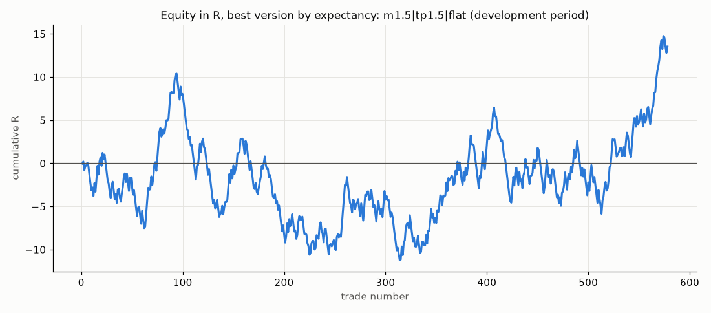

# 08 — Chronos H1 day trade: XAUUSD.sc

## Pre-registration (written and committed before any batch 3 result exists)

### Why
Batches 1 and 2 (`reports/06_setups.md`, `reports/07_ict_models.md`) found no edge in the owner's setups or in
the ICT models. Both FAILED and nothing was selected. On M5, costs ate about 20% of every stop, and tight
stops kept getting hit by noise. The owner asked whether an existing pretrained model could help. Batch 3
tests **Amazon Chronos**, a pretrained time-series forecaster, used as it comes (zero-shot, no training), as a
**direction call for one calm H1 day trade**.

The owner wants a trade they do not have to watch: a wide stop, set and forget. The owner's words for success:
"tell me the possible trend, as long as it could hit the profit side". "Chronos adds nothing" is a valid
result. The report must say plainly whether Chronos beats a coin flip and whether it beats simply reading the
overnight move off the chart.

The routine being tested, one trade per day:
1. Look at what New York did overnight.
2. Let Tokyo start.
3. Enter once.
4. Be out by mid-London. Looking for the London sweep afterwards is manual and is not part of this test.

### Times
- All bar times are broker server time (bar open time). Local times go local to UTC to server time through
  time zones, so daylight saving is automatic (the UK and the US switch on different dates; the code follows
  London for the exit and Manila for the decision, not New York).
- **Decision time: 10:00 Manila time (PH time; the Philippines has no daylight saving).** That is after Tokyo's
  first two H1 candles. The forecast uses only H1 bars that have **closed** by 10:00 PH. "Last close" is the
  close of the H1 bar that ends at 10:00 PH (it opened at 09:00 PH).
- **Entry:** market order at the open of the first M1 bar at or after 10:00 PH, plus cost.
- **Time exit: 12:00 London time.** That is 20:00 PH in UK winter and 19:00 PH in UK summer. Any trade still
  open closes at the open of the first M1 bar at or after that time.
- **Days:** Monday to Friday (by PH date). If a holiday or gap removes the decision H1 bar, the entry M1 bar
  (must be within 5 minutes of 10:00 PH) or the exit M1 bar (within 5 minutes of 12:00 London), or if
  ATR14 is not available, there is no trade that day. It is counted as a skip and never shifted to another time.
- A trade is also skipped if its entry bar follows a gap of more than 25 hours or falls at or after Friday 22:00
  server time, if no M1 bar exists between entry and exit, or if the stop would not be behind the fill. The
  report lists every skip reason with its count.

### Chronos settings
- **Model:** `amazon/chronos-bolt-base`, on CPU, through the `chronos-forecasting` package. The package version
  and the model's Hugging Face revision are pinned and printed in the report. Bolt outputs quantiles directly,
  so there is no random sampling and the forecast is reproducible.
- **Input:** the last **512 H1 closes** that closed by 10:00 PH, as raw prices (Bolt scales them itself). They
  are fed as a plain sequence: the daily break and weekend gaps are ignored. The bar still open at 10:00 PH is
  never included.
- **Warm-up:** a day is used only if at least 512 closed H1 bars exist before it. The first usable day is
  reported (about late June 2022), so 2022 is a partial year.
- **Horizon:** the whole number of hours from the entry to the time exit (9 or 10, depending on UK daylight
  saving), worked out per day.
- **Forecast:** the median is the 0.5 quantile at the horizon step. **Direction** = the sign of (median
  forecast at the horizon minus last close). Up means buy, down means sell. An exactly zero difference is no trade.
- **Flat filter (a version setting):** no trade if |median forecast minus last close| < **0.25 x ATR14(H1)** at
  the decision bar.
- Forecasts depend only on the day, not on the stop or exit, so one forecast table serves all 18 versions.
  Forecasts for the test year are computed only inside the one-time final run, never before it.

### Stops and exits
- **Starting stop** = m x ATR14(H1) from the fill, m in {1.5, 2.0, 3.0} (a version setting). ATR14 is the value
  at the decision bar, in the MT5 form (simple average of true range, as in `indicators.py`). **1R = this stop
  distance.** SL is set from the actual fill price (open plus cost, against the trade).
- Exit styles (a version setting):
  1. **tp1.5:** fixed take-profit at 1.5R from the fill.
  2. **tp2.0:** fixed take-profit at 2R from the fill.
  3. **be_trail:** no fixed target. When price reaches +1R (the M1 bar's best price reaches fill + 1R), the stop
     can move up to break-even (the fill). After that it trails **m x ATR14(H1)** behind the best price reached
     (the same m and the same decision-bar ATR as the starting stop). It only ever moves in the trade's favour.
     The stop updates after each M1 bar closes and applies from the next bar.
- Because the trail distance equals the starting stop (m x ATR = 1R), the break-even + trail exit in practice
  trails 1R behind the best price from +1R on, so the stop rarely sits exactly at break-even.
- If one M1 bar both reaches +1R and touches the starting stop, it is a stop-out at the starting stop (break-even
  does not apply in that bar). If a bar both makes a new best price and touches the current stop, it is a stop-out
  at the current stop.
- Every trade also closes at the time exit if still open. One trade per day by construction.

### Simulation and costs (as batches 1 and 2)
- Every trade is simulated bar by bar on M1. Stop and target inside one M1 bar = a loss. A bar that opens beyond
  the stop or target fills at its open, so a loss can be bigger than 1R.
- Cost per trade = max(entry M1 bar spread x point, **0.30**) + **0.05** slippage, applied by moving the fill
  against the trade. Sensitivity at total cost 0.50 and 0.75.
- Swap: charged per server-midnight rollover held (x3 for Wed to Thu), historical swap scaled by price, from
  `data/raw/research/symbol_info.json`. A trade between 10:00 PH and mid-London does not normally cross one, but
  the code charges it if it does.
- Forced exits: Friday 22:00 server time, and the last bar before any gap of more than 25 hours.
- R = profit in units of the starting stop distance, net of cost and swap. Win rate is **not** the criterion.

### Rivals
Each Chronos version is compared on the **same days, same entry, same exits and stops**. Only the direction
differs.
1. **Coin flip:** 200 runs, each with a random direction per traded day. The days are the version's own traded
   days (after the flat filter and skips). The random draws are seeded with the batch's null seed plus 3000 plus the
   version's position in the grid, so a version's coin flips are repeatable and differ between versions.
2. **Overnight direction:** the sign of (close at the decision time minus the price at the previous weekday's
   time exit). That is the move from mid-London yesterday, through New York and early Tokyo, i.e. what you
   would see by looking at the chart. The start price is the close of the last M1 bar before the previous
   weekday's time exit (looking back at most 72 hours; Monday looks back to Friday). A zero move or no start
   price means no trade that day for this rival only. The rival's trade count is reported.

"Beats the coin flips" means the version's expectancy is at least that of 95% or more of the 200 runs.
"Beats the overnight rival" means the version's expectancy is higher than the rival's on those same days.

### Fixed parameters (reported, never tuned)
| Parameter | Value |
|---|---|
| Decision time | 10:00 Asia/Manila |
| Time exit | 12:00 Europe/London |
| Model | amazon/chronos-bolt-base (zero-shot) |
| Context | last 512 H1 closes (raw) |
| Forecast | 0.5 quantile at the horizon step |
| ATR | MT5 iATR (simple average of true range), period 14, H1 |
| Stop multiples m | 1.5 / 2.0 / 3.0 |
| Break-even arm | +1R |
| Trail distance | m x ATR14(H1) |
| Flat filter | 0.25 x ATR14(H1) |
| Cost | max(spread, 0.30) + 0.05; sensitivity 0.50 / 0.75 |
| Coin-flip runs | 200 |

### Variant grid
Stop m {1.5, 2.0, 3.0} x exit {tp1.5, tp2.0, be_trail} x flat filter {off, on} = **18 versions**, all eligible.
Names look like `m2.0|be_trail|flat` (flat filter on) or `m2.0|be_trail|all` (off).

**Cumulative count across batches 1 to 3: 208 + 144 + 18 = 370 versions tried, 64 + 72 + 18 = 154 eligible.**
Some will pass by luck; the count is stated next to every result.

### Metrics per version (development period 2022-05-16 .. 2025-10-23)
- Trades (n), win rate, **break-even win rate** (worked out from the version's own average win and average
  loss) next to the actual win rate, expectancy in R with bootstrap 95% CI, total R, profit factor, max
  drawdown (R), longest losing streak, trades per month, expectancy per year.
- Cost as a share of the stop, and expectancy at total cost 0.50 and 0.75.
- Skip counts by reason.
- **Chronos direction hit rate:** the share of traded days where the forecast direction matched the sign of the
  raw price move from entry (10:00 PH) to the time exit (12:00 London), whatever the trade's stop or target did,
  against 50%, with a confidence interval. A zero move counts as a miss.
- The two rivals, as above.

### Selection rule (development period only)
A version must pass all of these, in order (the first failed one is shown):
1. n >= 100 trades.
2. Expectancy > 0 in each of 2022 (partial), 2023, 2024 and 2025 (to Oct 23).
3. Beats >= 95% of its 200 coin-flip runs.
4. Expectancy above the overnight rival's expectancy on the same days.

Then the **best expectancy** among those that pass is the one version sent to the test year. Nothing passes:
the test is not run, the batch is FAIL, and the test year stays locked.

### Test year (run once)
Run only the selected version on **2025-10-24 .. 2026-10-23, once**, with a bootstrap 95% CI. **PASS** =
expectancy >= +0.10R, n >= 30, and lower CI bound > -0.10R. The report also shows the coin-flip and overnight
rivals on the test year for context; they do not change the verdict. Whatever the result, no re-tuning and no
re-run. The one-time look is recorded in `reports/08_test_done.json`.

### Honesty notes
- (a) The owner traded live through the test year and has a view of it ("bearish right now"). The rules fix
  every choice in advance, trade both directions and have no regime setting, so that view cannot enter them.
- (b) Chronos-Bolt was released in late 2024, so its pretraining data cannot include the test year
  (2025-10-24 .. 2026-10-23). It might include gold prices from the development period, which is a known
  leakage risk of foundation models. A development pass is therefore weaker evidence than usual, and the
  test-year verdict is the one that counts. The report states the model's revision.
- (c) The earlier batches' locks (`06_test_done.json`, `07_test_done.json`) apply to those batches. This batch
  is a new pre-registered question and gets its own one-time look.
- (d) Win rate is not the criterion. Selection and PASS use expectancy in R after costs. A wide stop with a
  1.5R or 2R target can win often and still lose money, which is why the break-even win rate and the longest
  losing streak are shown next to the win rate.
- (e) Several settings are designer's calls, fixed before any result and never tuned: the 512-bar context, the
  median as the forecast, the 0.25 x ATR flat filter, the trail distance equal to the starting stop, the
  10:00 PH decision and the 12:00 London exit.
- (f) Batches 1 and 2 were known when this batch was designed, so its rules are not independent of them.
- (g) The test period 2025-10-24 .. 2026-10-23 has not been touched. No batch 3 result exists at the time of
  writing.

<!-- RESULTS BELOW: generated by src/xauai/chronos_day.py; everything above is the pre-registration -->

## Results (development period 2022-05-16 .. 2025-10-23)

Runtime 0.9 min. Versions tried here: **18** (pre-registered: 18), all eligible.

### In plain words

- Did any version pass the pre-registered selection? **No. Nothing is sent to the test year**.
- Did Chronos beat a coin flip? 6 of 18 versions beat at least 95.0% of their 200 coin-flip runs.
- Did Chronos beat simply reading the overnight move? 18 of 18 versions have a higher expectancy than the overnight rival on the same days.
- 12 of 18 versions have a positive expectancy over the whole period. The median version has an expectancy of 0.005R per trade.
- The direction hit rate (move from entry to the time exit) has a 95% interval entirely above 50% in 9 of 18 versions.
- Cumulative across batches 1 to 3: **370** versions tried, **154** eligible. Some pass by luck.

### Selection outcome

No version passed all four checks, so the batch is **FAIL** and the test year stays locked.

Closest failing version: `m1.5|tp1.5|flat` (expectancy 0.023R, n = 578). It failed the **years** check: expectancy is not above zero in every year (2022: 0.060, 2023: -0.080, 2024: 0.040, 2025: 0.082).

First failed check, counted over versions: years: 18.

### All versions

Performance (R, net of costs and swap):

| version | n | win% | break-even win% | exp R | 95% CI | total R | PF | max DD R | trades/mo | losing streak | cost % of stop | 2022 | 2023 | 2024 | 2025 |
|---|---|---|---|---|---|---|---|---|---|---|---|---|---|---|---|
| m1.5\|tp1.5\|flat | 578 | 50.3% | 48.9% | 0.023 | [-0.054, +0.101] | 13.5 | 1.06 | 21.6 | 14.0 | 9 | 4.2% | 0.060 | -0.080 | 0.040 | 0.082 |
| m2.0\|tp2.0\|flat | 578 | 52.6% | 50.8% | 0.023 | [-0.042, +0.089] | 13.4 | 1.07 | 16.9 | 14.0 | 9 | 3.2% | 0.074 | -0.029 | 0.032 | 0.034 |
| m3.0\|tp1.5\|flat | 578 | 54.0% | 51.6% | 0.021 | [-0.024, +0.066] | 11.9 | 1.10 | 12.4 | 14.0 | 9 | 2.1% | 0.088 | -0.014 | 0.005 | 0.034 |
| m3.0\|be_trail\|flat | 578 | 54.0% | 51.8% | 0.019 | [-0.025, +0.065] | 11.3 | 1.09 | 13.0 | 14.0 | 9 | 2.1% | 0.092 | -0.017 | 0.002 | 0.034 |
| m2.0\|tp1.5\|flat | 578 | 52.6% | 51.2% | 0.018 | [-0.046, +0.082] | 10.1 | 1.06 | 17.1 | 14.0 | 9 | 3.2% | 0.055 | -0.036 | 0.029 | 0.034 |
| m3.0\|tp2.0\|flat | 578 | 53.8% | 52.0% | 0.016 | [-0.028, +0.062] | 9.4 | 1.08 | 14.9 | 14.0 | 9 | 2.1% | 0.093 | -0.031 | 0.002 | 0.035 |
| m1.5\|tp2.0\|flat | 578 | 49.3% | 48.4% | 0.016 | [-0.063, +0.098] | 9.3 | 1.04 | 25.7 | 14.0 | 9 | 4.2% | 0.065 | -0.084 | 0.025 | 0.073 |
| m2.0\|be_trail\|flat | 578 | 53.5% | 52.8% | 0.008 | [-0.055, +0.071] | 4.6 | 1.03 | 19.5 | 14.0 | 9 | 3.2% | 0.040 | -0.041 | 0.012 | 0.033 |
| m1.5\|be_trail\|flat | 578 | 52.8% | 52.4% | 0.006 | [-0.071, +0.084] | 3.5 | 1.02 | 24.0 | 14.0 | 9 | 4.2% | 0.013 | -0.070 | 0.028 | 0.049 |
| m3.0\|be_trail\|all | 867 | 51.7% | 51.3% | 0.003 | [-0.034, +0.041] | 2.8 | 1.01 | 25.8 | 21.0 | 12 | 2.1% | 0.099 | -0.031 | -0.044 | 0.039 |
| m3.0\|tp1.5\|all | 867 | 51.7% | 51.4% | 0.003 | [-0.034, +0.040] | 2.4 | 1.01 | 25.1 | 21.0 | 12 | 2.1% | 0.092 | -0.028 | -0.044 | 0.039 |
| m3.0\|tp2.0\|all | 867 | 51.6% | 51.4% | 0.001 | [-0.036, +0.038] | 0.8 | 1.00 | 27.6 | 21.0 | 12 | 2.1% | 0.098 | -0.038 | -0.044 | 0.039 |
| m2.0\|tp2.0\|all | 867 | 50.5% | 50.9% | -0.004 | [-0.057, +0.049] | -3.9 | 0.99 | 35.9 | 21.0 | 12 | 3.2% | 0.094 | -0.047 | -0.053 | 0.041 |
| m2.0\|tp1.5\|all | 867 | 50.5% | 51.2% | -0.009 | [-0.060, +0.043] | -7.6 | 0.97 | 37.4 | 21.0 | 12 | 3.2% | 0.071 | -0.047 | -0.054 | 0.040 |
| m1.5\|tp2.0\|all | 867 | 47.8% | 48.4% | -0.011 | [-0.075, +0.054] | -9.5 | 0.97 | 49.6 | 21.0 | 12 | 4.3% | 0.064 | -0.083 | -0.058 | 0.085 |
| m1.5\|tp1.5\|all | 867 | 48.4% | 49.1% | -0.012 | [-0.073, +0.050] | -10.0 | 0.97 | 48.2 | 21.0 | 12 | 4.3% | 0.045 | -0.089 | -0.053 | 0.096 |
| m2.0\|be_trail\|all | 867 | 51.4% | 52.9% | -0.019 | [-0.070, +0.032] | -16.4 | 0.94 | 43.6 | 21.0 | 12 | 3.2% | 0.050 | -0.056 | -0.068 | 0.040 |
| m1.5\|be_trail\|all | 867 | 50.9% | 52.3% | -0.023 | [-0.084, +0.038] | -19.9 | 0.94 | 46.4 | 21.0 | 12 | 4.3% | 0.016 | -0.078 | -0.048 | 0.048 |

Rivals and hit rate:

| version | n | beat coin | overnight exp R | overnight n | hit rate | hit 95% CI | fails |
|---|---|---|---|---|---|---|---|
| m1.5\|tp1.5\|flat | 578 | 94.5% | -0.025 | 578 | 55.7% | [51.6%, 59.7%] | years |
| m2.0\|tp2.0\|flat | 578 | 95.0% | -0.040 | 578 | 55.7% | [51.6%, 59.7%] | years |
| m3.0\|tp1.5\|flat | 578 | 95.5% | -0.031 | 578 | 55.7% | [51.6%, 59.7%] | years |
| m3.0\|be_trail\|flat | 578 | 96.5% | -0.031 | 578 | 55.7% | [51.6%, 59.7%] | years |
| m2.0\|tp1.5\|flat | 578 | 97.5% | -0.040 | 578 | 55.7% | [51.6%, 59.7%] | years |
| m3.0\|tp2.0\|flat | 578 | 97.0% | -0.037 | 578 | 55.7% | [51.6%, 59.7%] | years |
| m1.5\|tp2.0\|flat | 578 | 95.5% | -0.058 | 578 | 55.7% | [51.6%, 59.7%] | years |
| m2.0\|be_trail\|flat | 578 | 92.5% | -0.040 | 578 | 55.7% | [51.6%, 59.7%] | years |
| m1.5\|be_trail\|flat | 578 | 94.0% | -0.043 | 578 | 55.7% | [51.6%, 59.7%] | years |
| m3.0\|be_trail\|all | 867 | 93.0% | -0.047 | 867 | 53.1% | [49.7%, 56.4%] | years |
| m3.0\|tp1.5\|all | 867 | 89.5% | -0.047 | 867 | 53.1% | [49.7%, 56.4%] | years |
| m3.0\|tp2.0\|all | 867 | 86.0% | -0.051 | 867 | 53.1% | [49.7%, 56.4%] | years |
| m2.0\|tp2.0\|all | 867 | 86.5% | -0.066 | 867 | 53.1% | [49.7%, 56.4%] | years |
| m2.0\|tp1.5\|all | 867 | 84.0% | -0.066 | 867 | 53.1% | [49.7%, 56.4%] | years |
| m1.5\|tp2.0\|all | 867 | 85.5% | -0.078 | 867 | 53.1% | [49.7%, 56.4%] | years |
| m1.5\|tp1.5\|all | 867 | 73.5% | -0.060 | 867 | 53.1% | [49.7%, 56.4%] | years |
| m2.0\|be_trail\|all | 867 | 82.0% | -0.068 | 867 | 53.1% | [49.7%, 56.4%] | years |
| m1.5\|be_trail\|all | 867 | 83.5% | -0.072 | 867 | 53.1% | [49.7%, 56.4%] | years |

Expectancy per year by signal date (2022 is a partial year). Break-even win rate comes from the version's own average win and loss. Hit rate: share of traded days where the forecast direction matched the sign of the raw move from entry to the time exit, with a Wilson 95% interval, against 50%.

### Cost sensitivity

| version | n | base 0.35 | total 0.50 | total 0.75 |
|---|---|---|---|---|
| m1.5\|tp1.5\|flat | 578 | 0.023 | 0.008 | -0.028 |
| m2.0\|tp2.0\|flat | 578 | 0.023 | 0.009 | -0.020 |
| m3.0\|tp1.5\|flat | 578 | 0.021 | 0.011 | -0.007 |

Top 3 versions by expectancy at total cost 0.50 and 0.75 (spread floor + 0.05 slippage); the other versions are not re-run at these costs.

### Equity of the best version

Best by expectancy: `m1.5|tp1.5|flat` (0.023R per trade, total 13.5R, max drawdown 21.6R). Cumulative R by trade, development period.

### First forecast day and skipped days

- First forecast day: **2022-06-16** (867 forecast days).
- Warm-up days (fewer than 512 closed H1 bars before the day): **21**.
- Days with no trade by reason (day table): no_decision_bar: 10, atr_nan: 1.

Days lost per version (simulator skips by reason, exact-zero forecasts, flat-filter drops; also in `08_variants.parquet`):

| version | no_entry_bar | stale_after_gap | entry_after_friday_close | no_exit_after_entry | sl_behind_fill | zero_forecast | flat_filter |
|---|---|---|---|---|---|---|---|
| m1.5\|tp1.5\|flat | 0 | 0 | 0 | 0 | 0 | 0 | 289 |
| m2.0\|tp2.0\|flat | 0 | 0 | 0 | 0 | 0 | 0 | 289 |
| m3.0\|tp1.5\|flat | 0 | 0 | 0 | 0 | 0 | 0 | 289 |
| m3.0\|be_trail\|flat | 0 | 0 | 0 | 0 | 0 | 0 | 289 |
| m2.0\|tp1.5\|flat | 0 | 0 | 0 | 0 | 0 | 0 | 289 |
| m3.0\|tp2.0\|flat | 0 | 0 | 0 | 0 | 0 | 0 | 289 |
| m1.5\|tp2.0\|flat | 0 | 0 | 0 | 0 | 0 | 0 | 289 |
| m2.0\|be_trail\|flat | 0 | 0 | 0 | 0 | 0 | 0 | 289 |
| m1.5\|be_trail\|flat | 0 | 0 | 0 | 0 | 0 | 0 | 289 |
| m3.0\|be_trail\|all | 0 | 0 | 0 | 0 | 0 | 0 | 0 |
| m3.0\|tp1.5\|all | 0 | 0 | 0 | 0 | 0 | 0 | 0 |
| m3.0\|tp2.0\|all | 0 | 0 | 0 | 0 | 0 | 0 | 0 |
| m2.0\|tp2.0\|all | 0 | 0 | 0 | 0 | 0 | 0 | 0 |
| m2.0\|tp1.5\|all | 0 | 0 | 0 | 0 | 0 | 0 | 0 |
| m1.5\|tp2.0\|all | 0 | 0 | 0 | 0 | 0 | 0 | 0 |
| m1.5\|tp1.5\|all | 0 | 0 | 0 | 0 | 0 | 0 | 0 |
| m2.0\|be_trail\|all | 0 | 0 | 0 | 0 | 0 | 0 | 0 |
| m1.5\|be_trail\|all | 0 | 0 | 0 | 0 | 0 | 0 | 0 |

### Model

- Model: `amazon/chronos-bolt-base`
- Hugging Face revision: `5d9f166d69f47aef3401367a7b842e78fe97b121`
- chronos-forecasting package: `2.3.2`

### Caveats

- Chronos was pretrained on data that may include gold prices from the development period, so a development pass is weaker evidence than usual. The test year is the verdict that counts.
- The 18 versions share one forecast table, so they are highly correlated, not 18 independent tries; the cumulative count is still stated.
- be_trail in practice trails 1R behind the best price from +1R (the trail distance equals the starting stop), so the stop rarely sits exactly at break-even.
- Win rate is not the criterion; expectancy in R after costs and swap is.
- **The test set has NOT been touched.** It is run once, with `--final`, only for a selected version.

## Test set (Part C)

Not run: no version passed the development selection. Per the pre-registration, the test period 2025-10-24 .. 2026-10-23 stays untouched.
